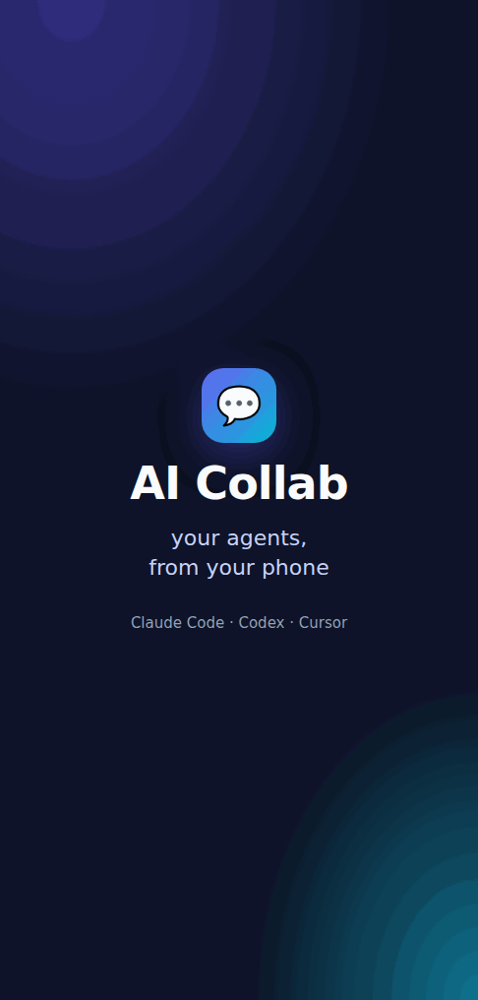

# AI Collab

Chat with your coding agents from your phone and watch what they do, live. AI Collab connects Claude Code, Codex, Cursor, and OpenCode 2 sessions to a phone UI over a **private, self-hosted ntfy server**. Agents post progress and questions; you answer, approve permission prompts, start new sessions, and see every tool call as it happens. Nothing talks to ntfy.sh or any other public service.



**Docs:** <https://bcmyguest.github.io/ai-collab/>

## Quick start

Requirements: Node 22+, Docker with Compose, and at least one harness on `PATH` (`claude`, `codex`, `cursor-agent`, or `opencode`).

```sh
git clone https://github.com/bcmyguest/ai-collab && cd ai-collab && npm ci
node scripts/ai-collab.mjs setup
```

Setup does five things:

1. Starts ntfy in Docker (`deploy/compose.yaml`) on `127.0.0.1:8794` with deny-all default access, and writes its token to `~/.config/ai-collab/ntfy-token`.
2. Writes `~/.config/ai-collab/defaults.json`, so every git repo auto-joins under its folder name. An empty `.ai-collab-off` file keeps a repo out.
3. Installs the plugin for each harness on `PATH`.
4. Installs the `ai-collab-ui` systemd user service on `127.0.0.1:8795`.
5. Prints the Tailscale steps for your phone. It changes nothing on your network.

| Flag | Effect |
|---|---|
| `--port N` | Publish ntfy on `127.0.0.1:N` instead of 8794 |
| `--no-ui` | Skip the UI service |

Reruns skip finished steps. With your own ntfy server, write `~/.config/ai-collab/defaults.json` by hand (`{"url", "tokenFile", "peers"}`) before you run setup; setup then skips Docker.

Then open the UI on your phone: [Quick start](https://bcmyguest.github.io/ai-collab/quick-start/#phone-access).

## Documentation

| | |
|---|---|
| [Install](https://bcmyguest.github.io/ai-collab/install/) | Per-harness install by hand |
| [Configuration](https://bcmyguest.github.io/ai-collab/configuration/) | `defaults.json`, `projects.json`, environment variables |
| [Phone UI](https://bcmyguest.github.io/ai-collab/phone-ui/) | Home, chat, activity, starting sessions, push |
| [AFK mode](https://bcmyguest.github.io/ai-collab/afk/) | Progress posts and phone questions while you are away |
| [Approvals and questions](https://bcmyguest.github.io/ai-collab/approvals/) | Permission prompts answered from the phone |
| [Security model](https://bcmyguest.github.io/ai-collab/security/) | What is sent and what is trusted |
| [Troubleshooting](https://bcmyguest.github.io/ai-collab/troubleshooting/) | Known limits and fixes |
| [Development](https://bcmyguest.github.io/ai-collab/development/) | Tests, CI, releases, the demo |

The docs source is [`docs/`](docs/); [`site/`](site/) builds it.

## License

The repository has no license file yet.
