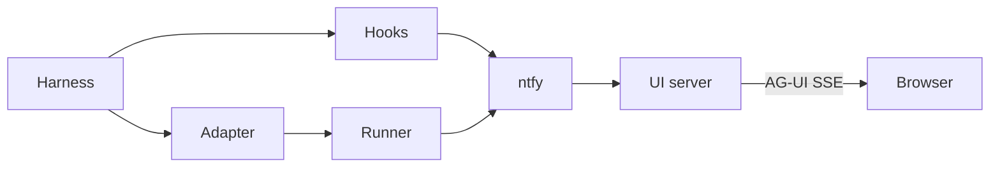

# AG-UI event protocol

The runner adapter contract and phone UI use [AG-UI events](https://docs.ag-ui.com/concepts/events). `@ag-ui/core` supplies the runner schemas. The phone uses the `@ag-ui/client` SSE parser. Hooks and the MCP server use a dependency-free codec because plugin caches may ship without `node_modules`.

`threadId` is the session address (`<peer>#<label>`). Each accepted adapter turn has one `runId`, from `RUN_STARTED` to `RUN_FINISHED` or `RUN_ERROR`. A steered input stays in that run. Hook-observed inline subagent boundaries are `ai-collab.activity` events. Attributed text and tool events carry `subagentRunId`. Separately addressed child sessions have their own threads and report their parent address in status events.

| Event | Fields AI Collab uses |
|---|---|
| `RUN_STARTED` | `threadId`, `runId`, and the user message in `input.messages` when available |
| `RUN_FINISHED`, `RUN_ERROR` | Finish carries `threadId`, `runId`, and `outcome` (`success` or `cancelled`). Failure carries `message` and optional `code`. An interruption reason and run correlation on multiplexed streams go in AI Collab metadata. |
| `TEXT_MESSAGE_*` | `messageId`, `role`, `delta`. ntfy can carry a completed item as `TEXT_MESSAGE_CHUNK`. |
| `TOOL_CALL_*` | `toolCallId`, `toolCallName`, argument `delta`, and result `messageId`, `content`, `role`. ntfy can carry a completed call as `TOOL_CALL_CHUNK`. |
| `STEP_STARTED`, `STEP_FINISHED`, `STATE_DELTA` | `stepName` for compaction and JSON Patch `delta` for runner state such as context usage |
| `CUSTOM` | `name` under `ai-collab.` and a `value` object. Names cover `msg`, `receipt`, `approval`, `approval-view`, `approval-end`, `question`, `mode`, `status`, and `alert`. |

Approvals and questions can suspend harness work within the same turn. The approval events carry the existing card identifiers, choices, deadlines, and resolution. An observed session lifecycle, notification, or legacy activity that lacks the IDs needed for a standard event uses `CUSTOM` with `name: "ai-collab.activity"`. Standard events can carry `metadata.aiCollab` for routing and display context absent from the standard fields, such as sender, session label, harness, tool result status, and original observation time.

## Rollout

Structured ntfy publishers default to the legacy `{v:1, kind, ...}` format. Readers accept both formats. Plain questions and `reply <id> <answer>` stay human-readable in the ntfy app in either mode.

1. Deploy 0.11.0 or later to the UI, runner, and every plugin reader. Old sessions can keep their old plugin code, so restart or retire those sessions before switching the project.
2. Set `"wire": "agui"` on the project in `projects.json`, or set `AI_COLLAB_WIRE=agui` in the publisher's environment. The environment overrides the project setting. Reload the configurations that publish to that project.
3. Readers continue to accept cached legacy messages. To roll back, remove the opt-in or set `AI_COLLAB_WIRE=legacy`. Every publish uses one wire format.

On connect, the UI sends one legacy `event: state` frame so older tabs can detect the new build and offer a reload. Current phone clients receive AG-UI `data:` frames. `STATE_SNAPSHOT` refreshes view state. Activity frames carry the ntfy ID, time, and any attachment in `metadata.aiCollabUi`. A `CUSTOM` event named `ai-collab.activity-batch` commits the preceding activity frames as a history reset or an append. The browser projects activity into the timeline, turns, and project feed.

## A2UI surfaces

Approval, AskUserQuestion choice, and question cards render as [A2UI](https://a2ui.org) surfaces. The server sends one `ACTIVITY_SNAPSHOT` per card with `activityType: "a2ui-surface"`, `messageId` `approval-<id>` or `question-<id>`, and `content.a2ui_operations`. Frames go before the state frame, and a surface is re-sent only when its operations change. `web/lib/a2ui.js` builds the operations and maps answers back.

- Protocol: v0.9.1. `@a2ui/react` 0.15.0 (Apache-2.0) exposes only the `v0_9` and `v0_8` entry points. `@a2ui/web_core` 0.15.0 has a `v1_0` processor, but the React renderer does not bind to it. Switch to v1.0 once `@a2ui/react` does.
- Catalog: the basic catalog plus `OptionPicker` (`urn:ai-collab:a2ui:catalog:1`), which adds per-option descriptions, previews, multi-select, read-only display, and the Other field as its last row, and `Chip`. `Button` and `TextField` are overridden with the app's components (same schemas). `web/lib/a2ui-catalog.js` holds the schemas; `web/components/a2ui/` holds the React implementations.
- Styling: `web/components/a2ui/surface.jsx` maps the `--a2ui-*` theme variables onto the app's tokens, so light and dark follow the app theme. Closed choices show only the chosen labels.
- Answers: the browser posts `{project, forwardedProps: {a2uiAction: {userAction}}}` to `/api/a2ui`. A decision or choice goes through the approval path that `approve` uses, and a question reply through the `reply` path. Submit stays disabled until every question has a pick or Other text.
- Fallback: when the stream sends no surface, or a surface fails to render, the card falls back to the legacy component in `web/app/cards.jsx`. Read-only AskUserQuestion rows in the activity timeline stay on the legacy component.
- `zod-v3` (npm alias for zod 3) holds the catalog schema. Root `zod` stays at 4 because `@anthropic-ai/claude-agent-sdk` peers on it.
