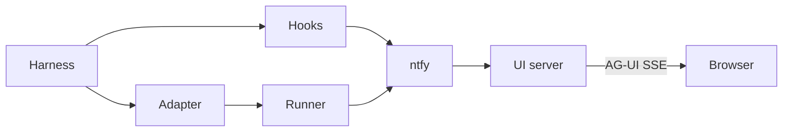

# AG-UI event protocol

The migration moves harness adapters, hooks, ntfy, and the phone UI to [AG-UI events](https://docs.ag-ui.com/concepts/events). `@ag-ui/core` supplies event types and schemas. The UI uses the `@ag-ui/client` SSE parser.

`threadId` is the session address (`<peer>#<label>`). Each accepted harness turn has one `runId`, from `RUN_STARTED` to `RUN_FINISHED` or `RUN_ERROR`. A steered input stays in that run. A subagent with an independent turn in the same thread sets `RUN_STARTED.parentRunId` to the enclosing turn. An inline subagent uses `SUBAGENT_STARTED` and `SUBAGENT_FINISHED` or `SUBAGENT_ERROR`. Its text and tools carry `subagentRunId`, and nested inline agents use `parentSubagentRunId`. A separately addressed child session has its own thread and carries its parent address and any known parent run ID in AI Collab metadata.

| Event | Fields AI Collab uses |
|---|---|
| `RUN_STARTED` | `threadId`, `runId`, optional `parentRunId`, and the user message in `input.messages` when available |
| `RUN_FINISHED`, `RUN_ERROR` | Finish carries `threadId`, `runId`, and `outcome` (`success` or `cancelled`). Failure carries `message` and optional `code`. An interruption reason and run correlation on multiplexed streams go in AI Collab metadata. |
| `TEXT_MESSAGE_*` | `messageId`, `role`, `delta`. ntfy can carry a completed item as `TEXT_MESSAGE_CHUNK`. |
| `TOOL_CALL_*` | `toolCallId`, `toolCallName`, argument `delta`, and result `messageId`, `content`, `role`. ntfy can carry a completed call as `TOOL_CALL_CHUNK`. |
| `STEP_STARTED`, `STEP_FINISHED`, `STATE_DELTA` | `stepName` for compaction and JSON Patch `delta` for runner state such as context usage |
| `CUSTOM` | `name` under `ai-collab.` and a `value` object. Names cover `msg`, `receipt`, `approval`, `approval-view`, `approval-end`, `mode`, `status`, and `alert`. |

Approvals and questions can suspend harness work within the same turn. The approval events carry the existing card identifiers, choices, deadlines, and resolution. An observed session lifecycle, notification, or legacy activity that lacks the IDs needed for a standard event uses `CUSTOM` with `name: "ai-collab.activity"`. Standard events can carry `metadata.aiCollab` for routing and display context absent from the standard fields, such as sender, session label, harness, tool result status, and original observation time.

## Rollout

The activity topic now carries AG-UI events from hooks and the runner. Readers accept both formats on ntfy. Chat, status, approvals, receipts, mode, and alert publishers still send their existing envelopes.

Deploy readers that accept both `{v:1, kind, ...}` and AG-UI before switching writers to AG-UI. Translate cached legacy records at the read boundary and preserve ntfy IDs, attachment metadata, topic routing, time order, and the message size limit. Maintain dual reads through the mixed-version rollout and cache expiry.

Phone clients receive AG-UI `data:` frames. `STATE_SNAPSHOT` refreshes view state. Activity frames carry the ntfy ID, time, and any attachment in `metadata.aiCollabUi`. A `CUSTOM` event named `ai-collab.activity-batch` commits the preceding activity frames as a history reset or an append. The browser projects activity into the timeline, turns, and project feed.
