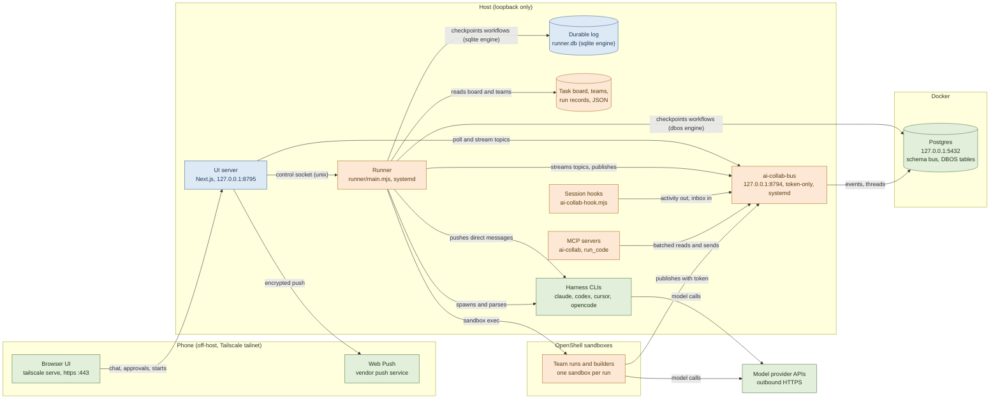
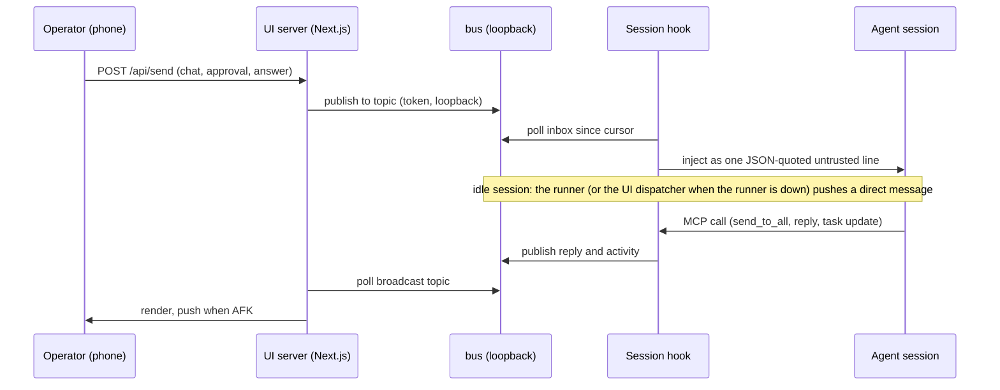
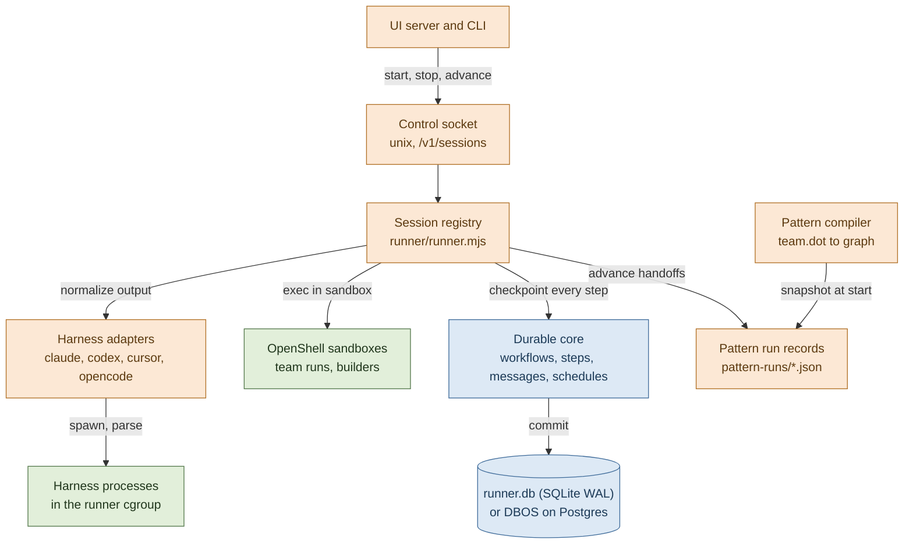

# Architecture diagrams

Three pictures: the whole system with its network boundaries, how a message travels between the phone and an agent, and what runs inside the runner. Colour says where a piece comes from.

| Colour | Meaning |
|---|---|
| Green | Off-the-shelf software, maintained elsewhere (robust) |
| Blue | Our code sitting on an off-the-shelf engine or framework |
| Amber | Home-grown, we own every line |

Boxes are network boundaries: the phone is off-host, everything on the host binds loopback only, the bus, runner and UI are systemd user services, Postgres runs in Docker, team runs and builders live in OpenShell sandboxes.

## System overview

Read it from the phone: the only door onto the host is Tailscale to the UI server. The bus binds loopback only; the token in `~/.config/ai-collab/bus-token` is the trust boundary. The bus stores events in Postgres (`lib/bus-postgres.ts`). The runner is the only thing that spawns agents, and it checkpoints every step in its durable log: `runner.db` (SQLite) by default, or DBOS tables in the same Postgres with `"workflowEngine": "dbos"`. Sandboxes reach the bus through `host.openshell.internal` routing only.

## Message path: phone to agent and back

A running turn gets messages from its hooks, which poll the bus with a cursor and inject at a safe point. An idle session gets a direct message pushed: the Claude messaging socket, `codex queue`, or the OpenCode prompt API, one durable delivery workflow per message in the runner ([Waking idle sessions](messaging.md#waking-idle-sessions)); Cursor stays hook-only. A reply is just a message on a shared topic, so the waiting tool trusts the token, not the sender name. Permission approvals ride the same path.

## Runner internals

The durable core is the interesting amber-blue boundary. `lib/workflows.ts` offers one interface on two engines: the home-grown, DBOS-shaped log (`lib/durable.ts`: workflows, checkpointed steps, deduplicated messages) on `node:sqlite`, the default, or DBOS Transact on Postgres (`"workflowEngine": "dbos"`). A crash replays pending workflows from the log, so a restart never double-launches an agent. The prose version, including the restart rules, is in [Owned sessions: durable execution](owned-sessions-contract.md#durable-execution) and [DBOS workflow engine](configuration.md#dbos-workflow-engine).

## What is robust, what is ours

| Piece | Origin | Notes |
|---|---|---|
| Message bus | Home-grown (`lib/bus.ts`), ntfy wire-compatible | Loopback bind, token-only; Postgres schema `bus` with 7-day retention |
| Postgres | Off-the-shelf database in Docker (`deploy/postgres/compose.yaml`, `ai-collab postgres up`) | Holds the bus store and the DBOS engine's tables; loopback only |
| DBOS Transact | Off-the-shelf workflow SDK (`@dbos-inc/dbos-sdk`, pinned 5.7.0) | Runner workflows with `"workflowEngine": "dbos"` |
| SQLite | Off-the-shelf engine (`node:sqlite`, WAL) | The default workflow engine's `runner.db`; schema and recovery logic are ours |
| Next.js, React, ui-sdk | Off-the-shelf framework | Pages, server routes, and phone behaviour are ours |
| Tailscale, systemd, Docker, OpenShell | Off-the-shelf plumbing | Tailscale is the only inbound path; systemd owns process lifetimes |
| Harness CLIs | Third-party (claude, codex, cursor-agent, opencode) | Adapters normalize their output; we never patch them |
| Model provider APIs | Third-party | The only outbound traffic |
| Durable core (`lib/durable.ts`, `lib/workflows.ts`) | Home-grown | DBOS-shaped: workflows, checkpointed steps, exactly-once messages; `lib/workflows.ts` switches engines |
| Runner (`runner/`) | Home-grown | Owns sessions, sandboxes, control socket, schedules, pattern runs |
| Session hooks and MCP servers | Home-grown | The seam between harnesses and the bus; injects inbound text as untrusted data |
| Pattern compiler (`lib/catalog/dot.ts`, `lib/pattern-compiler.ts`) | Home-grown | DOT graph in, validated transitions out; verifiable with traces, no model calls |
| Task board, team files, run records | Home-grown | Plain JSON under the state dir, lock-then-rename writes |
