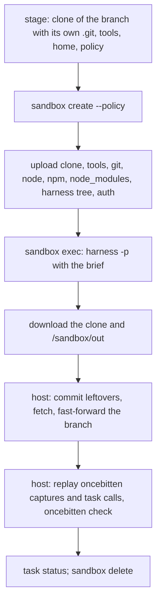

# Builders

A builder is one agent that implements one task on its own branch. `ai-collab builder start` runs each new builder inside its own OpenShell sandbox, detached from the caller in a transient systemd user unit, so a UI or runner restart does not kill it. Builders started by hand before this command existed run on the host and are left alone.

Lib: `lib/builder.mjs`. OpenShell lifecycle: `runner/sandbox.mjs`. Tests: `test/builder.test.mjs` with fake `openshell`, `systemd-run`, `systemctl`, agent and `oncebitten` from `test/helpers/`.

## Commands

```
ai-collab builder start --task <id> --harness cursor|codex [--model M] --brief <file> [--branch B]
ai-collab builder list [--all]
ai-collab builder stop <id>
```

| Command | Effect |
|---|---|
| `start` | Checks the task exists, creates `~/ai-collab-wt-<id>` on branch `builder/<id>` (or `--branch`) from `main`, links the repo's `node_modules` into it, writes the brief plus the sandbox notes, sets the task to `building`, and starts unit `builder-<id>` with `systemd-run --user --collect`. Prints `unit, task, sandbox, worktree, branch`. |
| `list` | Builders started by `start` that are still running: `unit, task, sandbox, phase, unit state`. `--all` adds finished ones. |
| `stop` | `systemctl --user stop builder-<id>`, then deletes the sandbox. Refuses an id that `start` did not create, so hand-started `builder-*` units are never touched. The worktree and branch stay. |

Defaults: Cursor `deepseek-v41-flash-1017-high`, Codex `gpt-6.2-sol`. The id is the task id. State lives in `$XDG_STATE_HOME/ai-collab/builders/<id>/` (`state.json`, `brief.md`, `policy.yaml`); the unit's output is in `journalctl --user -u builder-<id>`.

## What the unit does



Each builder gets a new sandbox named `b-<first 8 characters of the id>-<6 hex of its hash>`: openshell 0.1.9 refuses names over 19 characters. A sandbox that already has the name is neither reused nor deleted; the run fails and blocks the task. The sandbox is deleted when the agent exits, when the run fails after creating it, and on `builder stop`.

Inside the sandbox:

| Path | Content |
|---|---|
| `/sandbox/work/ai-collab-wt-<id>` | the clone; the agent's working directory |
| `/sandbox/tools/bin` | `git`, `oncebitten`, `npm`, `npx`, the harness launcher, and two shims: `ai-collab` and `ob-capture` |
| `/sandbox/tools/git-core`, `/sandbox/tools/node`, `/sandbox/tools/lib` | the host's git helpers, node binary with npm, and node's non-glibc libraries (on `LD_LIBRARY_PATH`) |
| `/sandbox/deps/node_modules` | the repo's `node_modules`, linked into the clone |
| `/sandbox/agent/<version>` or `/sandbox/codex/<release>` | the host's Cursor or Codex install tree |
| `/sandbox/home` | `HOME`: the harness auth file, capture hooks |
| `/sandbox/out` | what the shims record for the host |

The image (`nvcr.io/nvidia/base/ubuntu:24.04`) has `sh`, `bash` and `tar` but no `git`, `node`, `curl` or `python3` (measured 2026-11-22), so every tool comes from the host. The host is Ubuntu 24.04 too, so its dynamically linked `git` and `oncebitten` run unchanged.

## Git in the sandbox

A worktree's `.git` is a file that points into the host repo, which does not exist inside the sandbox. The unit uploads a self-contained clone instead:

1. On the host: `git clone --no-hardlinks --single-branch --branch <branch> <repo>`, drop `origin`, add a local `main` at the base commit, copy `user.name` and `user.email`, and exclude the `node_modules` symlink.
2. Upload it with `--no-git-ignore`: with `.gitignore` filtering on, openshell drops the `.git` directory.
3. The agent commits on its branch with the uploaded `git` and can diff against `main`.
4. After it exits: download the clone, commit anything left uncommitted (`chore(builder): uncommitted work from <id>` with an `Assisted-by` trailer), then `git fetch <clone> HEAD` and `git merge --ff-only FETCH_HEAD` in the host worktree. The agent's own commits land unchanged.

Why a clone rather than committing on the host after a plain file copy: builders commit in small Conventional Commits and `oncebitten check` needs history, both of which need a real repository inside. If the fast-forward fails (someone moved the host branch), the clone is kept under the state directory and the task is blocked with the path.

## Credentials and network

| Harness | Copied in | API hosts allowed |
|---|---|---|
| Cursor | `~/.config/cursor/auth.json` (or `~/.cursor/auth.json`) to `/sandbox/home/.config/cursor/` | `api2`, `api3`, `api4.cursor.sh`, `agentn.global.api5.cursor.sh`, `cursor.com` |
| Codex | `$CODEX_HOME/auth.json` to `/sandbox/home/.codex/` | `chatgpt.com`, `api.openai.com`, `auth.openai.com`, `ab.chatgpt.com` (UNVERIFIED list) |

The auth file goes through a 0600 temp copy and a single-file upload; it never appears in argv, `--env` or a log. Nothing else is copied: no ntfy token, no SSH keys, no host config. The policy (`policy.yaml`, JSON, which is YAML) allows the harness hosts on 443 and `host.openshell.internal:8794` (the host's ntfy) for the executables of the harness tree and the uploaded node; every other host is denied. The policy keeps `/sandbox`, `/tmp` and `/dev/null` writable, so the suite needs `TMPDIR` under `/tmp`.

The login shell of `sandbox exec` sets `SSL_CERT_FILE` to the CA OpenShell terminates TLS with, so the unit never overrides it.

The harness's own sandbox is off (`--sandbox disabled` for Cursor, `--dangerously-bypass-approvals-and-sandbox` for Codex): OpenShell is the isolation.

## Task status

The task store is a host file, so `ai-collab` inside the sandbox is a shim: `task set` and `task progress` are recorded under `/sandbox/out/ai-collab`, `task show` prints a snapshot taken at start, and everything else exits 2. After the run the host replays the recorded `set` and `progress` calls in order. Then:

| Case | Status set on the host |
|---|---|
| The agent set a status | its status |
| `oncebitten check --base <base>` fires on the landed branch | `blocked`, with the finding |
| No status, exit 0, commits landed | `done` |
| No status otherwise | `blocked`: `builder builder-<id> exited <code> with <n> commit(s) and set no status` |
| The fast-forward failed | `blocked`, with the kept clone's path |
| The unit failed (staging, sandbox, upload) | `blocked`, with the error |

A progress line records exit code, commit count and capture count. `done` and `blocked` wake the PM through `wakeOnTasks`.

## oncebitten

The host's capture hooks (`~/.cursor/hooks.json`, `~/.codex/hooks.json` calling `oncebitten capture --host <h>`) do not exist in the sandbox. The unit reads the host hooks file, takes the events whose command runs `oncebitten capture` (Cursor's defaults: `beforeSubmitPrompt`, `postToolUse`, `postToolUseFailure`; Codex: `UserPromptSubmit`), and writes the same events into the sandbox home with the command `ob-capture <harness>`. That shim saves each payload under `/sandbox/out/oncebitten`. After the run the host pipes every payload into `oncebitten capture --host <harness>`, with `/sandbox/work/ai-collab-wt-<id>` rewritten to the host worktree, so captures land in the host's `~/.local/share/oncebitten/events.db`. Chosen over running `oncebitten capture` inside: the events database stays on the host and is never uploaded.

Every brief ends with the sandbox notes, which tell the agent to run `oncebitten check --base main` and fix what fires before it marks the task done. The `oncebitten` binary is uploaded for that. The host runs the same check on the landed branch as a backstop. `steer` hooks are not carried into the sandbox.

## Verified and unverified

Measured on 2026-11-22 with openshell 0.1.9, a real sandbox per run, and throwaway task `sandbox-smoke-test-add-one-line-to-docs` (its branch and worktree deleted afterwards, never merged):

| Check | Result |
|---|---|
| Codex `gpt-6.2-sol` end to end | **works**: unit `builder-<id>` ran Codex in sandbox `b-sandbox-302b20`; the agent committed `docs(builders): sandbox smoke test line` with `git` inside; the commit landed on the host branch; the agent ran `oncebitten check --base main` (clean); its recorded `task progress` and `task set status=done` were applied on the host; the sandbox was deleted and `openshell sandbox list -o json` was empty |
| Cursor `deepseek-v41-flash-1017-high` | **fails**: the CLI exits 1 within a second with `Error: [unavailable] getaddrinfo EAI_AGAIN api2.cursor.sh`; the unit then blocked the task and deleted the sandbox, as designed |
| `node` and `npm` inside | the image lacks `libatomic.so.1`; the unit now uploads node's non-glibc libraries to `/sandbox/tools/lib` and sets `LD_LIBRARY_PATH`. A manual sandbox then printed `v26.13.0` and npm `11.20.0`; a builder run with this fix has not happened |
| Sandbox names | over 19 characters are refused (`name exceeds maximum length (50 > 19)`) |

Why Cursor fails, as far as measured: plain `node` (the CLI's own bundled binary) resolves and fetches `api2.cursor.sh` in the same sandbox, with the same env and workdir, sequentially and 30 at a time. Inside the CLI's process, a lookup probe loaded with `--require` succeeds at about 300 ms and fails from about 450-630 ms on; with `HTTPS_PROXY=http://127.0.0.1:3128` the CLI gets `connect EACCES 127.0.0.1:3128` instead. Seccomp, capabilities and the network namespace do not change over that time. OpenShell logs the DNS mapping and no denial. Something in the CLI process restricts its own sockets after start (`--sandbox disabled` does not stop it); docs/owned-sessions-contract.md (OpenShell, "Still unsolved") has the earlier probes. Until that is solved, use `--harness codex`.

UNVERIFIED:

- The full test suite inside a sandbox (node now starts there; no builder has run `npm test`).
- Capture replay with a real harness: the Codex run saved no hook payload (0 captures), so `codex exec` may not fire `UserPromptSubmit` hooks from `$CODEX_HOME/hooks.json`; the unit now also marks the worktree trusted in the sandbox's `config.toml`, untested. The replay path is covered only by the fake agent.
- Codex API host list: the run worked with it, but which of the four hosts Codex needs is not measured.
- `builder stop` against a real running unit (covered by fakes only).
- A host branch that moved during the run (fast-forward failure path; fakes only).

## Files

| Path | Role |
|---|---|
| `lib/builder.mjs` | `builder start/run/list/stop` |
| `lib/cli.mjs` | `ai-collab builder` wiring |
| `runner/sandbox.mjs` | OpenShell list, create, upload, download, exec argv, delete |
| `test/builder.test.mjs` | end to end against the fakes |
| `test/helpers/fake-systemd-run.mjs` | fake `systemd-run` (runs the unit in the foreground) and `systemctl` |
| `test/helpers/fake-builder-agent.mjs` | fake agent: commits, fires a capture hook, records task calls |
| `test/helpers/fake-oncebitten.mjs` | fake `oncebitten capture` and `check` |
