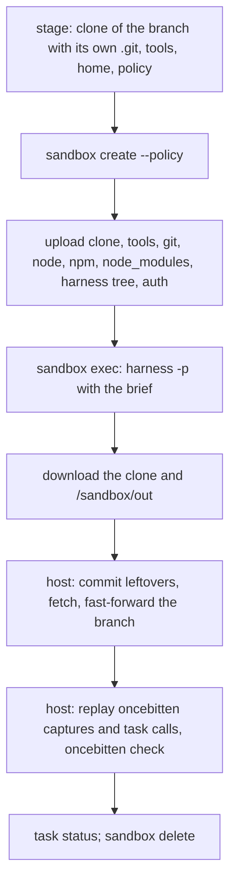

# Builders

A builder is one agent that implements one task on its own branch. `ai-collab builder start` runs each new builder inside its own OpenShell sandbox. Codex uses a runner-owned session when the runner is reachable. Cursor, Claude, and OpenCode use a transient systemd user unit. Codex uses the same fallback when the runner is unavailable. Builders started by hand before this command existed run on the host and are left alone.

Lib: `lib/builder.mjs`. OpenShell lifecycle: `runner/sandbox.mjs`. Tests: `test/builder.test.mjs` and `test/builder-claude.test.mjs` with fake `openshell`, `systemd-run`, `systemctl`, agent and `oncebitten` from `test/helpers/`.

## Commands

```
ai-collab builder start --task <id> [--harness cursor|codex|claude|opencode] [--model M] --brief <file> [--branch B] [--run ID]
ai-collab builder list [--all]
ai-collab builder stop <id>
```

| Command | Effect |
|---|---|
| `start` | Checks the task exists, creates `~/ai-collab-wt-<id>` on branch `builder/<id>` (or `--branch`) from `main`, links the repo's `node_modules` into it, writes the brief plus the sandbox notes, and starts the builder. Prints `session or unit, task, sandbox, worktree, branch`. |
| `list` | Builders started by `start` that are still running: `session or unit, task, sandbox, phase, state`. `--all` adds finished ones. |
| `stop` | Closes an owned session through the runner or stops the standalone unit and deletes its sandbox. Refuses an id that `start` did not create, so hand-started `builder-*` units are never touched. The worktree and branch stay. |

Defaults: Cursor `deepseek-v41-flash-1017-high`, Codex `gpt-6.2-sol`, Claude `haiku` (the alias for the latest Haiku). The id is the task id. State lives in `$XDG_STATE_HOME/ai-collab/builders/<id>/` (`state.json`, `brief.md`, `policy.yaml`); the unit's output is in `journalctl --user -u builder-<id>`.

When `--harness` is omitted, the first supported entry in `defaults.json`'s `builderOrder` array selects the starting harness. For example, `"builderOrder": ["codex", "cursor"]` starts with Codex. Codex is the built-in starting harness.

Both Codex launch paths retry a subscription usage limit once with Cursor `deepseek-v41-flash-1017-high`. The supervisor copies the Git worktree and recorded task calls and hooks into a fresh OpenShell sandbox, then sends the brief again. The normal collection and oncebitten check run after the retry.

## Runner-owned Codex builders

The runner starts a dedicated Codex app-server inside the staged OpenShell sandbox and sends the brief as its first turn. It sets the task to `building` and records the session address as the task owner before sending the brief. The phone shows the session activity and the task card opens it. Pass `--run ID` to attach the task to a team run. An existing run association is retained when the flag is omitted.

When the turn ends, the runner collects the branch and task calls, runs the normal landing checks, and deletes the sandbox. A restart cuts the active turn and the runner attempts collection on recovery. The ended session remains linked from the task for its timeline. If the runner responds with a start error, the CLI reports that error. The standalone path is used when the control socket is absent or refuses the connection.

## What the standalone unit does



Each builder gets a new sandbox named `b-<first 8 characters of the id>-<6 hex of its hash>`: openshell 0.1.9 refuses names over 19 characters. A sandbox that already has the name is neither reused nor deleted; the run fails and blocks the task. The sandbox is deleted when the agent exits, when the run fails after creating it, and on `builder stop`.

Inside the sandbox:

| Path | Content |
|---|---|
| `/sandbox/work/ai-collab-wt-<id>` | the clone; the agent's working directory |
| `/sandbox/tools/bin` | `git`, `oncebitten`, `npm`, `npx`, the harness launcher, and two shims: `ai-collab` and `ob-capture` |
| `/sandbox/tools/git-core`, `/sandbox/tools/node`, `/sandbox/tools/lib` | the host's git helpers, node binary with npm, and node's non-glibc libraries (on `LD_LIBRARY_PATH`) |
| `/sandbox/deps/node_modules` | the repo's `node_modules`, linked into the clone |
| `/sandbox/agent/<version>` or `/sandbox/codex/<release>` | the host's Cursor or Codex install tree |
| `/sandbox/home` | `HOME`: the harness auth file, capture hooks |
| `/sandbox/out` | what the shims record for the host |

The image (`nvcr.io/nvidia/base/ubuntu:24.04`) has `sh`, `bash` and `tar` but no `git`, `node`, `curl` or `python3` (measured 2026-11-22), so every tool comes from the host. The host is Ubuntu 24.04 too, so its dynamically linked `git` and `oncebitten` run unchanged.

## Git in the sandbox

A worktree's `.git` is a file that points into the host repo, which does not exist inside the sandbox. The unit uploads a self-contained clone instead:

1. On the host: `git clone --no-hardlinks --single-branch --branch <branch> <repo>`, drop `origin`, add a local `main` at the base commit, copy `user.name` and `user.email`, and exclude the `node_modules` symlink.
2. Upload it with `--no-git-ignore`: with `.gitignore` filtering on, openshell drops the `.git` directory.
3. The agent commits on its branch with the uploaded `git` and can diff against `main`.
4. After it exits: download the clone, commit anything left uncommitted (`chore(builder): uncommitted work from <id>` with an `Assisted-by` trailer), then `git fetch <clone> HEAD` and `git merge --ff-only FETCH_HEAD` in the host worktree. The agent's own commits land unchanged.

Why a clone rather than committing on the host after a plain file copy: builders commit in small Conventional Commits and `oncebitten check` needs history, both of which need a real repository inside. If the fast-forward fails (someone moved the host branch), the clone is kept under the state directory and the task is blocked with the path.

## Credentials and network

| Harness | Copied in | API hosts allowed |
|---|---|---|
| Cursor | `~/.config/cursor/auth.json` (or `~/.cursor/auth.json`) to `/sandbox/home/.config/cursor/` | `api2`, `api3`, `api4.cursor.sh`, `agentn.global.api5.cursor.sh`, `cursor.com` |
| Codex | `$CODEX_HOME/auth.json` to `/sandbox/home/.codex/` | `chatgpt.com`, `api.openai.com`, `auth.openai.com`, `ab.chatgpt.com` (UNVERIFIED list) |
| Claude | `$CLAUDE_CONFIG_DIR/.credentials.json` (default `~/.claude/`) to `/sandbox/home/.claude/`, and the ntfy token from `defaults.json` `tokenFile` to `/sandbox/home/.config/ai-collab/ntfy-token` | `api.anthropic.com` (the only host a lean run contacted), `platform.claude.com` (OAuth refresh) and `claude.ai` (account auth), per [network-config](https://code.claude.com/docs/en/network-config.md) |

Each secret goes through a 0600 temp copy and a single-file upload; it never appears in argv, `--env` or a log. Only Claude builders get the ntfy token, for the ai-collab MCP server. Nothing else is copied: no SSH keys, no host config. When Claude refreshes its OAuth login inside, the unit copies the new credentials back to the host (0600, atomic rename) unless the host file changed during the run; whether a refresh rotates the refresh token is not documented. The policy (`policy.yaml`, JSON, which is YAML) allows the harness hosts on 443 and `host.openshell.internal:8794` (the host's ntfy) for the executables of the harness tree and the uploaded node; every other host is denied. The policy keeps `/sandbox`, `/tmp` and `/dev/null` writable, so the suite needs `TMPDIR` under `/tmp`.

The login shell of `sandbox exec` sets `SSL_CERT_FILE` to the CA OpenShell terminates TLS with, so the unit never overrides it.

The harness's own sandbox or permission prompts are off (`--sandbox disabled` for Cursor, `--dangerously-bypass-approvals-and-sandbox` for Codex, `--dangerously-skip-permissions` for Claude): OpenShell is the isolation. Codex also gets `--dangerously-bypass-hook-trust`, because a headless `codex exec` otherwise fires no hooks at all; it covers hooks from `$CODEX_HOME` and installed plugins, and hooks a repository ships in its own `.codex/` stay off in a sandbox project Codex has not marked trusted (see [Install](install.md#codex)).

## Continue a stopped builder

On the task card, choose another harness and select **Continue with another agent**. The runner opens a local session in the builder’s existing worktree, with the harness’s normal local permission mode. The replacement receives the task brief, recorded decision and check result, and the previous session address when available. Ownership transfers after the replacement opens. If the launch fails, the task and worktree remain available for retry.

The action is available once the builder has exited and its work is available in the host worktree. If a stop leaves a retained sandbox or the branch cannot be fast-forwarded, recover the saved work first.

## Task status

The task store is a host file, so `ai-collab` inside the sandbox is a shim: `task set` and `task progress` are recorded under `/sandbox/out/ai-collab`, `task show` prints a snapshot taken at start, and everything else exits 2. After the run, the host collects the branch, replays captures, checks the landed branch with oncebitten, and applies the recorded task fields and progress. The builder's own status assignments are requests.

| Case | Final status |
|---|---|
| Commits landed, the agent exited successfully, and policy checks passed | `done`, or `blocked` if the agent requested it |
| The policy check reports a finding or cannot run | `blocked`, with the reason |
| The agent requested `done` without landed commits or exited unsuccessfully | `blocked`, with the exit code and commit count |
| The fast-forward failed | `blocked`, with the kept clone's path |
| Setup or collection failed | `blocked`, with the error |

The runner saves the verdict before publishing it. The final status and completion progress are written together, so a restarted runner can recognize a verdict it already published. The terminal transition wakes the PM through `wakeOnTasks`.

## oncebitten

The host's capture hooks (`~/.cursor/hooks.json`, `~/.codex/hooks.json` calling `oncebitten capture --host <h>`) do not exist in the sandbox. The unit reads the host hooks file, takes the events whose command runs `oncebitten capture` (Cursor's defaults: `beforeSubmitPrompt`, `postToolUse`, `postToolUseFailure`; Codex: `UserPromptSubmit`), and writes the same events into the sandbox home with the command `ob-capture <harness>`. That shim saves each payload under `/sandbox/out/oncebitten`. After the run the host pipes every payload into `oncebitten capture --host <harness>`, with `/sandbox/work/ai-collab-wt-<id>` rewritten to the host worktree, so captures land in the host's `~/.local/share/oncebitten/events.db`. Chosen over running `oncebitten capture` inside: the events database stays on the host and is never uploaded.

Every brief ends with the sandbox notes, which tell the agent to run `oncebitten check --base main` and fix what fires before it marks the task done. The `oncebitten` binary is uploaded for that. The host runs the same check on the landed branch as a backstop. `steer` hooks are not carried into the sandbox.

## Lean Claude builders

`--harness claude` uploads the host's native `claude` binary (one 364 MB file) to `/sandbox/claude/` and runs it headless with only what a builder needs. Every switch below is a documented Claude Code mechanism or a settings key the host's own `~/.claude/settings.json` uses; the sources are `claude --help` (2.1.330) and code.claude.com/docs ([cli-reference](https://code.claude.com/docs/en/cli-reference.md), [env-vars](https://code.claude.com/docs/en/env-vars.md), [settings-reference](https://code.claude.com/docs/en/settings-reference.md), [permissions](https://code.claude.com/docs/en/permissions.md)).

| Turned off | How |
|---|---|
| Every built-in tool except Bash, Read, Edit, Write, Glob, Grep (gone: Task, Cron*, ScheduleWakeup, RemoteTrigger, PushNotification, Monitor, SendMessage, Skill, ToolSearch, WebFetch, WebSearch, Workflow, DesignSync, NotebookEdit, worktree tools, ListAgents, ReportFindings) | `--tools Bash,Read,Edit,Write,Glob,Grep`, plus the same names in `permissions.deny` |
| Every MCP server but ai-collab (and `ai-collab-code` once `scripts/ai-collab-code-mcp.mjs` exists) | `--strict-mcp-config --mcp-config /sandbox/home/.claude/builder-mcp.json`; `ENABLE_CLAUDEAI_MCP_SERVERS=false` |
| ai-collab MCP tools that would act on sandbox-local state: `task_list`, `task_update`, `team_start`, `team_status`, `pattern_*`, `interrupt`, `list_sessions` | `permissions.deny` (`mcp__ai-collab__<tool>`); task changes go through the `ai-collab task` shim |
| User, project and local settings files; skills and slash commands; Chrome | `--setting-sources ""` (an empty value is not documented, but 2.1.330 accepts it and loads none), `--disable-slash-commands`, `--no-chrome` |
| Bundled skills, workflows, artifacts, Remote Control, prompt suggestions, away summary, push and input-needed notifications, feedback survey, spinner tips, git instructions in the system prompt, auto memory | settings `disableBundledSkills`, `disableWorkflows`, `disableArtifact`, `disableRemoteControl`, `remoteControlAtStartup: false`, `promptSuggestionEnabled`, `awaySummaryEnabled`, `agentPushNotifEnabled`, `inputNeededNotifEnabled`, `feedbackSurveyRate: 0`, `spinnerTipsEnabled`, `includeGitInstructions: false`, `autoMemoryEnabled: false` |
| Built-in plugins (`cc-plugin-telemetry`, `-privacy`, `-agents-md`, `-plugin-authoring`) | `enabledPlugins: {"<name>@builtin": false}`; the init event then lists no plugins (that these ids switch off exactly those plugins is UNVERIFIED) |
| Telemetry, error reports, auto-update, feedback command, cost warnings, terminal title, background tasks, agent view, artifacts, marketplace auto-install, IDE extension install, and all nonessential traffic | env `CLAUDE_CODE_DISABLE_NONESSENTIAL_TRAFFIC`, `DISABLE_TELEMETRY`, `DISABLE_ERROR_REPORTING`, `DISABLE_AUTOUPDATER`, `DISABLE_FEEDBACK_COMMAND`, `DISABLE_COST_WARNINGS`, `CLAUDE_CODE_DISABLE_FEEDBACK_SURVEY`, `CLAUDE_CODE_DISABLE_AUTO_MEMORY`, `CLAUDE_CODE_DISABLE_TERMINAL_TITLE`, `CLAUDE_CODE_DISABLE_BACKGROUND_TASKS`, `CLAUDE_CODE_DISABLE_AGENT_VIEW`, `CLAUDE_CODE_DISABLE_ARTIFACT`, `CLAUDE_CODE_DISABLE_OFFICIAL_MARKETPLACE_AUTOINSTALL`, `CLAUDE_CODE_IDE_SKIP_AUTO_INSTALL` |

Kept: the project's `CLAUDE.md` (builders follow repo rules), the ai-collab MCP messaging tools, and the oncebitten capture hooks (`UserPromptSubmit`, `PostToolUse`, `PostToolUseFailure`, read from the host's `settings.json`). `--bare` is not used because it reads no OAuth login.

The ai-collab MCP server runs from a copy of this checkout's `package.json`, `scripts/`, `lib/` and `web/lib/` under `/sandbox/tools/ai-collab`, with the uploaded node, `AI_COLLAB_PEER=claude`, and a sandbox `defaults.json` that points at `http://host.openshell.internal:8794`.

### First-turn input tokens

Measured 2026-11-22 in real sandboxes with `claude-haiku-5-5` (input = uncached + cache creation + cache read, from the first assistant message):

| Run | First-turn input tokens |
|---|---|
| Default (`claude -p --dangerously-skip-permissions`, fresh home), prompt "Reply with the single word PONG." | 21,606 |
| Default, the smoke builder's brief | 19,008 |
| Lean flags, no MCP server, PONG | 5,373 |
| Lean builder, smoke brief, ai-collab MCP failed to start (13 fewer tools) | 7,489 |
| Lean builder, smoke brief, ai-collab MCP connected (6 built-in + 13 MCP tools) | 12,040 |

The lean builder with MCP sends 37% fewer first-turn tokens than the default on the same brief; the 13 ai-collab tools cost about 4,500 of them. A default run also contacted `mcp-proxy.anthropic.com` (claude.ai connectors) and tried `http-intake.logs.us5.datadoghq.com` (denied by the policy); the lean runs contacted only `api.anthropic.com`.

## Verified and unverified

Measured on 2026-11-22 with openshell 0.1.9, a real sandbox per run, and throwaway task `sandbox-smoke-test-add-one-line-to-docs` (its branch and worktree deleted afterwards, never merged):

| Check | Result |
|---|---|
| Codex `gpt-6.2-sol` end to end | **works**: unit `builder-<id>` ran Codex in sandbox `b-sandbox-302b20`; the agent committed `docs(builders): sandbox smoke test line` with `git` inside; the commit landed on the host branch; the agent ran `oncebitten check --base main` (clean); its recorded `task progress` and `task set status=done` were applied on the host; the sandbox was deleted and `openshell sandbox list -o json` was empty |
| Cursor `deepseek-v41-flash-1017-high` | **fails**: the CLI exits 1 within a second with `Error: [unavailable] getaddrinfo EAI_AGAIN api2.cursor.sh`; the unit then blocked the task and deleted the sandbox, as designed |
| `node` and `npm` inside | the image lacks `libatomic.so.1`; the unit now uploads node's non-glibc libraries to `/sandbox/tools/lib` and sets `LD_LIBRARY_PATH`. A manual sandbox then printed `v26.13.0` and npm `11.20.0`; a builder run with this fix has not happened |
| Claude `claude-haiku-5-5` end to end | **works**: sandbox `b-sandbox-0bd292`; init listed tools `Bash, Edit, Glob, Grep, Read, Write` plus 13 `mcp__ai-collab__*`, MCP `ai-collab` connected; the agent ran git 2.43.0, node v26.13.0, npm 11.20.0 and `list_agents`, committed `docs(builders): sandbox smoke test line` (`Assisted-by: Claude:claude-haiku-5-5`), ran `oncebitten check --base main` (clean) and set the task done; the commit landed on the host branch, 7 captures were replayed into oncebitten, and the sandbox was deleted. 7 turns, $0.0055 |
| Sandbox names | over 19 characters are refused (`name exceeds maximum length (50 > 19)`) |

Before the builder policy switched Cursor API endpoints to native TCP with TLS passthrough, plain `node` (the CLI's own bundled binary) resolves and fetches `api2.cursor.sh` in the same sandbox, with the same env and workdir, sequentially and 30 at a time. Inside the CLI's process, a lookup probe loaded with `--require` succeeds at about 300 ms and fails from about 450-630 ms on; with `HTTPS_PROXY=http://127.0.0.1:3128` the CLI gets `connect EACCES 127.0.0.1:3128` instead. Seccomp, capabilities and the network namespace do not change over that time. OpenShell logs the DNS mapping and no denial. Something in the CLI process restricts its own sockets after start (`--sandbox disabled` does not stop it); docs/owned-sessions-contract.md (OpenShell, "Still unsolved") has the earlier probes. The revised policy uses exact API hostnames so OpenShell can serve policy DNS and Cursor can negotiate TLS directly. A live prompt with the revised policy is pending.

UNVERIFIED:

- Claude OAuth refresh inside a sandbox and the copy-back: no smoke run needed a refresh, so only the fakes cover it.
- ntfy from inside: the ai-collab MCP server connected and `list_agents` answered, but no message was sent through `host.openshell.internal:8794`.
- `--setting-sources ""` loading nothing is observed behaviour, not documented.

- The full test suite inside a sandbox (node now starts there; no builder has run `npm test`).
- Capture replay with a real harness: the Codex run saved no hook payload (0 captures), so `codex exec` may not fire `UserPromptSubmit` hooks from `$CODEX_HOME/hooks.json`; the unit now also marks the worktree trusted in the sandbox's `config.toml`, untested. The replay path is covered only by the fake agent.
- Codex API host list: the run worked with it, but which of the four hosts Codex needs is not measured.
- `builder stop` against a real running unit (covered by fakes only).
- A host branch that moved during the run (fast-forward failure path; fakes only).

## Files

| Path | Role |
|---|---|
| `lib/builder.mjs` | `builder start/run/list/stop` |
| `lib/cli.mjs` | `ai-collab builder` wiring |
| `runner/sandbox.mjs` | OpenShell list, create, upload, download, exec argv, delete |
| `test/builder.test.mjs` | end to end against the fakes |
| `test/builder-claude.test.mjs`, `test/helpers/fake-claude-builder.mjs` | the lean Claude builder against the fakes |
| `test/helpers/fake-systemd-run.mjs` | fake `systemd-run` (runs the unit in the foreground) and `systemctl` |
| `test/helpers/fake-builder-agent.mjs` | fake agent: commits, fires a capture hook, records task calls |
| `test/helpers/fake-oncebitten.mjs` | fake `oncebitten capture` and `check` |

## Calling tools from sandbox programs

Node.js programs can import `lib/tool-api.mjs` from the checkout inside
OpenShell. `listTools()` returns the same names and input schemas as MCP.
`callTool()` resolves with the tool's data and rejects with an error on failure.
Pass an `AbortSignal` as the third argument's `signal` to cancel a supported
wait.

```js
import { toolClient } from "./lib/tool-api.mjs";

const tools = toolClient();
const { agents } = await tools.callTool("list_agents");
```

The client executes in the sandbox process. OpenShell's filesystem and
network policy applies to every call. The operator configures access when
setting up the sandbox, and the client uses the regular AI Collab project,
peer, and session settings in that environment. For ntfy-backed tools, set
`AI_COLLAB_URL` to the policy-allowed endpoint (for example,
`http://host.openshell.internal:8794` under the builder policy), and provide
credentials inside the sandbox if the endpoint requires them. Tools that
operate on files use the sandbox's own AI Collab state. The builder's
recorded `ai-collab task set` and `task progress` calls remain the way to
apply task changes to the host store.

Cursor and OpenCode builders can batch worktree operations with `ai-collab-code` `run_code`. The server and program run inside the builder's OpenShell session. See [builder code mode](code-mode.md#cursor-and-opencode-builders).

OpenCode uses the OpenCode 2 CLI in standalone mode. The supervisor stages the executable found on PATH or at `AI_COLLAB_OPENCODE_BIN`. For an installation with a launcher shim, set that override to the standalone executable. The default model is `opencode/deepseek-v4.1-flash-free`, and the sandbox policy permits OpenCode's model endpoint and model catalog. The launcher and MCP registration follow the [OpenCode CLI](https://opencode.ai/docs/cli/commands/) and [MCP configuration](https://opencode.ai/docs/mcp-servers/) documentation.
