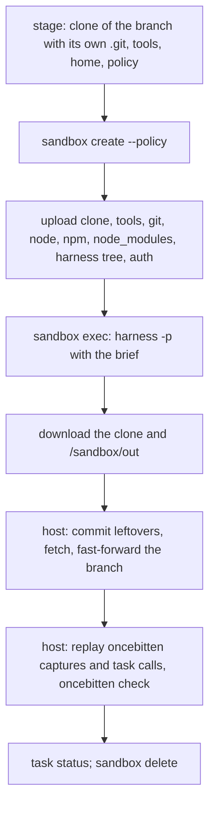

# Builders

A builder is one agent that implements one task on its own branch. `ai-collab builder start` runs each new builder inside its own OpenShell sandbox. Codex uses a runner-owned session when the runner is reachable. Cursor, Claude, and OpenCode use a transient systemd user unit. Codex uses the same fallback when the runner is unavailable. Builders started by hand before this command existed run on the host and are left alone.

Lib: `lib/builder/`, re-exported by `lib/builder.mjs`. OpenShell lifecycle: `lib/sandbox.ts`. Tests: `test/builder.test.mjs` and `test/builder-claude.test.mjs` with fake `openshell`, `systemd-run`, `systemctl`, agent and `oncebitten` from `test/helpers/`. Pure outputs (policy, argv, hook files, paths) are pinned by `test/builder-characterize.test.mjs`.

| Module | Owns |
|---|---|
| `state.mjs` | ids, sandbox and unit names, paths, state file, phases |
| `policy.mjs` | harness argv, sandbox network policy, Claude settings, capture hooks |
| `stage.mjs` | host staging: clone, tools tree, sandbox home, OpenShell upload, `git` and `must` helpers |
| `run.mjs` | one attempt: agent in the sandbox, collection, the Codex limit retry chain |
| `settle.mjs` | commit, fast-forward the host branch, oncebitten check, task verdict |
| `recover.mjs` | recovery after a restart, the task handoff, runner-owned builder hooks |
| `supervisor.mjs` | systemd unit launch, the durable workflow inside the unit, stop |
| `cli.mjs` | `ai-collab builder start|run|list|stop|clean` |

Codex's hook trust flag is needed because `codex exec` runs plugin hooks only when their trust is persisted in config.toml, which only the interactive `/hooks` review writes.

`runner/runner.mjs` manages the durable session steps for runner-owned builders. Both supervisors use `lib/builder/` to collect work, publish landing results, and clean up sandboxes. Cleanup retains an uploaded workspace until its worktree has been collected.

For the opt-in host integration matrix, see [Live OpenShell bootstrap smoke](sandbox-smoke.md).

## What runs where

| Agent | Where | How |
|---|---|---|
| Builder (`ai-collab builder start`) | its own sandbox `b-<id>-<hash>` | this page |
| UI or runner start, Cursor | the project sandbox `ai-collab-<project>` | `startPlace` (default `openshell`); [Start a session](phone-ui.md#start-a-session-from-the-phone) |
| UI or runner start, Claude, Codex, OpenCode | host folder, approvals on | no sandbox launcher in their runner adapters yet |
| Schedule with `"sandbox": true` | a fresh sandbox `s-<name>-<hash>` per tick | [Scheduled workflows](owned-sessions-contract.md#scheduled-workflows) |
| PM schedule (`pm`) | host, with `AI_COLLAB_ALLOW_HOST_AGENT=1` on the runner unit | operator decision 2026-11-23: it starts builders and writes tasks, which a sandbox cannot yet |
| `stakeholders`, `rule-steward` | host | plain scripts; their agents run read-only (Codex `-s read-only`, Cursor `--mode ask`) or with a Claude tool allowlist |
| `run_code`, `run_read_code` | `ai-collab-code`, `aic-ro-*` | [Code mode](code-mode.md#run_code) |

Builders, runner sessions and sandboxed ticks share one cap, `defaults.json` `maxSandboxes` (default 6); `run_code`'s sandboxes do not count. `builder start` over the cap is refused with an error naming the running sandboxes, before it creates a worktree. Runner sessions and ticks get the same Claude and Codex login files as builders (see [Credentials and network](#credentials-and-network)); long-lived session tokens may replace these copies later.
| Schedule without it, `job run`, runner `full-access` outside OpenShell | host | refused when the argv turns approvals off, unless `AI_COLLAB_ALLOW_HOST_AGENT=1` ([Environment variables](configuration.md#environment-variables)) |

## Commands

```
ai-collab builder start --task <id> [--harness cursor|codex|claude|opencode] [--model M] --brief <file> [--branch B] [--run ID]
ai-collab builder list [--all]
ai-collab builder stop <id>
```

| Command | Effect |
|---|---|
| `start` | Checks the task exists, creates `~/ai-collab-wt-<id>` on branch `builder/<id>` (or `--branch`) from `main`, links the repo's `node_modules` into it, writes the brief plus the sandbox notes, and starts the builder. Prints `session or unit, task, sandbox, worktree, branch`. |
| `list` | Builders started by `start` that are still running: `session or unit, task, sandbox, phase, state`. `--all` adds finished ones. |
| `stop` | Closes an owned session through the runner or stops the standalone unit and deletes its sandbox. Refuses an id that `start` did not create, so hand-started `builder-*` units are never touched. The worktree and branch stay. |

Defaults: Cursor `deepseek-v41-flash-1017-high`, Codex `gpt-6.2-sol`, Claude `haiku` (the alias for the latest Haiku). The id is the task id. State lives in `$XDG_STATE_HOME/ai-collab/builders/<id>/` (`state.json`, `brief.md`, `policy.yaml`); the unit's output is in `journalctl --user -u builder-<id>`.

When `--harness` is omitted, the first supported entry in `defaults.json`'s `builderOrder` array selects the starting harness. For example, `"builderOrder": ["codex", "cursor"]` starts with Codex. Codex is the built-in starting harness.

Both Codex launch paths retry a subscription usage limit without asking. The order is `defaults.json`'s `limitFallback` (`harness:model`, which may name another Codex model), then Cursor `deepseek-v41-flash-1017-high`, then `opencode/deepseek-v4.1-flash-free`, then the first listed model of each other installed harness. A Cursor model with a recorded limit is skipped until its reset; other harnesses have no such record. The supervisor copies the Git worktree and recorded task calls and hooks into a fresh OpenShell sandbox, then sends the brief again. The normal collection and oncebitten check run after a retry that is not itself limited.

When Cursor reports a model usage limit, the task records the cause and retry time. Starts, recoveries, and Codex fallbacks on the same host skip that model until the end of the reported reset date in UTC, or for five hours when Cursor gives no usable date. Other approved models remain available.

## Runner-owned Codex builders

The runner starts a dedicated Codex app-server inside the staged OpenShell sandbox and sends the brief as its first turn. It sets the task to `building` and records the session address as the task owner before sending the brief. The phone shows the session activity and the task card opens it. Pass `--run ID` to attach the task to a team run. An existing run association is retained when the flag is omitted.

When the turn ends, the runner collects the branch and task calls, runs the normal landing checks, and deletes the sandbox. After a restart, the runner opens the same Codex thread in its existing sandbox and starts a continuation turn. If resuming fails, the runner attempts to collect the workspace. The ended session remains linked from the task for its timeline. If the runner responds with a start error, the CLI reports that error. The standalone path is used when the control socket is absent or refuses the connection.

## What the standalone unit does

The task moves to `building` after the sandbox workspace is uploaded and before the unit runs the agent.



Each builder gets a new sandbox named `b-<first 8 characters of the id>-<6 hex of its hash>`: openshell 0.1.9 refuses names over 19 characters. A sandbox that already has the name is neither reused nor deleted; the run fails and blocks the task. The sandbox is deleted when the agent exits, when the run fails after creating it, and on `builder stop`.

Inside the sandbox:

| Path | Content |
|---|---|
| `/sandbox/work/ai-collab-wt-<id>` | the clone; the agent's working directory |
| `/sandbox/tools/bin` | `git`, `oncebitten`, `npm`, `npx`, the harness launcher, and two shims: `ai-collab` and `ob-capture` |
| `/sandbox/tools/git-core`, `/sandbox/tools/node`, `/sandbox/tools/lib` | the host's git helpers, node binary with npm, and node's non-glibc libraries (on `LD_LIBRARY_PATH`) |
| `/sandbox/deps/node_modules` | the repo's `node_modules`, linked into the clone |
| `/sandbox/agent/<version>` or `/sandbox/codex/<release>` | the host's Cursor or Codex install tree |
| `/sandbox/home` | `HOME`: the harness auth file, capture hooks |
| `/sandbox/out` | what the shims record for the host |

The image (`nvcr.io/nvidia/base/ubuntu:24.04`) has `sh`, `bash` and `tar` but no `git`, `node`, `curl` or `python3` (measured 2026-11-22), so every tool comes from the host. The host is Ubuntu 24.04 too, so its dynamically linked `git` and `oncebitten` run unchanged.

## Git in the sandbox

A worktree's `.git` is a file that points into the host repo, which does not exist inside the sandbox. The unit uploads a self-contained clone instead:

1. On the host: `git clone --no-hardlinks --single-branch --branch <branch> <repo>`, drop `origin`, add a local `main` at the base commit, copy `user.name` and `user.email`, and exclude the `node_modules` symlink.
2. Upload it with `--no-git-ignore`: with `.gitignore` filtering on, openshell drops the `.git` directory.
3. The agent commits on its branch with the uploaded `git` and can diff against `main`.
4. After it exits: download the clone, commit anything left uncommitted (`chore(builder): uncommitted work from <id>` with an `Assisted-by` trailer), then `git fetch <clone> HEAD` and `git merge --ff-only FETCH_HEAD` in the host worktree. The agent's own commits land unchanged.

Why a clone rather than committing on the host after a plain file copy: builders commit in small Conventional Commits and `oncebitten check` needs history, both of which need a real repository inside. If the fast-forward fails (someone moved the host branch), the clone is kept under the state directory and the task is blocked with the path.

## Credentials and network

| Harness | Copied in | API hosts allowed |
|---|---|---|
| Cursor | `~/.config/cursor/auth.json` (or `~/.cursor/auth.json`) to `/sandbox/home/.config/cursor/`, and the bus token from `defaults.json` `tokenFile` to `/sandbox/home/.config/ai-collab/ntfy-token` (the sandbox keeps the historical filename) | `api2`, `api3`, `api4.cursor.sh`, `agentn.global.api5.cursor.sh`, `cursor.com` |
| Codex | `$CODEX_HOME/auth.json` to `/sandbox/home/.codex/` | `chatgpt.com`, `api.openai.com`, `auth.openai.com`, `ab.chatgpt.com` (UNVERIFIED list) |
| Claude | `$CLAUDE_CONFIG_DIR/.credentials.json` (default `~/.claude/`) to `/sandbox/home/.claude/`, and the bus token from `defaults.json` `tokenFile` to `/sandbox/home/.config/ai-collab/ntfy-token` (the sandbox keeps the historical filename) | `api.anthropic.com` (the only host a lean run contacted), `platform.claude.com` (OAuth refresh) and `claude.ai` (account auth), per [network-config](https://code.claude.com/docs/en/network-config.md) |

Each secret goes through a 0600 temp copy and a single-file upload; it never appears in argv, `--env` or a log. Every builder sandbox gets the bus token, for the ai-collab MCP server. The sandbox `defaults.json` `tokenFile` is the uploaded path. Nothing else is copied: no SSH keys, no host config. When Claude refreshes its OAuth login inside, the unit copies the new credentials back to the host (0600, atomic rename) unless the host file changed during the run; whether a refresh rotates the refresh token is not documented. The policy (`policy.yaml`, JSON, which is YAML) allows the harness hosts on 443 and `host.openshell.internal:8794` (the host's bus) for the executables of the harness tree and the uploaded node; every other host is denied. The policy keeps `/sandbox`, `/tmp` and `/dev/null` writable, so the suite needs `TMPDIR` under `/tmp`.

The login shell of `sandbox exec` sets `SSL_CERT_FILE` to the CA OpenShell terminates TLS with, so the unit never overrides it.

Cursor needs OpenShell's DNS broker and outbound TCP 443 to the Cursor hosts listed above. The broker must be able to resolve the running CLI's binary identity through `/proc/<pid>/exe`. The builder passes `CURSOR_AGENT_ALLOW_PROCESS_INSPECTION=1` to the CLI and lists the staged executables, including the bundled `node`, in the network policy. Keep the image's resolver configuration readable under `/etc`. The Cursor endpoints use `protocol: tcp` and `tls: skip`, so the OpenShell broker routes the connection and Cursor validates the origin certificate. This setup uses the standard OpenShell builder capabilities, with no additional Linux capabilities required.

For the reachability gate, launch a throwaway Cursor builder from the OpenShell host using `ai-collab builder start --task <smoke-task> --harness cursor --brief <file>`. Give it a brief that asks it to edit a tracked file, commit, and run `oncebitten check --base main`. Verify a successful Cursor response in the builder unit log and confirm the commit landed on the host's builder branch. A DNS lookup alone cannot verify TLS or policy routing. The fake-endpoint regression in `test/builder.test.mjs` exercises the builder launch and commit round trip. Keep using Codex builders per [MISSION](../MISSION.md) until the live gate passes.

The harness's own sandbox or permission prompts are off (`--sandbox disabled` for Cursor, `--dangerously-bypass-approvals-and-sandbox` for Codex, `--dangerously-skip-permissions` for Claude): OpenShell is the isolation. Codex also gets `--dangerously-bypass-hook-trust`, because a headless `codex exec` otherwise fires no hooks at all; it covers hooks from `$CODEX_HOME` and installed plugins, and hooks a repository ships in its own `.codex/` stay off in a sandbox project Codex has not marked trusted (see [Install](install.md#codex)).

## Continue a stopped builder

On the task card, choose another harness and select **Continue with another agent**. The runner opens a local session in the builder’s existing worktree, with the harness’s normal local permission mode. The replacement receives the task brief, recorded decision and check result, and the previous session address when available. Ownership transfers after the replacement opens. If the launch fails, the task and worktree remain available for retry.

The action is available once the builder has exited and its work is available in the host worktree. If a stop leaves a retained sandbox or the branch cannot be fast-forwarded, recover the saved work first.

## Task status

The task store is a host file, so `ai-collab` inside the sandbox is a shim: `task set` and `task progress` are recorded under `/sandbox/out/ai-collab`, `task show` prints a snapshot taken at start, and everything else exits 2. After the run, the host collects the branch, replays captures, checks the landed branch with oncebitten, and applies the recorded task fields and progress. The builder's own status assignments are requests.

| Case | Final status |
|---|---|
| Commits landed, the agent exited successfully, and policy checks passed | `review`, or `blocked` if the agent requested it |
| The policy check reports a finding or cannot run | `blocked`, with the reason |
| The agent requested `done` without landed commits or exited unsuccessfully | `blocked`, with the exit code and commit count |
| The fast-forward failed | `blocked`, with the kept clone's path |
| Setup or collection failed | `blocked`, with the error |

The runner saves the verdict before publishing it. The final status and completion progress are written together, so a restarted runner can recognize a verdict it already published. The terminal transition wakes the PM through `wakeOnTasks`.

### Review

A landed build settles to `review`, not `done`: the operator gives the verdict, not the builder. The task carries a review packet with the submitted commit, the branch, the criteria the build was judged against (the task's detail, else the brief's first paragraph), the host `oncebitten` check, and per-file line counts (at most 12 files, with the rest counted). The board shows one line per card — the short commit, the net change, the file count, and whether it waits for the operator or has already been decided — and the task view offers the diff and the two decisions:

- **Accept** moves the task to `done` for that commit.
- **Return** moves it back to `decided` with a one-line note, so the next build knows what to change.

A decision is refused when the packet is stale: a re-run replaces the packet's `submission`, and a branch that has moved past the submitted commit no longer reads as current, so a build cannot be accepted after later work landed on top of it.

```
ai-collab task set <id> status=review   # a person can queue a review by hand too
```

The packet rides in the same store write that moves the task to `review`, so a card never shows a review status with no packet. `/api/review-diff?project=<p>&id=<task>&submission=<s>` serves the `base..commit` diff as plain text, capped at 4 MiB; the commit and base come from the stored packet, never the request, so a URL cannot ask for an arbitrary diff.

## oncebitten

The host's capture hooks (`~/.cursor/hooks.json`, `~/.codex/hooks.json` calling `oncebitten capture --host <h>`) do not exist in the sandbox. The unit reads the host hooks file, takes the events whose command runs `oncebitten capture` (Cursor's defaults: `beforeSubmitPrompt`, `postToolUse`, `postToolUseFailure`; Codex: `UserPromptSubmit`), and writes the same events into the sandbox home with the command `ob-capture <harness>`. That shim saves each payload under `/sandbox/out/oncebitten`. After the run the host pipes every payload into `oncebitten capture --host <harness>`, with `/sandbox/work/ai-collab-wt-<id>` rewritten to the host worktree, so captures land in the host's `~/.local/share/oncebitten/events.db`. Chosen over running `oncebitten capture` inside: the events database stays on the host and is never uploaded.

Every brief ends with the sandbox notes, which tell the agent to run `oncebitten check --base main` and fix what fires before it marks the task done. The `oncebitten` binary is uploaded for that. The host runs the same check on the landed branch as a backstop. `steer` hooks are not carried into the sandbox.

The runner looks for `oncebitten` on its service `PATH`, then in `$CARGO_HOME/bin` or `~/.cargo/bin` when `CARGO_HOME` is unset.

## Lean Claude builders

`--harness claude` uploads the host's native `claude` binary (one 364 MB file) to `/sandbox/claude/` and runs it headless with only what a builder needs. Every switch below is a documented Claude Code mechanism or a settings key the host's own `~/.claude/settings.json` uses; the sources are `claude --help` (2.1.330) and code.claude.com/docs ([cli-reference](https://code.claude.com/docs/en/cli-reference.md), [env-vars](https://code.claude.com/docs/en/env-vars.md), [settings-reference](https://code.claude.com/docs/en/settings-reference.md), [permissions](https://code.claude.com/docs/en/permissions.md)).

| Turned off | How |
|---|---|
| Every built-in tool except Bash, Read, Edit, Write, Glob, Grep (gone: Task, Cron*, ScheduleWakeup, RemoteTrigger, PushNotification, Monitor, SendMessage, Skill, ToolSearch, WebFetch, WebSearch, Workflow, DesignSync, NotebookEdit, worktree tools, ListAgents, ReportFindings) | `--tools Bash,Read,Edit,Write,Glob,Grep`, plus the same names in `permissions.deny` |
| Every MCP server but ai-collab (and `ai-collab-code` once `scripts/ai-collab-code-mcp.mjs` exists) | `--strict-mcp-config --mcp-config /sandbox/home/.claude/builder-mcp.json`; `ENABLE_CLAUDEAI_MCP_SERVERS=false` |
| ai-collab MCP tools that would act on sandbox-local state: `task_list`, `task_update`, `team_start`, `team_status`, `pattern_*`, `interrupt`, `list_sessions` | `permissions.deny` (`mcp__ai-collab__<tool>`); task changes go through the `ai-collab task` shim |
| User, project and local settings files; skills and slash commands; Chrome | `--setting-sources ""` (an empty value is not documented, but 2.1.330 accepts it and loads none), `--disable-slash-commands`, `--no-chrome` |
| Bundled skills, workflows, artifacts, Remote Control, prompt suggestions, away summary, push and input-needed notifications, feedback survey, spinner tips, git instructions in the system prompt, auto memory | settings `disableBundledSkills`, `disableWorkflows`, `disableArtifact`, `disableRemoteControl`, `remoteControlAtStartup: false`, `promptSuggestionEnabled`, `awaySummaryEnabled`, `agentPushNotifEnabled`, `inputNeededNotifEnabled`, `feedbackSurveyRate: 0`, `spinnerTipsEnabled`, `includeGitInstructions: false`, `autoMemoryEnabled: false` |
| Built-in plugins (`cc-plugin-telemetry`, `-privacy`, `-agents-md`, `-plugin-authoring`) | `enabledPlugins: {"<name>@builtin": false}`; the init event then lists no plugins (that these ids switch off exactly those plugins is UNVERIFIED) |
| Telemetry, error reports, auto-update, feedback command, cost warnings, terminal title, background tasks, agent view, artifacts, marketplace auto-install, IDE extension install, and all nonessential traffic | env `CLAUDE_CODE_DISABLE_NONESSENTIAL_TRAFFIC`, `DISABLE_TELEMETRY`, `DISABLE_ERROR_REPORTING`, `DISABLE_AUTOUPDATER`, `DISABLE_FEEDBACK_COMMAND`, `DISABLE_COST_WARNINGS`, `CLAUDE_CODE_DISABLE_FEEDBACK_SURVEY`, `CLAUDE_CODE_DISABLE_AUTO_MEMORY`, `CLAUDE_CODE_DISABLE_TERMINAL_TITLE`, `CLAUDE_CODE_DISABLE_BACKGROUND_TASKS`, `CLAUDE_CODE_DISABLE_AGENT_VIEW`, `CLAUDE_CODE_DISABLE_ARTIFACT`, `CLAUDE_CODE_DISABLE_OFFICIAL_MARKETPLACE_AUTOINSTALL`, `CLAUDE_CODE_IDE_SKIP_AUTO_INSTALL` |

Kept: the project's `CLAUDE.md` (builders follow repo rules), the ai-collab MCP messaging tools, and the oncebitten capture hooks (`UserPromptSubmit`, `PostToolUse`, `PostToolUseFailure`, read from the host's `settings.json`). `--bare` is not used because it reads no OAuth login.

The ai-collab MCP server runs from a copy of this checkout's `package.json`, `scripts/`, `lib/` and `web/lib/` under `/sandbox/tools/ai-collab`, with the uploaded node, `AI_COLLAB_PEER=claude`, and a sandbox `defaults.json` that points at `http://host.openshell.internal:8794`.

### First-turn input tokens

Measured 2026-11-22 in real sandboxes with `claude-haiku-5-5` (input = uncached + cache creation + cache read, from the first assistant message):

| Run | First-turn input tokens |
|---|---|
| Default (`claude -p --dangerously-skip-permissions`, fresh home), prompt "Reply with the single word PONG." | 21,606 |
| Default, the smoke builder's brief | 19,008 |
| Lean flags, no MCP server, PONG | 5,373 |
| Lean builder, smoke brief, ai-collab MCP failed to start (13 fewer tools) | 7,489 |
| Lean builder, smoke brief, ai-collab MCP connected (6 built-in + 13 MCP tools) | 12,040 |

The lean builder with MCP sends 37% fewer first-turn tokens than the default on the same brief; the 13 ai-collab tools cost about 4,500 of them. A default run also contacted `mcp-proxy.anthropic.com` (claude.ai connectors) and tried `http-intake.logs.us5.datadoghq.com` (denied by the policy); the lean runs contacted only `api.anthropic.com`.

## Verified and unverified

Measured on 2026-11-22 with openshell 0.1.9, a real sandbox per run, and throwaway task `sandbox-smoke-test-add-one-line-to-docs` (its branch and worktree deleted afterwards, never merged):

| Check | Result |
|---|---|
| Codex `gpt-6.2-sol` end to end | **works**: unit `builder-<id>` ran Codex in sandbox `b-sandbox-302b20`; the agent committed `docs(builders): sandbox smoke test line` with `git` inside; the commit landed on the host branch; the agent ran `oncebitten check --base main` (clean); its recorded `task progress` and `task set status=done` were applied on the host; the sandbox was deleted and `openshell sandbox list -o json` was empty |
| Cursor `deepseek-v41-flash-1017-high` | **works**: unit `builder-cursor-dns-probe` ran the CLI in sandbox `b-cursor-d-6d2862` with brief `Reply OK`; stream-json `result` `success`, reply `OK`, `duration_ms` 3266; the sandbox was deleted. Before `CURSOR_AGENT_ALLOW_PROCESS_INSPECTION=1` the CLI exited 1 within a second with `Error: [unavailable] getaddrinfo EAI_AGAIN api2.cursor.sh` |
| `node` and `npm` inside | the image lacks `libatomic.so.1`; the unit now uploads node's non-glibc libraries to `/sandbox/tools/lib` and sets `LD_LIBRARY_PATH`. A manual sandbox then printed `v26.13.0` and npm `11.20.0`; a builder run with this fix has not happened |
| Claude `claude-haiku-5-5` end to end | **works**: sandbox `b-sandbox-0bd292`; init listed tools `Bash, Edit, Glob, Grep, Read, Write` plus 13 `mcp__ai-collab__*`, MCP `ai-collab` connected; the agent ran git 2.43.0, node v26.13.0, npm 11.20.0 and `list_agents`, committed `docs(builders): sandbox smoke test line` (`Assisted-by: Claude:claude-haiku-5-5`), ran `oncebitten check --base main` (clean) and set the task done; the commit landed on the host branch, 7 captures were replayed into oncebitten, and the sandbox was deleted. 7 turns, $0.0055 |
| Sandbox names | over 19 characters are refused (`name exceeds maximum length (50 > 19)`) |

Why Cursor failed (measured 2026-11-22, CLI 2026.11.22-e9042b2): about 230 ms after start the CLI marks its own process non-dumpable, which its launcher skips only when `CURSOR_AGENT_ALLOW_PROCESS_INSPECTION=1`. From then on `/proc/<pid>/environ` is owned by `0:0` and `/proc/<pid>/exe` is unreadable to the sandbox's same-UID processes, so OpenShell cannot resolve the caller's binary identity and denies its DNS queries and sockets without logging a denial: getaddrinfo returns `EAI_AGAIN`, a UDP send to `127.0.0.53:53` and a TCP connect return `EACCES`. Children of the CLI still resolve, the CLI is a single `node` process (listed in the policy), `/etc/resolv.conf` stays readable, and seccomp, capabilities and the network namespace stay unchanged. The unit now sets `CURSOR_AGENT_ALLOW_PROCESS_INSPECTION=1` for Cursor builders; this also keeps Node's SIGUSR1 debugger open to same-UID processes inside the sandbox. `Cannot open directory /etc/ssl/certs` is harmless: the image has no `/etc/ssl/certs` and the launcher passes `--use-system-ca`.

UNVERIFIED:

- Claude OAuth refresh inside a sandbox and the copy-back: no smoke run needed a refresh, so only the fakes cover it.
- bus from inside: the ai-collab MCP server connected and `list_agents` answered, but no message was sent through `host.openshell.internal:8794`.
- `--setting-sources ""` loading nothing is observed behaviour, not documented.

- The full test suite inside a sandbox (node now starts there; no builder has run `npm test`).
- Capture replay with a real harness: the Codex run saved no hook payload (0 captures), so `codex exec` may not fire `UserPromptSubmit` hooks from `$CODEX_HOME/hooks.json`; the unit now also marks the worktree trusted in the sandbox's `config.toml`, untested. The replay path is covered only by the fake agent.
- Codex API host list: the run worked with it, but which of the four hosts Codex needs is not measured.
- `builder stop` against a real running unit (covered by fakes only).
- A host branch that moved during the run (fast-forward failure path; fakes only).

## Files

| Path | Role |
|---|---|
| `lib/builder.mjs` | `builder start/run/list/stop` |
| `lib/cli.mjs` | `ai-collab builder` wiring |
| `lib/prune.mjs` | `ai-collab prune`: builder copies and worktrees |
| `test/prune.test.mjs` | prune decisions, archive refs and reachability against temp repos |
| `lib/sandbox.ts` | OpenShell list, create, upload, download, exec argv, delete, staged upload |
| `test/builder.test.mjs` | end to end against the fakes |
| `test/builder-claude.test.mjs`, `test/helpers/fake-claude-builder.mjs` | the lean Claude builder against the fakes |
| `test/helpers/fake-systemd-run.mjs` | fake `systemd-run` (runs the unit in the foreground) and `systemctl` |
| `test/helpers/fake-builder-agent.mjs` | fake agent: commits, fires a capture hook, records task calls |
| `test/helpers/fake-oncebitten.mjs` | fake `oncebitten capture` and `check` |

## Prune copies

`ai-collab prune [--apply] [--older-than 7d] [--json]` is a dry run unless `--apply` is given. It removes:

- Builder dirs in a settled phase (`finished`, `failed`, `stopped`) whose `state.json` is older than the cutoff, with the unit inactive and no live pid. It deletes `back/` (clone), `stage/` (staged tree and `tools/`), `download-*` and `*.log` files over 1 MiB. It keeps `state.json`, `brief.md`, `policy.yaml`, the `workflow-*.db` journal, `out/` (ai-collab call records and oncebitten payloads) and smaller logs.
- Unlanded commits (`commits > 0`, `landed` false) are archived first: the clone's HEAD goes to `refs/ai-collab/archive/<builder-id>` in the project repo. A builder with unlanded commits and no clone is kept.
- Linked worktrees of the project repo, except the main worktree and protected checkouts. A worktree goes only when it has no uncommitted or untracked-but-not-ignored files (one top-level `node_modules` symlink is ignored; its target is never touched), is not locked, no live process has its cwd inside it, and its last commit or directory mtime is older than the cutoff. A detached HEAD goes to `refs/ai-collab/archive/wt-<name>` before `git worktree remove`. Branches are never deleted.

Builders hold no harness transcript on the host. Claude, Codex and OpenCode write their output to the unit's journal, Cursor streams to OTLP, and the sandbox session directories are destroyed at cleanup.

## Calling tools from sandbox programs

Node.js programs can import `lib/tool-api.mjs` from the checkout inside
OpenShell. `listTools()` returns the same names and input schemas as MCP.
`callTool()` resolves with the tool's data and rejects with an error on failure.
Pass an `AbortSignal` as the third argument's `signal` to cancel a supported
wait.

```js
import { toolClient } from "./lib/tool-api.mjs";

const tools = toolClient();
const { agents } = await tools.callTool("list_agents");
```

The client executes in the sandbox process. OpenShell's filesystem and
network policy applies to every call. The operator configures access when
setting up the sandbox, and the client uses the regular AI Collab project,
peer, and session settings in that environment. For bus-backed tools, set
`AI_COLLAB_URL` to the policy-allowed endpoint (for example,
`http://host.openshell.internal:8794` under the builder policy), and provide
credentials inside the sandbox if the endpoint requires them. Tools that
operate on files use the sandbox's own AI Collab state. The builder's
recorded `ai-collab task set` and `task progress` calls remain the way to
apply task changes to the host store.

Cursor and OpenCode builders can batch worktree operations with `ai-collab-code` `run_code`. The server and program run inside the builder's OpenShell session. See [builder code mode](code-mode.md#cursor-and-opencode-builders).

OpenCode uses the OpenCode 2 CLI in standalone mode. The supervisor stages the executable found on PATH or at `AI_COLLAB_OPENCODE_BIN`. For an installation with a launcher shim, set that override to the standalone executable. The default model is `opencode/deepseek-v4.1-flash-free`, and the sandbox policy permits OpenCode's model endpoint and model catalog. The launcher and MCP registration follow the [OpenCode CLI](https://opencode.ai/docs/cli/commands/) and [MCP configuration](https://opencode.ai/docs/mcp-servers/) documentation.

The policy passes OpenCode's TLS to `opencode.ai` and `models.dev` through unterminated (`protocol: tcp`, `tls: skip`), as it does for Cursor. Measured 2026-11-22 with OpenCode 2.2.5, prompt "Reply with the single word OK.", fresh home, same egress IP: through OpenShell's TLS-terminating `rest` proxy, Zen answered every free-model request with HTTP 429 `FreeUsageLimitError` ("Free models work in OpenCode"); with TLS passthrough the same sandbox got `OK`. The proxy forwards OpenCode's headers and adds none (checked against an echo service), so Zen tells the clients apart below HTTP, by the proxy's own TLS connection; which signal it reads is UNVERIFIED. The cost: OpenShell no longer inspects OpenCode's API requests, only the destination host and port.

## Probes

- 2026-11-23: OpenShell Codex builder commit probe on main `26c11ebf`.
