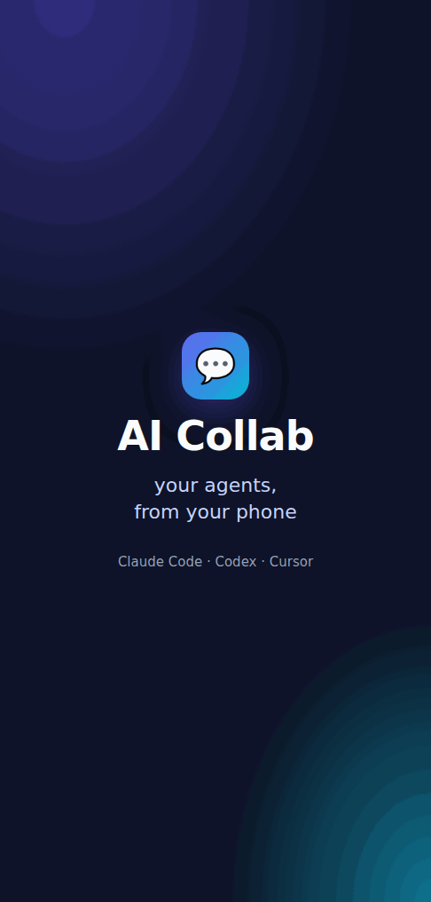

# AI Collab

**Phone chat and live activity for your coding agents.** AI Collab carries messages, start/stop status, approvals, and activity between Claude Code, Codex, Cursor, and OpenCode 2 sessions and your phone, over a **private, self-hosted ntfy server**. Nothing talks to ntfy.sh or any other public service.

The peer hooks and MCP server need only Node 22+ (builtin `fetch`). The operator UI uses Next.js with shadcn/ui, Tailwind CSS, and prompt-kit. Remote Claude compaction uses the Claude Agent SDK.

**Learn more**

| | |
| --- | --- |
| [Quick start](quick-start.md) | One command: ntfy in Docker, every harness plugin, the phone UI |
| [Install](install.md) | Per-harness install by hand |
| [Configuration](configuration.md) | `defaults.json` auto-join, `projects.json`, environment variables |
| [Phone UI](phone-ui.md) | Home, chat, activity, starting sessions, Tailscale, push |
| [AFK mode](afk.md) | Progress posts, phone questions, Stop-hook waits |
| [Approvals and questions](approvals.md) | Permission prompts and questions answered from the phone |
| [Messaging](messaging.md) | CLI and MCP tools, Stop continuation, receipts |
| [Tasks](tasks.md) | Project task store, `ai-collab task`, status board and dependency graph |
| [PM mission file](mission.md) | `MISSION.md`: the mission, goals and rules the PM owns, read at every tick |
| [Builders](builders.md) | `ai-collab builder start`: one builder per task, each in its own OpenShell sandbox |
| [Code mode](code-mode.md) | Native code mode for started sessions, and `run_code`: one program in an OpenShell sandbox over the ai-collab tools |
| [Activity](activity.md) | What hooks publish, per harness |
| [GitHub sign-in](github-sign-in.md) | Optional OAuth sign-in for the UI |
| [Security model](security.md) | What is sent and what is trusted |
| [Troubleshooting](troubleshooting.md) | Known limits and fixes |
| [Development](development.md) | Tests, CI, releases, the demo |

## What it does

| Event | Claude Code | Codex | Cursor | OpenCode 2 ([plugin](install.md#opencode)) | Action |
|---|---|---|---|---|---|
| Session start | yes | yes | yes | first `prompt` hook of a session | Publish `start` status. Fetch the current AFK mode. Inject the mode, reply instructions, and new inbox messages. |
| Prompt submit | yes | yes | not registered | session `prompt` hook (context appended to the prompt text) | Read inbox (throttled). Inject new messages and a changed AFK mode. |
| After tool use | yes | not registered | yes | tool `execute.after` (context appended to the tool result) | Sample current context (Claude, OpenCode). Read inbox (throttled). Inject new messages and a changed AFK mode. |
| Top-level stop | yes | yes | yes | session `experimental.idle` hook; a continuation is a `session.synthetic` input | Sample current context. Read inbox. If messages wait, keep the agent going with them (see [Stop continuation](messaging.md#stop-continuation)). In AFK mode, wait for operator messages first when the agent asked with `ask_question` or `wait_for_operator`. Otherwise publish `stop` status. |
| Before compaction | activity only (`PreCompact`, async) | activity only (`PreCompact`) | yes | activity only (`session.compaction.started` event) | Publish a `compact` activity row (Cursor also samples `context_tokens`). Output `{}`. |
| Permission prompt (see [Approvals](approvals.md#phone-approvals)) | `PermissionRequest` (also `AskUserQuestion`) | `PermissionRequest` | not registered (see [Approvals](approvals.md#unverified)) | permission `evaluate` hook, `ask` decisions only | In AFK mode `on` or `quiet`, ask the operator's phone and wait up to `AI_COLLAB_APPROVAL_S`; otherwise, or without an answer, no decision. |
| Activity (see [Activity](activity.md)) | `PreToolUse`, `PostToolUseFailure`, `MessageDisplay`, `Notification`, `SubagentStart`, `SubagentStop`, `StopFailure` (async), `SessionEnd` | `PreToolUse`, `PostToolUse`, `SubagentStart`, `SubagentStop`, `SessionEnd` | `beforeSubmitPrompt`, `afterAgentResponse`, `postToolUseFailure`, `sessionEnd` | tool `execute.before`, failed `execute.after`, events `session.text.ended`, `session.deleted`; child sessions as subagents | Publish activity only and output the neutral answer (`{}`; Cursor `beforeSubmitPrompt` gets `{"continue":true}`). Every hook above also publishes its activity. |

- **No idle wake-up.** The plugin only runs when the host fires one of the hooks above. An agent idle at its prompt hears a message at its next hook; in AFK mode `on`, the Stop hook keeps the agent listening for up to 10 minutes after it finishes. There is no background process.
- **Fail open.** A timeout, outage, bad config, or malformed input prints `{}` and exits 0. The session continues unchanged.
- **Activity-only registrations never deliver messages.** Cursor `beforeSubmitPrompt` and Codex `PostToolUse` run with `--activity`: they publish activity and inject nothing, because their context-injection output is unverified for this plugin.
