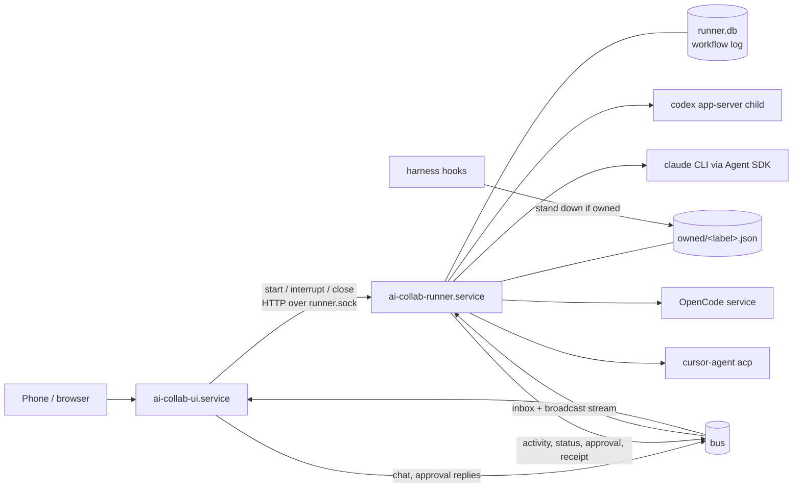

# Owned sessions: shared contract

The contract the four harness adapters (Claude, Codex, Cursor, OpenCode) code against. The `ai-collab-runner` user service drives these sessions directly instead of observing them through hooks. Background: [research](research/owned-sessions.md), [review](research/owned-sessions-review.md), [message delivery](research/pulsar-parity.md).

The types live in `runner/types.d.ts`, the constants and validators in `runner/contract.mjs`, and the reference adapter in `runner/adapters/fake.mjs`. Where this page and the code disagree, the code wins; fix the page.

## Deployment status

The November 22, 2026 rollout enabled Claude and Codex. Cursor and OpenCode still need an authenticated live turn under the runner service account. Cursor needs a signed-in CLI in the service environment. OpenCode needs a registered loopback service with working provider credentials.

`GET /v1/harnesses` reports adapter availability. Verify authentication by starting an owned session for each harness and checking for streamed text and `RUN_FINISHED` before enabling it in the deployed `AI_COLLAB_RUNNER_HARNESSES` list.

## Settled decisions

| Topic | Decision | Source |
|---|---|---|
| Process | A separate `ai-collab-runner` systemd user unit (`deploy/ai-collab-runner.service`) | operator |
| Language | ESM JS with JSDoc and a `.d.ts` contract. TypeScript is allowed; adapters in `.ts` must use erasable syntax only, so Node runs them without a build step. Rust is a long-term option. | operator |
| Execution | Durable workflows: a SQLite workflow/step log shaped like DBOS (see [Durable execution](#durable-execution)) | operator; this page picks the implementation |
| Codex | Its own `codex app-server` child per runner, launched with `-c thread_unload_delay_secs=0` | review |
| Claude | Agent SDK `query()` with an `AsyncIterable` prompt; the adapter picks the session UUID and passes it as `options.sessionId` (sdk.d.ts L2273) | research |
| OpenCode | The registered OpenCode service (`~/.local/state/opencode/service.json`), HTTP plus SSE; permission replies are always `once` | research, review |
| Cursor | `cursor-agent acp`, one child per session, in a git worktree outside OpenShell; `--force` inside an OpenShell sandbox with no further limits (2026-11-22) | operator |
| Events | AG-UI adapter events and a configurable [wire format](ag-ui.md) | operator |
| Hook stand-down | Owned record keyed by session label; only the process the runner spawned stands down, and agents started inside it register as its children | operator |
| Cut runs | Never resent. Every cut run, on every adapter, is marked interrupted | operator |
| T3 Code | MIT; may be ported with its notice kept (one-line header naming T3 Code, the file, and the commit) | operator |

## Architecture



## Durable execution

The operator asked for DBOS-style durable execution: workflows and steps are checkpointed, so a runner restart resumes each session's workflow instead of every adapter inventing its own recovery.

### DBOS Transact for TypeScript vs a minimal layer

| | DBOS Transact (`@dbos-inc/dbos-sdk` 5.6.0) | Minimal layer (`runner/durable.mjs`) |
|---|---|---|
| Storage | Postgres only. The README says "built on top of Postgres"; `dist/src/config.js` builds `postgresql://` URLs; the 5.6.0 package has no SQLite code path (searched `dist/` for "sqlite": no match). No Postgres is installed on this machine. | `node:sqlite` (built into Node 22.13+; Node 26 here). One file: `$AI_COLLAB_STATE_DIR/runner.db`, mode 0600 |
| Licence | MIT | Ours (Apache-2.0) |
| Weight | 2.04 MB unpacked, plus `pg`, `yaml`, `commander`, `superjson`, `serialize-error` | About 200 lines, no dependency |
| Features | Workflows, steps, durable queues, notifications (`send`/`recv`), scheduling, workflow management, client API | Workflows, steps, `send`/`recv` with dedupe, key-value store, recovery of PENDING workflows |
| Cut steps | Re-executes an unfinished step at recovery (at-least-once) | A step may declare `onCut`, which replaces re-execution; this enforces "never resend" |
| Operations | A Postgres server to run, upgrade and back up | One SQLite file next to the existing state |

**Pick: the minimal layer.** DBOS would add a Postgres server to a single-user machine to run a single-process runner with a few concurrent sessions. The minimal layer keeps DBOS's names (`startWorkflow`, `step`, `recv`, `send`, `recover`), so if Postgres ever arrives, porting means swapping `runner/durable.mjs` for DBOS and wrapping the session workflow with `DBOS.registerWorkflow`. Costs: we own the layer's correctness (covered by `test/runner-durable.test.mjs`), and it has no queues, scheduler or workflow UI.

### Log schema (`runner.db`)

| Table | Columns | Meaning |
|---|---|---|
| `workflows` | `id, name, input, status (PENDING, SUCCESS, ERROR, CANCELLED, SKIPPED), output, error, created_at, updated_at` | One row per session workflow; one per scheduled tick (`scheduled:<name>`) |
| `steps` | `workflow_id, seq, name, status (started, done, error), output, error, started_at, finished_at` | A checkpoint per step and per `recv`, numbered in call order |
| `messages` | `id, workflow_id, topic, value, dedupe UNIQUE, consumed, created_at` | Durable input to a workflow; `dedupe` holds `ntfy:<event id>` |
| `kv` | `key, value` | `ntfy-cursor:<project>`, the last bus event the runner handled |

Replay rule: a step whose row is `done` returns its recorded output without running. A step whose row is `started` was cut by a stop or crash: it runs `onCut` when one is given and re-executes otherwise. A step whose name differs from the recorded one throws `NonDeterminismError`, so workflow code must call steps in a deterministic order.

### The session workflow

One workflow per owned session, id `session-<uuid>`, name `session`, input `{project, harness, place, permissionMode, prompt, model?}`. Code: `sessionWorkflow` in `runner/runner.mjs`.

| Step | Does | On replay | When cut |
|---|---|---|---|
| `place` | Resolves the project root; for `worktree`, runs `git worktree add -b ai-collab/<harness>-<stamp>` under `.claude/worktrees/` | returns the cwd; never adds a second worktree | re-executes |
| `open` | `adapter.open(options, ctx)`; records `{nativeId}` | returns `nativeId`; there is no live handle until the next input | the workflow ends: "the runner stopped while the session opened" |
| `claim` | Writes `owned/<label>.json` (status `idle`) | skipped; the record is read from disk | re-executes (idempotent) |
| *(not a step)* | Registry entry (`lib/sessions.mjs` `recordSession`, pid = runner); "owned session started" notice on the first run only | runs again, so the registry shows the restarted runner's pid | |
| `recv:input` | Waits for durable `input` messages and takes them all as one run (texts joined by a blank line, message ids merged); `{close:true}` ends the loop | returns the recorded batch | not checkpointed until consumed, so nothing is lost |
| `run.send` | `liveHandle()` (resumes when needed), `handle.send(input)` → `{runId}`, then read receipts | returns `{runId}` | `onCut`: the run is marked interrupted ("runner restarted before the harness accepted the input"); **not resent** |
| `run.wait` | Waits for `RUN_FINISHED` or `RUN_ERROR` with that `runId` | returns the outcome | `onCut` marks the run interrupted |
| `close` | Cancels open approvals, `handle.close()`, record `ended`, registry pid cleared, "session ended" row | returns | re-executes |

The first prompt is the first input; the loop starts with it, not with `recv`.

### Restart and resume rules

| Situation at restart | Result |
|---|---|
| Waiting in `recv:input` (idle) | Workflow replays to `recv`; no harness call until the next input, which resumes the native session lazily |
| Cut inside `run.send` | Marked interrupted with `RUN_FINISHED {outcome:{type:"cancelled"}}` with the reason in metadata; the operator resends by hand |
| Cut inside `run.wait` | Marked interrupted (`turn ended · interrupted · runner restarted`); `record.cut = {runId, at, reason}`; open approval cards end with reason `cancelled` |
| `resume: "none"` | Next input fails with 409; the operator closes the session |
| Adapter module missing at boot | The workflow fails (status ERROR); its owned record stays as it was |
| Messages that arrived on the bus while the runner was down | Read from the stored `ntfy-cursor:<project>` and deduplicated by `ntfy:<event id>` |

`runner.stop()` (SIGTERM) aborts workflows where they wait and leaves open steps `started`, so the rules above apply at the next boot. The cut row is published at that boot, not at stop, so it appears exactly once.

### Scheduled workflows

`scheduled(name, {everyMs}, fn)` in `runner/durable.mjs` registers a DBOS-style scheduled workflow (DBOS `@DBOS.scheduled`). Each tick is a workflow named `scheduled:<name>` with id `<name>@<scheduledTime ISO>`, and `fn(scheduledTime, actualTime, wf)` runs in it. Ticks align to the Unix epoch: a 30-minute schedule fires at :00 and :30 UTC. Cron is not supported.

| Case | Result |
|---|---|
| Tick due, id unused | Runs. The workflow row and its first step (`command`) commit in one transaction before the command starts |
| Runner down across one or more ticks, then started | Runs the latest due tick once. Earlier missed ticks never run: no backlog |
| Latest due tick within 60 s of the next boundary (capped at half the interval) | Not run at start; the next boundary runs instead |
| Tick due while the previous tick of the schedule still runs | Recorded `SKIPPED` with output `{"skipped":"previous run still going"}`; not retried |
| Previous non-skipped tick's scheduled time is under `everyMinutes` before this one (interval edited) | Recorded `SKIPPED` with output `{"skipped":"interval changed: ..."}`; not retried |

A skipped tick is a workflow row like any other and appears in the run list, but it is not a run: `last` in `GET /v1/schedules` is the newest non-skipped tick, so a skipped extra trigger never replaces the last real run's status on the scheduler card.
| Runner stops during a run | The command's process group gets SIGTERM, then SIGKILL after 5 s. The step stays `started`; at the next boot it records `cut` and is not re-run |
| `POST /v1/schedules/:name/run` | Starts a tick under `<name>@manual@<uuid>` with the same overlap rule; returns 202 without waiting. One run per 10 s per schedule (429 otherwise); the caller label from `?caller=` is logged |

A tick id is recorded with its first step, so a tick starts at most once while `runner.db` is intact. An operator who deletes or restores the database can start a tick twice. A skipped tick is not retried: its id stays in the log.

**Run detail.** A command that resumes a harness session names it: `--resume <id>` / `-r <id>` for Cursor and Claude, `--session <id>` for OpenCode, `codex exec resume <id>` for Codex. The runner matches the id against the registered session label (`sessionLabel`, the hash the hooks publish), so each run in `GET /v1/schedules/:name/runs` carries `startedAt`, `finishedAt` and `session: {harness, session}`. The UI turns that into a link to the session's timeline cut to the run's window (the run plus 15 min either side), where the tick's prompts, tool calls and builders appear. A command that resumes nothing (a plain script, a wrapper like `npx`) lists its runs with no session and no link. Code: `lib/schedule-session.mjs`.

The command runs with `spawn` (argv, no shell) in its own process group, stdin closed, in `cwd`, with `timeoutSec` as the deadline. A timeout or abort kills the group. A clean exit leaves processes the command started in the background (agents it handed work to) running. Its result is `{ok, exitCode, signal, timedOut, durationMs, tail, scheduledTime, actualTime}`, where `tail` is the last 2000 characters of stdout and stderr. Ticks publish no bus rows: a schedule has no session to publish under.

**Prompt blocks.** A harness command's prompt is the schedule's own prompt, then the project's [mission file](mission.md) (`withMission`, `lib/mission.mjs`), then the [run review](mission.md#the-run-review) (`withReview`, `lib/pm-review.ts`). Both are appended at run time, so a tick always reads the current files, and a plain script is left exactly as `schedules.json` wrote it.

**PM workspace.** A `pm` entry may set `workspace` to an absolute path. That path is a separate clone of the `cwd` repo's origin, not a linked worktree. At the start of the tick the runner clones it when the directory is missing, and when the clone is clean it runs `git fetch` and `git pull --ff-only` there. A dirty clone is left as it is and the reason is logged. The tick never resets or checks out `cwd`. An existing clone is not reset, even when it has local commits. The command runs in the workspace and the mission is read from there; `projectOfFolder` still uses `cwd`, so the run stays on the registered project. Builder start and merge start keep using that project. Omitting `workspace` leaves the tick in `cwd`.

Config: `$XDG_CONFIG_HOME/ai-collab/schedules.json` (default `~/.config/ai-collab/schedules.json`), or the path in `AI_COLLAB_SCHEDULES`. A JSON array. An invalid entry, unreadable file or bad JSON is reported in `configError` and skipped; the runner keeps serving. A missing file means no schedules. Code: `runner/schedules.mjs`.

The runner takes `runner.lock` beside `runner.db`; a second live runner on the same state directory refuses to start. The control socket binds before any tick starts, so a runner that cannot bind starts no command.

```json
[
  { "name": "pm", "everyMinutes": 30, "cwd": "/home/b/ai-collab",
    "command": ["cursor-agent", "-p", "--trust", "--model", "composer-2.5", "--resume", "<id>", "PM tick: follow the goal from your first message (steps 1-5)."],
    "timeoutSec": 900 }
]
```

| Key | Type | Required |
|---|---|---|
| `name` | 1–40 chars of `a-z`, `0-9`, `-`; unique | yes |
| `everyMinutes` | integer, 1 to 525600 | yes |
| `cwd` | absolute path to an existing directory | yes |
| `command` | non-empty array of strings: argv, no shell | yes |
| `timeoutSec` | positive integer, default 900, shorter than `everyMinutes` × 60 | no |
| `sandbox` | boolean; `true` runs the command in a fresh OpenShell sandbox; the command must run `claude`, `codex`, `cursor-agent`/`agent` or `opencode` | no |
| `workspace` | absolute path; for `pm`, the clone the tick runs in and reads `MISSION.md` from. The directory may be missing until the tick clones it. `cwd` stays the registered project | no |

**Sandboxed ticks.** With `"sandbox": true` the tick runs `node runner/sandbox-run.mjs --name <name> --cwd <cwd> [--project <p>] -- <command>` in its scope, and the host guard (`lib/agent-guard.mjs`) lets `--force` and the like through. Without it, a command whose argv turns the harness's approvals off is refused with a `tail` that names the flag, unless the runner has `AI_COLLAB_ALLOW_HOST_AGENT=1`. A plain script (`steward.sh`, `round.mjs`, `runner-reload.sh`) is never wrapped. `sandbox-run.mjs`:

1. Skips the tick (exit 0, the reason in its log) at the sandbox cap, `defaults.json` `maxSandboxes` (default 6, every sandbox but `ai-collab-code` and `aic-ro-*`; see [Configuration](configuration.md#auto-join-every-repo-defaultsjson)). Refuses when `cwd` is not a git work tree.
2. Stages a clone of `cwd`'s checked-out branch, node and its libraries, git, oncebitten, `package.json`, `scripts/`, `lib/` and `web/lib/` for the ai-collab CLI and MCP server, the harness install, the project's `node_modules`, a snapshot of the project's task file, and a policy with the harness's API hosts and `host.openshell.internal:8794`. The sandbox home gets `defaults.json` and `projects.json` pointing at that bus URL, the bus token, the ai-collab MCP server (Cursor `~/.cursor/mcp.json`, Claude `~/.claude.json`), the harness's own login, and the host's Claude `.credentials.json` and Codex `auth.json` for any harness, copied as builders copy them (0600 temp file, single-file upload, never in argv or a log). Long-lived session tokens may replace these copies later.
3. Creates sandbox `s-<first 8 of name>-<6 hex>`, uploads, and runs the command with the harness binary replaced by its launcher name on `/sandbox/tools/bin`; stdout and stderr go to the tick's `tail`.
4. Downloads the clone, commits loose edits as `chore(sandbox): uncommitted work from schedule <name>`, and fetches new commits into `cwd`'s repo as branch `sandbox/<name>-<UTC stamp>`; the checked-out branch is not touched. A failed download keeps the sandbox and the staging and logs both.
5. Replays recorded `ai-collab task set|progress` calls through the host CLI and drops other task writes with a log line. Inside, `ai-collab task list|show` read the snapshot, `builder` commands are refused, and other commands are the real CLI over the bus.
6. Deletes the sandbox, also after SIGTERM from a timeout.

The scheduler passes host install overrides such as `AI_COLLAB_CURSOR_TREE` and `AI_COLLAB_BUILDER_NODE` to `sandbox-run.mjs` for staging. The helper constructs the environment used inside OpenShell.

Live 2026-11-23 (throwaway entry `sbx-proof-tick`, Cursor DeepSeek, project in a temp repo): the tick wrote and committed a file, sent `sandboxed tick OK` to the project's `all` topic on the bus, landed 2 commits on `sandbox/sbx-proof-tick-20261123T032955Z`, deleted its sandbox, and finished in 34 s. Ticks that use the MCP `task_update` tool write the sandbox's task file, which is dropped: only CLI `task set|progress` reach the host.

Control socket only (operator): `GET /v1/schedules` returns `{schedules: [{name, everyMs, nextRun, last: {id, status, scheduledTime, output, error}, command, cwd, session?}], configError: [...]}`; `GET /v1/schedules/:name/runs` returns the recent runs newest first, each `{id, status, scheduledTime, startedAt, finishedAt, updatedAt, output, error, session?}`, where `session` is `{harness, session}` when the command resumes one; `POST /v1/schedules/:name/run?caller=<label>` runs a tick now. Neither route is on MCP or the bus.

## Delivery and wake workflows

Delivery of direct messages runs in the runner. The UI dispatcher stands down while the runner answers its control socket (`runnerUp()` in `runner/client.mjs`) and resumes when it does not. Both use the same inbox reservations, so a message goes out once. Code: `runner/delivery.mjs` (`deliveryWorkflow`), `lib/deliver-push.mjs` (the live push paths shared with the dispatcher), `wakeWorkflow` and `pumpDeliveries` in `runner/runner.mjs`.

### Delivery to live sessions

One workflow per (session, message), id `delivery:<address>:<message id>`, name `delivery`, input `{project, address, message, redeliver?}`. `pumpDeliveries` starts it every 5 s for each direct message to a live Claude, Codex or OpenCode session the runner does not own. Owned sessions take input through their session workflow. `redeliver` is set for an expect-reply message the UI dispatcher delivered: the runner takes its `dispatch.json` entry over (`migrateLedger`) and resumes the redelivery with the entry's `attempts` and `firstAt`.

Reservations are owned by the workflow id (`reserveOwned`, `{until, owner}` in the inbox state): the same owner re-acquires its reservation after a restart, and another owner (the hooks, the waiter, the dispatcher) skips the message until release or expiry. The reservation lasts as long as the Claude watch window plus 30 s.

| Step | Does | When cut |
|---|---|---|
| `start` | Records the first execution's time (or the migrated `firstAt`); the 24 h TTL counts from it | re-executes (done rows replay) |
| *(wait)* | Polls without a checkpoint, every 5 s, until the session is live and ready | waits again |
| `snapshot` | Claude: the transcript size before the **first** push; kept for every later attempt | re-executes |
| `recheck` | Before each resend after the first: `confirmedSince(first snapshot)`; a landed write counts as delivered | re-executes |
| `reserve` | `reserveOwned` for this workflow; **busy** (lock held) is a failed attempt with backoff, not a skip; an empty answer without busy ends `skipped` | re-executes (the owner re-acquires) |
| `push` | `pushSession`: `delivered`, `unsent`, or `unconfirmed` (Claude) | polls the transcript for the full confirm and watch window: landed → delivered; not landed → `cut` |
| `renew` | Re-reserves before the Claude watch so the reservation outlives it | re-executes |
| `confirm` | Waits for the Claude watch to confirm the write | polls the full window; not confirmed → `cut` |
| `late` | `confirmedSince` before any resend after an unconfirmed watch | re-executes |
| `mark` | `markDelivered`: only after a confirmation | re-executes |
| `release` | `release` with this owner: after `unsent`, after an unconfirmed watch, or after a cut that did not land | re-executes |
| `sleep`, `sleep.wait` | Durable backoff after a failed attempt: 5 s, doubling, up to 10 min | the deadline is kept |

A `cut` push is never sent again by the runner. Its message is released, not marked seen, so the session's hooks inject it as context; the delivery row stays, so the pump never starts a second delivery for it.

Outcomes (the workflow output's `status`): `delivered`, `skipped`, `cut`, `answered`, `dropped`, `expired`.

Expect-reply: after the first delivery the workflow sleeps 10 min (durable), checks for a read receipt or reply from the address, and stops if one came. Otherwise it pushes again as `attempt N of 5`, up to 5 pushes and until the 24 h TTL. Then `dropped` or `expired`.

### Wake of closed sessions

One workflow per wake, id `wake:<address>:<last message id>`, name `wake`, input `{project, address, messages, adopt?}`. `messages` is the batch of direct messages queued for the session when the wake starts. Broadcasts and messages addressed to the peer as a whole never wake: only `to` equal to the session's address. A wake starts from:

- the bus route, for a direct message to a closed owned session; while a wake for that session runs, the message joins the running wake's queue (`wake` topic, deduplicated by bus id) instead;
- `pumpDeliveries`, for a direct message to a closed session the runner does not own, seen in the registry within the last 7 days; `adopt` carries `nativeId`, `cwd` and `model`. At most 2 such wakes start per pump tick.

One run takes every message in the batch, so a burst costs one paid turn. Messages that arrive while a run is in flight take one more run.

| Step | Does | When cut |
|---|---|---|
| *(adapter check)* | No loaded adapter for the harness: output `{status: "no-adapter", error: "no <harness> adapter yet"}`; the hooks take the messages | not checkpointed |
| `adopt.check` | Adoption only: a registry entry online in another process (the user resumed the session) ends the wake `skipped-online`; the hooks and live delivery take the messages | re-executes |
| `adopt` | Adoption only: writes an owned record (`status: "ended"`, `workflowId` = the wake id) when none exists | re-executes (idempotent) |
| `wake.reserve` | `reserveOwned` for the batch under this wake's id (busy: retried after 1 s, up to 5 tries); messages another owner holds drop out of the batch | re-executes (the owner re-acquires) |
| `wake.send` | Resumes the native session through `adapter.resume`, `handle.send` of the batch; on success the batch is marked seen and receipts go out. A send error with `retryable: true` and no `mayHaveStarted` is retried on a fresh resume, at most `WAKE_SEND_ATTEMPTS` (3) tries with `WAKE_SEND_BACKOFF_MS` doubling from 500 ms; the case is a codex thread still closing after its session ended. On error the batch is released, except an error with `mayHaveStarted` (a codex `turn/start` timeout): the batch is marked delivered and an error notice says it was not resent | `onCut`: `cutRun` marks the run interrupted, the session ends again, the batch is released (never resent) |
| `wake.wait` | Waits for `RUN_FINISHED` or `RUN_ERROR` | `onCut` marks the run interrupted |
| `wake.more` | Whether the `wake` queue holds messages that arrived during the run | re-executes |
| `wake.close` | `endSession`: the session is `ended` again | re-executes |

Wakes of one address run in sequence (a gate per address). A woken session is owned by the runner: its events, approvals and receipts go through the same publish path as an owned session. When the wake finishes, messages that reached its queue after its last check start a new wake (`drain`), so none wait without a run.

A session the user resumed outside the runner: the pump drops the adopted owned record of a session seen online in another process and serves it as live; a wake for a session seen online outside is skipped.

Harness adapters: all four are built (`claude`, `codex`, `cursor`, `opencode`); each is checked against fakes only, and its unverified protocol facts are listed in its status section. A harness whose adapter fails to load logs `no <harness> adapter yet`, and wakes for it record `no-adapter`; the message stays for hooks.

### Pruning

Hourly, `pumpDeliveries` deletes the steps and messages of delivery and wake workflows that are not `PENDING` and were last updated more than 12 h ago (the approval expiry cap, at most 720 min). The workflow row stays as a tombstone, so a message the log knows is never started again. Rows are a few bytes each.

### Restart rules for delivery and wake

| Situation at restart | Result |
|---|---|
| Cut during `push`, transcript shows the message within the window | `delivered`; the push is not sent again |
| Cut during `push`, transcript does not show it within the window | `cut`; released to the hooks, never sent again by the runner |
| Cut during `confirm` | Polls the full window; confirmed → delivered; else `cut` as above |
| Cut during `reserve` | Re-acquires its reservation (same owner); the step runs again |
| Cut during `wake.send` | Run marked interrupted; session ended; batch released to the hooks; not resent |
| Cut during a `wake.send` retry | Same as a cut during `wake.send`; the retries are not checkpointed |
| Cut during `wake.wait` | Run marked interrupted; session ended |
| Waiting in a backoff or redelivery sleep | Waits the rest of the deadline |
| Waiting for a ready target | Waits again (not checkpointed) |

### Control route

`GET /v1/deliveries` returns `{deliveries: [{id, kind: "delivery" | "wake", status, address, messageId, outcome, error, updatedAt}]}`: the 100 newest of each kind, by `updatedAt`. `outcome` is the workflow output's `status`. The UI can show delivery state from this route; the phone view does not yet. The route returns message bodies to the operator's socket.

## Adapter interface

The native calls below come from the research doc; each adapter agent verifies its own column against the harness before relying on it.

Each adapter is `runner/adapters/<harness>.mjs` with a default export `(options: {env, stateDir}) => Adapter` (`AdapterFactory` in `runner/types.d.ts`). `runner/main.mjs` loads the harnesses in `AI_COLLAB_RUNNER_HARNESSES` (default all four) and skips a missing module.

| Member | Contract | Claude | Codex | OpenCode | Cursor |
|---|---|---|---|---|---|
| `capabilities.resume` | `transcript` or `none` | `transcript` | `transcript` (own child dies with the runner) | `transcript` | `transcript`; `session/load` replays history, no run is resumed (UNVERIFIED replay) |
| `capabilities.steer` | whether `steer()` exists | `streamInput` | `turn/steer` | `/prompt` `delivery:"steer"` | false |
| `available(env)` | `{ok, detail?}`, no tokens | CLI present | `codex --version` | service reachable | `cursor-agent --version` |
| `open(options, ctx)` | Native session, no prompt. `handle.nativeId` is set when it resolves | `query()` with `sessionId` = new UUID | `initialize`, `thread/start` | create a session (endpoint unverified) | `initialize`, `session/new`; in openshell, `openshell sandbox` list/create/start, then `sandbox exec` |
| `resume(record, ctx, env)` | Reattach to `record.nativeId` for the next input; a cut run is not resumed | `options.resume` | `thread/resume` | reconnect SSE, list pending permissions | `initialize` (must advertise `loadSession`), `session/load` |
| `handle.send(input)` | Starts a run; resolves `{runId}` once the harness accepted it | yield an `SDKUserMessage` | `turn/start` | `POST .../prompt` | `session/prompt`; resolves once written to the child's stdin (UNVERIFIED that Cursor accepted it) |
| `handle.steer(input)` | Adds input to the running run | `streamInput` | `turn/steer` | `delivery:"steer"` | — |
| `handle.interrupt()` | Ends the run; the adapter then emits `RUN_FINISHED {outcome:{type:"cancelled"}}` | `query.interrupt()` | `turn/interrupt` | `POST .../interrupt` | `session/cancel`; the pending `session/prompt` returns `cancelled` |
| `handle.compact()` | Compacts the context in place, through the harness's own trigger; resolves `{before?, after?}`. Absent for Cursor | `/compact` typed into the live query; reads the `compact_boundary` counts | `thread/compact/start`; first and last `thread/tokenUsage/updated` totals | `POST .../compact` | — (the runner reports `unsupported`) |
| `handle.setPermissionMode(mode)` | Applies a mode from the permission table to the open session; called only by the runner on the operator's control-socket request | `query.setPermissionMode()` | next `turn/start` settings | the runner's auto-reply set | not built: `--force` is a process argument, so 409 |
| `handle.respond(interruptId, decision)` | `{behavior:"allow"\|"deny", answers?}` | `canUseTool` resolves | approval response | `.../permission/:id/reply` `once` or `reject` | `request_permission` result: `selected` with an `allow_once` or `reject_once` option, else `cancelled` |
| `listModels(env)` | `[{id, label?, default?}]` | `initializationResult()` | `model/list` | `model.list` | `cursor-agent --list-models` (UNVERIFIED output format) |
| `listCommands(cwd, env)` | `[{name, description?, argumentHint?}]`, no tokens | `initializationResult()` (T3 ClaudeProvider.ts L520-L601) | `skills/list` | `command.list` | `[]` |
| `handle.contextUsage()` | `{tokens, window?}` or null | `getContextUsage()` | last `thread/tokenUsage/updated` | session stats | — |
| `handle.close()` | Ends the session's process; the native session stays resumable | end the prompt iterable | adapter decides | drop SSE | kill the session's ACP child |
| `adapter.shutdown()` | Stops shared children after all sessions closed | — | kill the app-server child | — | kill tracked ACP children |

Rules for every adapter:

- Emit only the events below, through `ctx.emit`. The runner validates each with `eventProblem` and drops malformed ones.
- Spawn children with `options.env`, `shell: false`, and argv from a fixed template; the prompt is never an argv element that a CLI could read as a flag (`checkPrompt` already rejects a leading `-`).
- Export `AI_COLLAB_PARENT=<harness>#<label>` (`label` = `sessionLabel(nativeId)`) into the shell environment the agent runs commands in, as `lib/family.ts` does for hook-driven sessions, so an agent it starts registers as the owned session's child.
- Map `options.permission` (from the permission table) onto the harness; never widen it.
- Emit completed text and tool calls as `TEXT_MESSAGE_CHUNK` and `TOOL_CALL_CHUNK`. The bus publisher skips incremental `TEXT_MESSAGE_CONTENT` fragments.
- Reject `open` with an `Error` whose message the operator can act on. Never print secrets into it.
- `open` may call `options.beforeStart(nativeId)` once the adapter has chosen the native id and before the child starts; the runner writes the owned record there (status `starting`), so the child's hooks stand down.
- A send error with `mayHaveStarted: true` means the harness may have taken the input: the runner marks it delivered and never resends it. Only a send error that certainly did not start releases the batch.
- A send error with `retryable: true` and no `mayHaveStarted` means the harness refused the request and ran nothing: the wake send retries it a bounded number of times (see `wake.send` above). An adapter sets it from proven provenance, not from message text — the codex adapter sets it when the app-server answers with a JSON-RPC error, because an error response means `turn/start` (or `thread/resume`) was refused.
- No real CLI runs in tests: drive the adapter against a fake transport (a stub JSON-RPC peer, a stub HTTP server) plus `test/helpers/fake-ntfy.mjs`.

### OpenCode adapter facts (`runner/adapters/opencode.mjs`)

Verified means the string appears in the local OpenCode 2.2.5 binary (`strings`); no request reached a live service. UNVERIFIED means no local source confirmed it.

| Fact | Status | Evidence |
|---|---|---|
| Resync on reconnect: an owned session with an open run that reports `data.status === "idle"` ends the run with `RUN_ERROR`; a pending ask the server no longer lists closes its card (`cancelled`); an ask whose reply is in flight raises no card | Adapter behaviour; `data.status` field and its `idle` value UNVERIFIED | `test/runner-adapter-opencode-resync.test.mjs` (fake service) |
| Subagent asks: `permission.asked` whose `sessionID` is a child of an owned session (`parentID`) surface on the owned session; the reply goes to the child's id | Adapter behaviour; the installed `permission.asked` schema has no `parentID`, so the adapter reads the child session (`GET /api/session/:id`) for its parent | `test/runner-adapter-opencode-resync.test.mjs`, `test/runner-adapter-opencode-child-ask.test.mjs` |
| Execution binding: once our execution has started, only a `session.execution.*` event whose `executionID` matches it ends the run. Before that, a completion ends the run (existing test: failed without started). A TUI prompt that completes before ours starts can still end it | `executionID` field UNVERIFIED; the unbound case is a known gap | `test/runner-adapter-opencode.test.mjs` |
| Routes: `POST /api/session`, `POST /api/session/:id/prompt`, `POST .../interrupt`, `GET .../permission`, `POST .../permission/:requestID/reply`, `GET /api/event`, `GET /api/model`, `GET /api/command`, `GET /api/info` | Verified names | binary route strings |
| Create body `{location: {directory}, model?}`; reply `{id}` as `data.id` | Partly: `location` and `data` verified, `model` key shape (`providerID`, `modelID`) UNVERIFIED | `session.create` schema |
| Prompt body `{text, delivery: "queue" \| "steer", resume: true}` | Verified names; live effect UNVERIFIED | `session.prompt` schema |
| Permission reply body `{decision: "once" \| "reject", message?}` (`always` is never sent) | Verified | `session.permission.reply` schema |
| Event envelope `{type, data: {sessionID, ...}}`; event names `session.execution.*`, `session.text.ended`, `session.tool.*`, `session.compaction.*`, `permission.asked`, `permission.replied` | Names verified; wire framing and `callID` field UNVERIFIED | binary strings, plugin consumer code |
| Pending asks list `GET .../permission` returns `{data: [...]}` | Route verified; response shape UNVERIFIED beyond `data` array | `session.permission.list` schema |
| `GET /api/model` and `GET /api/command` response items | UNVERIFIED | none |
| Approval id is the `permission.asked` `data.id`; asks with an auto-reply action get `once` without a card | Adapter behaviour; not run against a live service | test file |
| `AI_COLLAB_PARENT` export into the agent shell | Not done: the service runs its own shell, so the adapter cannot set a per-session env | owned-sessions.md |
| Hook stand-down | Keyed by owned record (session id), not by env, because the service is shared | `lib/sessions/registry.ts` `standsDown` |
| Model switch | `setModel` calls the live Claude SDK query while idle. The runner saves the selection for resume. |
| Not implemented | `contextUsage`, question forms (`/form` replies), `resumeData` | |
### Codex adapter status

`runner/adapters/codex.mjs` bounds each RPC at 60 s. A timed-out `turn/start` carries `mayHaveStarted`, so the runner never resends it. A `turn/start` or `thread/resume` the app-server answers with a JSON-RPC error carries `retryable`, because the server refused it and ran nothing: this is the "thread is closing" case, where a wake resumes a thread whose unload from the session's close is still in flight, and the runner retries it with backoff. `shutdown()` also kills a child still in its `initialize` handshake. `steer` and `interrupt` after the child is gone (or the session closed) throw `the codex app-server is not running` instead of a `TypeError`. Tested against `test/helpers/fake-codex-silent-app-server.mjs` (`test/runner-adapter-codex-regressions.test.mjs`) and `test/helpers/fake-codex-app-server.mjs` (`test/runner-wake-retry.test.mjs`); nothing ran against the real app-server, and the real error text for a closing thread is UNVERIFIED — the retry keys on the JSON-RPC error, not on the text.

### Claude adapter status

The CLI handshake at `open` and `resume` is bounded at 60 s: a CLI that does not answer fails with `claude session failed to start: no response from the CLI within 60 s` (or `claude resume ...`), and its query is closed. Tested with `test/helpers/fake-claude-query.mjs` (`test/runner-adapter-claude-handshake.test.mjs`, `test/runner-owned-before-start.test.mjs`).

`runner/adapters/claude.mjs` implements the Claude column above with `query()` from the Agent SDK; `createClaudeAdapter({query})` takes the query function for tests (`test/runner-adapter-claude.test.mjs`, 20 tests, fake query). Nothing ran against the real CLI or SDK. UNVERIFIED:

- `query()` spawns the CLI on first read or on call, and `initializationResult()` makes no API request (no tokens).
- `query.interrupt()` ends the turn with a `result` message; the adapter reports `cancelled` on it.
- AskUserQuestion input (`questions`) and `updatedInput.answers` shape.
- `steer` with `priority: "now"` folds into the running turn.
- `listModels` and `listCommands` via a prompt-less probe query, and `supportedCommands` names (with or without `/`).
- The SDK `env` option replaces the child environment; the adapter passes the runner's `childEnv` plus `AI_COLLAB_OWNED=claude` and `AI_COLLAB_PARENT`.
- `AI_COLLAB_OWNED` is set but no code reads it. Hooks stand down by the owned record (`lib/sessions/registry.ts` `standsDown`). `docs/research/owned-sessions.md` L158 says the value is `"1"`; `runner/types.d.ts` says `<harness>`. The adapter uses `claude`.

## Adapter events

Adapters emit the supported subset of AG-UI events from `@ag-ui/core`. The runner checks the official schemas and validates its application fields. See the [event model](ag-ui.md).

| AG-UI event | Runner handling |
|---|---|
| `RUN_STARTED` | `threadId` is the session address, `runId` identifies the turn, and the user message in `input.messages` supplies the prompt. |
| `TEXT_MESSAGE_CONTENT` / `TEXT_MESSAGE_CHUNK` | An incremental fragment or a completed message. The publisher emits the completed message as activity. |
| `TOOL_CALL_CHUNK` / `TOOL_CALL_RESULT` | A completed call or result. The result carries its own `messageId`. An oversized result travels with a text attachment. |
| `STEP_STARTED` / `STEP_FINISHED` | The `compact` step creates an activity row. |
| `STATE_DELTA` | JSON Patch on `/contextTokens`, `/contextWindow`, `/model`, or `/permissionMode`. The token count drives the context alert. |
| `CUSTOM` | `ai-collab.approval-requested` and `ai-collab.approval-resolved` carry approval payloads in `value`. The turn stays open while waiting. `ai-collab.notice` and `ai-collab.error` carry text. |
| `RUN_FINISHED` / `RUN_ERROR` | A completed, cancelled, or failed turn. The runner closes outstanding approvals and publishes stop status. |

Standard subagent attribution uses `subagentRunId`. The optional `metadata.aiCollab` fields supply the subagent display type (`subagentType`), tool result labels and failures (`toolCallName`, `failed`), a compaction `note`, and a cancellation `reason`. `RUN_ERROR` requires `metadata.aiCollab.runId` for turn correlation.

### Envelope details

Activity and control events publish through: `publishActivity` (`lib/activity.mjs`, one 1.5 s deadline per batch, clipping to 4,095 bytes), `publishStatus` (`lib/inbox.mjs`), `sendReceipts` (`lib/receipts.mjs`) and `publish` (`lib/transport.mjs`) for approvals. The sender is `from: <harness>, session: <label>`, the same as a hook in that session, so `web/server/ui.mjs` (`activityItem`, `approvalEntry`, `outcomes`, `agents`) renders owned rows, cards and presence without change. Publishes for one session are serialized, so rows keep their order.

- **Approval card:** `lib/approvals.mjs` `approvalMessage` publishes the usual card fields plus `owned: true` in the configured wire format. The runner, not the adapter, makes the 12-hex `id` and maps it to the adapter's `interruptId`. `expiresAt` is `ts` + `AI_COLLAB_APPROVAL_TIMEOUT_MIN` minutes (default 30, at most 720). The runner denies an unanswered card at that time and ends it with `denied`. The UI's existing Allow / Deny publishes `reply <id> allow|deny` (or the answers as JSON) on the broadcast topic; the runner streams that topic and calls `handle.respond`. Ends: `allowed`, `denied` (operator or timeout), `answered`, `cancelled` (run ended, session closed, or runner restarted).
- **Read receipts:** published when `handle.send` or `handle.steer` resolves, for the bus ids the input carried.
- **Status:** `start` at `RUN_STARTED`, `stop` at a run's end and at session end. Today's UI counts a session online for `ONLINE_MS` after `start`, as with hooks.

## Session identity and the registry

| Item | Value |
|---|---|
| Native id | The harness's own id: Claude session UUID (chosen by the adapter), Codex `threadId`, OpenCode session id, Cursor ACP `sessionId` |
| Label | `sessionLabel(nativeId)`: first 16 hex of SHA-256 (`lib/config.mjs`), the same label hooks compute from the same id |
| Address | `<harness>#<label>`, for example `codex#3f2a9c0d1e4b5a69`; peer name = harness name |
| Owned record | `$AI_COLLAB_STATE_DIR/<project>/owned/<label>.json`, written by `lib/sessions/registry.ts` `writeOwned` (0600 file, 0700 dir); shape `OwnedRecord` in `runner/types.d.ts` |
| Registry entry | `$AI_COLLAB_STATE_DIR/<project>/registry/<address>.json` via `lib/sessions.mjs` `recordSession`, with `pid`/`pidStart` = the runner, `event: "owned"`; `list_agents`, `list_sessions` and the UI's agent list read it unchanged. At session end the entry is rewritten without a pid, so it shows offline |
| Workflow | `OwnedRecord.workflowId` = `session-<uuid>` in `runner.db` |
| Managed and spawn fields | `managed: true` for team, pattern, builder and spawned sessions (adapters turn native subagents off, and keep them off on resume); `parent` (the spawning address) and `spawn: {depth}` for a `spawn_agent` child, which reports each run to `parent` inside the `run.send` (undelivered or cut) or `run.wait` step. The runner takes `managed` from the session workflow's durable input, never from this file, which the session itself can write. `managed` is cooperative, not a security boundary: an agent with a shell can still start a harness the gates miss |

`OwnedRecord.status` is `starting`, `idle`, `running` or `ended`. The durable log is the source of truth; the owned record is a projection that hooks and the UI can read without opening SQLite.

## Hook stand-down

`scripts/ai-collab-hook.mjs` calls `lib/sessions/registry.ts` `standsDown(cfg, {label})` right after loading its config. When it returns true, the hook prints its neutral output (`{}`; `{permission:"ask"}` for Cursor permission hooks; `{continue:true}` for Cursor `beforeSubmitPrompt`) and publishes nothing: no activity, status, approval, inbox claim, receipt, Stop wait or registry write. It returns true when `owned/<label>.json` exists for the hook input's session id and its status is not `ended`. Only the process the runner spawned matches: its native session id is the one in the record.

An agent started inside an owned session (say `claude -p` from an owned Claude's Bash) has its own native session id, matches no record, and reports normally. It registers as the owned session's child through `AI_COLLAB_PARENT` (`lib/family.ts`, `lib/config.mjs` `ownEnv`); the adapter exports that variable into the shell its agent runs commands in (see the adapter rules).

Known limits:

- Hooks that fire before the `claim` step writes the record (a Codex app-server child's first events, the shared OpenCode service) may publish one stray row. A Claude child does not: its owned record exists before the child starts (`beforeStart`).
- Once a session is `ended`, its hooks report again, so a later `claude --resume <id>` from a terminal shows up as a normal session.

## Control API (runner ↔ UI)

HTTP/1.1 JSON over a unix socket: `AI_COLLAB_RUNNER_SOCKET`, else `$XDG_RUNTIME_DIR/ai-collab/runner.sock`, else `$AI_COLLAB_STATE_DIR/runner.sock`. The socket is 0600 in a 0700 dir; the runner refuses to start when another runner answers on it. Bodies are limited to 64 KB. Errors are `{error}` with status 400, 404, 405, 409, 413, 429, 502 or 504. Server: `runner/control.mjs`; client: `runner/client.mjs` `runnerClient({socket})`.

| Method and path | Body | Answer |
|---|---|---|
| `GET /v1/health` | | `{ok, version: 1, harnesses: [...]}` |
| `GET /v1/harnesses` | | `{harnesses: [{harness, capabilities, ok, detail?}]}` |
| `GET /v1/harnesses/:harness/models` | | `{models}` |
| `GET /v1/harnesses/:harness/commands?project=` | | `{commands}` |
| `GET /v1/sessions` | | `{sessions: [view]}` |
| `POST /v1/sessions` | `{project, harness, prompt, model?, place?: "folder"\|"worktree", permissionMode? (default: see Permission modes)}` | 201 `{status:"started", session, nativeId, workflowId, detail}` once `open` and `claim` are done; at most one start per 10 s |
| `GET /v1/sessions/:harness/:label` | | `view`: `{session, harness, project, nativeId, workflowId, cwd, place, status, permissionMode, model?, run, approvals, cut?}` |
| `POST /v1/sessions/:harness/:label/send` | `{text, steer?}` | 202 `{status: "sent"\|"queued"\|"steered"}` |
| `POST /v1/sessions/:harness/:label/interrupt` | | 202 `{status: "interrupting"\|"idle"}` |
| `POST /v1/sessions/:harness/:label/compact` | | 200 `{status:"succeeded", detail, before?, after?}` after an in-place harness compaction; 409 when the session is mid-turn or ended; `{status:"unsupported"}` when the harness has no outside trigger (Cursor) |
| `POST /v1/sessions/:harness/:label/mode` | `{mode}` | `{status:"changed", permissionMode}`; 400 when the harness or place does not allow the mode, 409 when the adapter cannot change it while open |
| `POST /v1/sessions/:harness/:label/approvals/:id` | `{decision: "allow"\|"deny"}` or `{answers}` | `{status:"answered"}` |
| `GET /v1/sessions/:harness/:label/context` | | `{context: {tokens, window?} \| null}` |
| `DELETE /v1/sessions/:harness/:label` | | `{status: "ended"\|"closing"}` |
| `GET /v1/schedules` | | `{schedules: [{name, everyMs, nextRun, last, command, cwd, session?}]}`; see [Scheduled workflows](#scheduled-workflows) |
| `GET /v1/schedules/:name/runs` | | `[{id, status, scheduledTime, startedAt, finishedAt, updatedAt, output, error, session?}]`, newest first; `session` is `{harness, session}` when the command resumes one |
| `GET /v1/deliveries` | | `{deliveries: [{id, kind, status, address, messageId, outcome, error, updatedAt}]}`; see [Delivery and wake workflows](#delivery-and-wake-workflows) |
| `POST /v1/schedules/:name/run?caller=` | | 202 `{id, status: "started"\|"skipped"}`; 404 for an unknown schedule; 429 within 10 s of the last manual run |

How a UI start reaches the runner (the UI change comes with the first adapter, not in this skeleton):

1. The phone's Start form gains an "owned" switch. `POST /api/start` with `owned: true` keeps every existing check in `web/server/ui.mjs` (harness, place, prompt, model, the 10 s gap), then calls `runnerClient().start({project, harness, prompt, model, place, permissionMode})` instead of `startSession`.
2. When the socket is missing, the UI answers 503 "The runner is not running" and does not fall back to a terminal start.
3. Chat, Allow / Deny and replies need no new route: they already travel over the bus, and the runner streams them.
4. Interrupt and Close are new UI buttons that call the runner directly; the bus has no interrupt envelope.

## Input from the bus

The runner streams, per project, `ai-collab-<project>--to--all` plus `ai-collab-<project>--to--<harness>` for every loaded adapter, from the stored cursor.

- A `msg` envelope with `to: <harness>` and `toSession: <label>` of an owned session (a direct message or an @mention) becomes a durable `input` message for that session.
- A `msg` envelope with `to: "all"` on the broadcast topic, and raw operator text there that is neither a phone reply nor a question, becomes an `input` message only for an owned session the body `@mentions` (`@harness#label` or `@harness`). Other project-chat posts stay on the channel and do not start a turn. A session's own broadcast is skipped. A delivered post to an idle owned session starts a turn. A direct message still always wakes that session.
- Every input is deduplicated by `ntfy:<event id>:<label>`. The text is `lib/format.mjs` `formatInbox([message])`, the same block hooks inject, so agents answer with `reply_to_operator` or `send_to_all` as they do today. `urgent: true` steers when the adapter can steer; otherwise it queues.
- `reply <id> <answer>` on the broadcast topic answers the owned approval with that id (`lib/approvals.mjs` `replyDecision`). Anyone who can post to the project topic may answer.

## Permission modes

Modes: `supervised`, `accept-edits`, `auto`, `full-access`. The table is `PERMISSION_TABLE` in `runner/contract.mjs`; `permissionSettings(harness, mode, place)` returns the settings the adapter receives as `options.permission`, or an error. Codex values follow T3 Code `CodexAdapterV2.ts` L751-L800 at `5935157` (MIT).

| Mode | Claude `permissionMode` | Codex `approvalPolicy` / `approvalsReviewer` / `sandboxPolicy` | OpenCode (auto-reply `once` to) | Cursor |
|---|---|---|---|---|
| `supervised` | `default` (operator **default**) | `untrusted` / `user` / `readOnly` (operator **default**) | nothing; every ask goes to the phone (**default**) | ACP `request_permission` goes to the phone (**default**) |
| `accept-edits` | `acceptEdits` | `on-request` / `user` / `workspaceWrite` | edit asks | — |
| `auto` | `auto` (member **default**) | `on-request` / `auto_review` / `workspaceWrite` (member **default**) | — | — |
| `full-access` | `bypassPermissions` | granular (only MCP elicitations ask) / `user` / `dangerFullAccess` | every ask | `acp --force`; only with `place: "openshell"` |

Defaults (`start` in `runner/runner.mjs`):

| Start | Mode when the caller names none |
|---|---|
| Operator start (UI, control socket) | `supervised` |
| Member start: pattern role, continuation, `spawn_agent`, or any start with `managed: true` | `auto` where the adapter lists it (Claude, Codex), else `DEFAULT_PERMISSION` (OpenCode and Cursor: `supervised`) |
| `place: "openshell"` | `full-access` for every harness, whatever the caller names |

Order: the instance's `permissionMode`, then for Claude the `claudePermission` setting (instance, else team, else `auto` for a member, else `claudePermissionMode` in `defaults.json`), then for other harnesses a `claudePermission` that `runnerModeOfClaude` maps to a mode the adapter lists (a mode it lacks is skipped), then the default above. A team's `team.dot` `permission` attribute reaches every role start as `claudePermission`.

The operator changes a running session's mode with `POST /v1/sessions/:harness/:label/mode` on the control socket (0600, the operator's user only), `/mode <mode>` in the session chat, or `ai-collab mode <peer#session> <mode>`. The mode is a runner mode or a Claude name (`default`, `acceptEdits`, `auto`, `bypassPermissions`) that `runnerModeOfClaude` maps. Neither the bus nor the MCP server offers the operation, so an agent cannot raise its own mode; it can ask the operator. The runner validates the pair with `permissionSettings`, calls `handle.setPermissionMode`, updates the owned record and publishes a notice row.

Cursor's `full-access` needs OpenShell. For the other harnesses the runner refuses `full-access` outside OpenShell, at start and on a mode change, unless the runner has `AI_COLLAB_ALLOW_HOST_AGENT=1` (`lib/agent-guard.mjs`). OpenCode replies are always `once`, never `always`, because an "always" grant covers the whole project. An adapter that cannot honour a mode leaves it out of `capabilities.permissionModes`, and the runner answers 400.

## Cursor adapter

`runner/adapters/cursor.mjs`. One `<cursor cli> acp` child per owned session (stdio, newline-delimited JSON-RPC 2.0), spawned in the session's cwd, or inside an OpenShell sandbox. The adapter does not share one ACP child across sessions, so each child's environment is its own. `shutdown()` kills the children still tracked.

Argv: `<cursor cli> acp`, plus `--force` for full-access, plus `--model <m>` when a model is named. Outside OpenShell, `--force` is refused. The binary is `agent` when the first PATH directory holding either name has it, else `cursor-agent` (`cursorBinary` in `lib/start.mjs`); `agent 2026.11.22-e9042b2` is installed here, and `~/.local/bin/cursor-agent` is the same symlink.

| Capability | Status | Evidence |
|---|---|---|
| Open, prompt, streamed text, `RUN_FINISHED` | supported (fake ACP) | `test/runner-adapter-cursor.test.mjs` |
| AG-UI events pass `eventProblem` | supported | same test |
| Approval card, allow and deny map to `allow_once` and `reject_once` | supported (fake ACP) | same test |
| Interrupt ends the run as `cancelled`, cancels open approvals | supported (fake ACP) | same test |
| Resume by `session/load` | partial: needs `loadSession`; real replay UNVERIFIED | same test (fake) |
| Tool calls and results | supported (fake ACP); field names follow the ACP spec | same test |
| `setPermissionMode` | not built (409) | |
| `steer`, `contextUsage`, `listCommands` | not built; `listCommands` returns `[]` | |
| `listModels` | partial: `--list-models` output format UNVERIFIED | same test (fake output) |
| `available` | supported | `agent --version` prints `2026.11.22-e9042b2` |
| Runs inside a real OpenShell sandbox: staged CLI, auth, worktree upload, edits back, sandbox deleted on close | supported, but **no prompt completed** (see below) | `test/cursor-sandbox.test.mjs` (fake); live 2026-11-22: `initialize` succeeded (`isAuthenticated: true` in the CLI log), `session/new` failed |
| Real ACP schema, `protocolVersion: 1`, method names | **initialize verified live**: `protocolVersion: 1`, `loadSession`, `authMethods: [cursor_login]`, `sessionCapabilities.list` | live `agent acp` in a sandbox, 2026-11-22 |
| `--force` applied by ACP mode | UNVERIFIED: the flag parses after `acp` (see below), not whether ACP honours it | |
| `AI_COLLAB_PARENT` in the agent's shell | not built: the native session id is known only after `session/new`, after the child starts | |
| Hooks stand down for the cursor child | not verified: `AI_COLLAB_OWNED=cursor` is set on the child, in a sandbox through `--env` |

Cursor help, `agent 2026.11.22-e9042b2` (read locally; nothing run against an account):

- `acp` takes only `-h`. `-f, --force` and `--yolo` (alias) are top-level options. `cursor-agent acp --force` and `cursor-agent acp --model x` exit 0 with no unknown-option error; `cursor-agent acp --bogus-flag-x` exits 1 with `unknown option`.
- `--list-models` lists models and exits. `--version` prints the version.

## OpenShell

`openshell 0.1.9`, measured on this machine on 2026-11-22 against real sandboxes (`oslab-verify` and `ai-collab-osdbg*`, all deleted afterwards; `openshell sandbox list -o json` is empty). Tests inject `test/helpers/fake-openshell.mjs`; nothing in the suite creates a sandbox.

Adapter flow for `place: "openshell"`: `sandbox list -o json`, then `sandbox create` when the project sandbox is missing (with `AI_COLLAB_OPENSHELL_POLICY`, else a generated policy for Cursor's API hosts and the host's bus, for the executables of the CLI tree), or `sandbox start` (or `resume`) when its state says stopped (or suspended). A start that would add a sandbox at the cap (`maxSandboxes`, default 6) is refused with 409 naming the running sandboxes. Then it uploads the worktree (a git work tree as a clone of its branch, with its own `.git`), the host CLI tree (once per sandbox), Cursor's auth file and the host's Claude and Codex logins (the same files builders copy; long-lived session tokens may replace them later), and the bus token from `defaults.json` `tokenFile` to `/sandbox/home/.config/ai-collab/ntfy-token` (the sandbox keeps the historical filename), with sandbox `defaults.json` and `projects.json` pointing `tokenFile` at that path. A team worktree (`team-<run>`, reused after the first upload) gets the token on every open. Then `sandbox exec` runs `cursor-agent acp --force` with the owned marker, `CURSOR_AGENT_ALLOW_PROCESS_INSPECTION=1`, the session home and a PATH that has `/sandbox/bin`. On close it downloads the clone, commits loose edits, and fast-forwards the host worktree (`runner/adapters/cursor.mjs`). A start that names no place gets `defaults.json` `startPlace` (default `openshell`) when the adapter lists it and `openshell` is installed; Codex keeps the folder unless it is a builder. The runner uses `ai-collab-<project slug>` when it fits the 19-character limit in OpenShell 0.1.9. For longer or empty slugs it uses `ai-collab-` followed by eight hex characters from a hash of the project name.

**Labels.** Every sandbox ai-collab creates passes `--label` pairs (`lib/sandbox.ts` `sandboxLabels`): `ai-collab.managed=true`, `ai-collab.project`, `ai-collab.kind` (`builder`, `run`, `code`, `team` or `session`), `ai-collab.owner` (builder id, schedule name, `run_code`, team run id, or project name for a session's shared sandbox) and `ai-collab.version`. `sandbox list -o json` reports them in each record's `labels`. The cap counts this project's managed sandboxes, but not `kind=code`. Cleanup (team release, builder cleanup, sandbox-run, run_code) deletes only managed sandboxes whose project, kind and owner match. A sandbox with labels for another project, or without `managed=true`, is never selected. An unlabelled sandbox (created before this change) is matched by its old name and logged as legacy. Measured 2026-11-25: existing sandboxes report `labels: {}`, and their Docker containers carry only `openshell.ai/*` labels. Whether `--label` reaches the container labels is unverified; no sandbox was created.

| Command | Used for | Verified |
|---|---|---|
| `openshell sandbox list -o json` | find the project's sandbox | yes: `{"next_page_token": "", "sandboxes": [...]}`, `phase` is `"Ready"` and `provisioning.phase` is `"ready"` |
| `openshell sandbox create --name N --no-tty --detach` | create when missing | yes: returns in about 1 s with the sandbox Ready; `--policy`, `--provider`, `--from`, `--no-keep` exist |
| `openshell sandbox start NAME`, `resume NAME` | a stopped or suspended sandbox | `start` from the help; `resume` used by the fake only |
| `openshell sandbox exec --no-tty -n N --env K=V --workdir D -- <cmd...>` | run the agent | yes: stdin and stdout pass through unchanged, so ACP over stdio works; env pairs come before `--workdir`; a login shell keeps the caller's PATH |
| `openshell sandbox upload N <dir>/ <dest>/` | the worktree, the CLI tree, auth | yes: copies `<dir>` to `<dest>/<basename>`; without the trailing slash on DEST the tree nests one level deeper, and a single file into a directory path keeps its name and mode |
| `openshell sandbox download N <remote> <local>` | bring edits back | yes: merges into `<local>`; host-only files stay |
| `openshell sandbox delete NAME` | end the session | yes: `sandbox list` is empty afterwards and the docker containers are gone |

Measured facts that shaped the code:

- The image (`nvcr.io/nvidia/base/ubuntu:24.04`) has **no `/etc/ssl`** and **no `node` on PATH**; the CLI's bundled node prints `Cannot open directory /etc/ssl/certs` once and works.
- `sandbox upload` inside a Git work tree applies `.gitignore` and **refuses** when that leaves nothing (a repo with no tracked files). `uploadTree` retries with `--no-git-ignore`.
- The CLI install tree is 539 MB unpacked; the upload takes about 3 s, so it is done once per sandbox, not once per session.
- **SIGTERM to the local `exec` client does stop the remote command** (a `node -e` process that would have written a marker at +8 s never did). Only a command that detached itself (`nohup ... &`) survives, and the sandbox delete is what ends that one. The local client cannot be relied on for this alone: after `kill()` the ACP pipes stay open behind it, which is the hang the adapter now avoids by destroying them.
- `host.openshell.internal` is the host; `127.0.0.1:8794` inside a sandbox is not.
- Egress is policy-brokered: a network policy must name the host and the real path of the binary that connects (`readlink -f`); only hostnames route.
- There is no host bind mount. The docker driver mounts only its own channel volume and refuses raw bind mounts while resource admission is on; caller `driver_config` is off by default. Sync is upload before the run and download after it.

Still unsolved:

- **Solved 2026-11-23: a real prompt completes.** Through an isolated `runner/main.mjs`, `POST /v1/sessions {harness: "cursor", model: "deepseek-v41-flash-1017-high"}` with no place opened `ai-collab-sbx-proof` with the generated policy and `CURSOR_AGENT_ALLOW_PROCESS_INSPECTION=1`; the turn wrote and committed a file, replied `OK`, `ai-collab sessions` listed the session, and the close landed the commit on the host worktree and deleted the sandbox. The two bullets below describe the earlier failure.
- **Earlier failure: a real prompt had never completed inside a sandbox.** The staged `agent` starts, speaks ACP, reports `isAuthenticated: true`, and `initialize` succeeds with `protocolVersion: 1`. `session/new` then answers `{"code":-32603,"message":"Internal error","data":{"message":"Failed to initialize session services"}}` with `cwd: "/sandbox/work/repo"`, and its own log shows why the same request cannot reach home: `privacy.refresh.error ConnectError: [unavailable] getaddrinfo EAI_AGAIN api2.cursor.sh`, then `analytics.flush.error ... fetch failed`. The CLI sandboxes *itself* (`sandbox.configureSuccess {.../cursorsandbox}`) and applies a Landlock network rule that denies its own egress about a second in; the sandbox's policy engine logs the connection as allowed, so the denial is inside the CLI process. Auth, staging and file sync are proven; the conversation is not.
- **The fix to try next.** A Cursor CLI version whose nested sandbox detects that it is already sandboxed, a supported knob that turns the nested network policy off (the CLI's own `networkAccess` profile did not), or a policy change that exempts the `cursorsandbox` helper.
- **Bus access from inside.** Owned sessions need none: the runner publishes their events. Sandboxed schedule ticks run the ai-collab CLI and MCP server inside and reach `host.openshell.internal:8794` (live 2026-11-23). Hooks still do not run in an owned session's sandbox.
- **Idle cleanup.** A sandbox lives until its last session closes. A runner crash leaves it; there is no orphan sweep.
- **The other harnesses.** Claude and OpenCode still cannot use `place: "openshell"` as owned sessions, and Codex only as a builder; `capabilities.places` names what each adapter allows. A start of theirs with no place stays in the folder.
- **Session lifetime.** An idle owned session keeps its project sandbox until the operator closes it; the commits reach the host only at close.

### Offline verification for Cursor Agent mode

The standard CI test job runs these checks through `npm test`. For a focused run in an OpenShell builder, give Node a writable temporary directory under `/tmp`:

```sh
export TMPDIR="$(mktemp -d -p /tmp)"
node --test test/runner.test.mjs test/runner-contract.test.mjs \
  test/runner-adapter-cursor.test.mjs test/cursor-sandbox.test.mjs
```

- The runner integration test starts an owned Cursor session in OpenShell with the permission mode omitted. It checks that the runner selects `full-access`, the fake CLI receives `acp --force` and the owned marker, the prompt produces text and a stop event, and closing releases the sandbox.
- The adapter tests cover policy forwarding, sandbox paths, CLI and auth staging with fixture credentials, edit sync, and cleanup after a failed start. The runner and contract tests also check that full access is refused outside OpenShell.

### Live verification through the runner service

Run on a host where `openshell sandbox list -o json` works, the Cursor CLI is installed and signed in under the runner account, and Cursor can reach its API from the OpenShell sandbox. Use the account and PATH that would run `deploy/ai-collab-runner.service`. If needed, set `AI_COLLAB_OPENSHELL_BIN`, `AI_COLLAB_CURSOR_BIN`, `AI_COLLAB_CURSOR_TREE`, or `AI_COLLAB_OPENSHELL_POLICY` as you would for the service.

```sh
export TMPDIR="$(mktemp -d -p /tmp)"
AI_COLLAB_LIVE_CURSOR_OPENSHELL=1 node --test \
  --test-name-pattern='live Cursor OpenShell' test/runner.test.mjs
```

The opt-in test starts `runner/main.mjs` with an isolated project, database, and control socket. It uses the in-process bus fixture for activity capture and the real OpenShell and Cursor CLIs for the turn. It requests an owned Cursor session in OpenShell with the permission mode omitted, checks that the service selects `full-access`, then waits for assistant text and a successful stop. It closes the session through the socket and checks the marker in the host worktree and the removal of the project sandbox.

The OpenShell builder returned `ENOENT` for `openshell --version` at the live test's preflight. Cursor Agent was also absent from its PATH. The test skips by default. The earlier live probe described above reached ACP `initialize` and failed at `session/new` with Cursor logging `EAI_AGAIN api2.cursor.sh`.

### Live verification of scheduled sandbox bootstrap

On the runner host, install Claude, Codex, Cursor Agent and OpenCode under the
runner account and make sure OpenShell has a free sandbox slot. The test uses the
same host install overrides and login staging as a scheduled sandbox run.

```sh
export TMPDIR="$(mktemp -d -p /tmp)"
AI_COLLAB_LIVE_SANDBOX_BOOTSTRAP=1 node --test test/live-sandbox-bootstrap.test.mjs
```

Each row uses a fresh Git fixture and sandbox. It checks that the staged launcher
prints a version, the checkout returns with no new commits, and OpenShell removes
the sandbox. The version probes require no model requests. The matrix skips by
default and reports missing prerequisites as failures when explicitly enabled.

For authenticated model turns through the scheduler, builder, and runner
entry points, see [Live OpenShell bootstrap smoke](sandbox-smoke.md).

## Files

| Path | Role |
|---|---|
| `runner/types.d.ts` | Adapter interface, events, records |
| `runner/contract.mjs` | Harness, mode and event constants; `PERMISSION_TABLE`; `eventProblem` |
| `runner/durable.mjs` | SQLite workflow/step/message log; `scheduled` ticks |
| `runner/schedules.mjs` | `schedules.json` loader and the scheduled command step |
| `lib/schedule-session.mjs` | The registered session a schedule's command resumes, and the project a schedule's folder names |
| `runner/lock.mjs` | Single-instance lock (`runner.lock` beside `runner.db`) |
| `runner/runner.mjs` | Session workflow, control operations, bus input |
| `runner/publish.mjs` | Event → envelope mapping |
| `runner/control.mjs`, `runner/client.mjs` | Control socket server and client |
| `runner/main.mjs` | Service entry (`npm run runner`) |
| `runner/adapters/fake.mjs` | Scripted adapter for tests and a template for real adapters |
| `runner/adapters/codex.mjs` | Codex adapter: one `codex app-server` child per runner (`-c thread_unload_delay_secs=0`, env `AI_COLLAB_OWNED=codex`); tests in `test/runner-adapter-codex.test.mjs` drive `test/helpers/fake-codex-app-server.mjs` |
| `runner/adapters/claude.mjs` | Claude adapter: Agent SDK `query()` with an input queue, `canUseTool` → approval cards |
| `runner/adapters/opencode.mjs` | OpenCode adapter: local OpenCode 2 HTTP service and its `/api/event` SSE stream |
| `runner/adapters/cursor.mjs` | Cursor adapter: ACP over stdio, optional OpenShell sandbox (staged CLI, auth, worktree sync) |
| `lib/sandbox.ts` | OpenShell lifecycle shared by adapters and builders: ensure, upload, download, delete, and the argv builders (`runner/sandbox.mjs` re-exports it) |
| `test/runner-adapter-cursor.test.mjs`, `test/helpers/fake-cursor-agent.mjs`, `test/helpers/fake-openshell.mjs` | Cursor adapter tests; fake ACP child and fake openshell |
| `test/cursor-sandbox.test.mjs`, `test/runner-sandbox.test.mjs` | Sandbox staging (CLI tree, auth, worktree round trip, release on failure) and the sandbox module's argv and lifecycle |
| `runner/delivery.mjs` | Delivery workflow: reserve, push, confirm, mark or release, expect-reply redelivery |
| `lib/deliver-push.mjs` | Live push paths (socket, `codex queue`, OpenCode HTTP) and the ack tracker, shared with the UI dispatcher |
| `lib/sessions/registry.ts` | Owned-record read/write and `standsDown` |
| `deploy/ai-collab-runner.service` | User unit template; not installed |
| `test/runner*.test.mjs` | Tests with the fake adapter and the in-process bus |

Environment: `AI_COLLAB_APPROVAL_TIMEOUT_MIN` (minutes before an unanswered owned approval is denied; default 30), `AI_COLLAB_RUNNER_SOCKET`, `AI_COLLAB_RUNNER_DB` (default `$AI_COLLAB_STATE_DIR/runner.db`), `AI_COLLAB_RUNNER_HARNESSES` (comma list; `none` loads no adapter; unset loads all four), `AI_COLLAB_RUNNER_ADAPTER_DIR` (directory the adapter modules load from; default `runner/adapters`), `AI_COLLAB_SCHEDULES` (path of `schedules.json`), and the usual `AI_COLLAB_*` project settings, read through `loadProjects`.

## Operator decisions (2026-11-21)

- **DBOS:** keep the DBOS-shaped `node:sqlite` layer now; move to DBOS later.
- **1 Broadcast delivery:** an owned session takes a project-chat post only when it `@mentions` that session or its harness, the same rule as a terminal session. A direct message always wakes it. Each such delivery to an idle owned session starts a turn.
- **2 Cut runs:** every cut run is marked interrupted, on every adapter. No adapter resumes a cut run.
- **3 Default modes:** each harness's auto mode where it has one, else the mode a user's own session uses:
  - Claude `auto`; Codex `auto` (on-request plus auto review); OpenCode `supervised` (its default asks go to the phone); Cursor `supervised` in a worktree.
  - Inside OpenShell, `full-access` is the default for every harness.
  - The operator can change a session's mode at runtime from the UI or CLI. An agent cannot raise its own mode; it can ask the operator.
- **4 Approval expiry:** an unanswered owned approval is denied after `AI_COLLAB_APPROVAL_TIMEOUT_MIN` (default 30).
- **5 Who approves:** anyone who can post to the project topic, as today.
- **6 Nested agents:** only the process the runner spawned stands down; agents started inside it join AI Collab as its children.

## Codex adapter status

Codex 0.171.0 (`codex-cli`). Protocol facts come from `codex app-server generate-json-schema` (dumped to `/dev/shm`, not committed) and `codex app-server --help`, and the `thread_unload_delay_secs` key from the binary's strings. No live app-server run: every behaviour below is checked against the fake server only.

| Capability | Status | Evidence |
|---|---|---|
| open (`thread/start`), no prompt | supported | schema `ThreadStartParams`; test "open starts a thread" |
| resume by native id (`thread/resume`, `excludeTurns`) | supported | schema `ThreadResumeParams`; test "resume reattaches" |
| send (`turn/start`) → RUN_STARTED / RUN_FINISHED | supported | `turn/started`, `turn/completed` status enum; fake |
| steer (`turn/steer`, `expectedTurnId`) | supported | schema `TurnSteerParams`; fake |
| interrupt (`turn/interrupt`) → cancelled | supported | schema `TurnInterruptParams`; fake |
| approvals (command, file change, permissions) → cards; allow `accept`, deny `decline` | supported | schema `CommandExecutionApprovalDecision`; fake |
| permission modes (`PERMISSION_TABLE.codex`) | supported | `thread/start` `sandbox` enum mapped from `sandboxPolicy.type` |
| unanswered server requests | error reply plus notice | fake |
| child exit mid-run → RUN_ERROR; next input re-attaches | supported | fake "crash" |
| context tokens (`thread/tokenUsage/updated`) | supported | `tokenUsage.last.totalTokens` as used in `lib/codex-compact.mjs`; fake |
| models (`model/list`), commands (`skills/list`) | partial | fake only; `model` as the id and `SkillMetadata.name` UNVERIFIED |
| `AI_COLLAB_PARENT` for agents the session starts | not implemented | a shared child has one env; a per-thread shell env setting (`shell_environment_policy.set`) is UNVERIFIED in the schema |
| hooks stand down on `AI_COLLAB_OWNED=codex` | UNVERIFIED | no hook reads the marker yet; Codex passing the child env to its hooks is not checked |
| `auto` mode: approvals routed to `auto_review` | UNVERIFIED | the reviewer may answer without a request reaching the adapter (`item/autoApprovalReview/*` notifications not handled) |
| permissions allow echoes the requested profile | UNVERIFIED | `GrantedPermissionProfile` shape not compared with `RequestPermissionProfile` |
| `item/completed` for `mcpToolCall` results | partial | result content left empty; `status` values `failed`/`declined` UNVERIFIED |
| `thread/unsubscribe` on close | UNVERIFIED | method present in schema; effect on a later `thread/resume` not checked live |
| `error` notification (`willRetry`) | partial | non-retry errors become `ai-collab.error`; turn failures come through `turn/completed` |
- **7 Cursor run-everything (2026-11-22):** Cursor runs `cursor-agent acp --force` (run everything) inside an OpenShell sandbox with no further limits for now. Outside OpenShell it stays supervised. Full-access is refused outside OpenShell.
