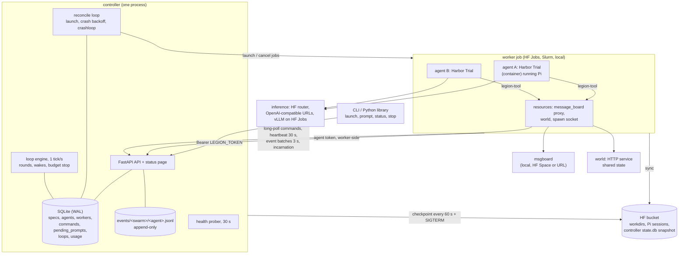

# Legion: what ai-collab can learn

Source: [huggingface/legion](https://github.com/huggingface/legion) at `e04645bc00babafe80d9bfe1be0265889690530d` (2026-11-25, shallow clone). Read only: no script, installer or test from it ran. Links below point to exact lines at that commit.

## Summary

Legion hosts swarms of agents for Harbor benchmark tasks. A controller (FastAPI, one SQLite file, a reconcile loop) places agents on workers. Workers are HF Jobs, Slurm jobs or local processes. Each agent is one long-lived Harbor Trial in its own container, running the Pi harness one turn per prompt. The controller holds pending prompts, derives agent state from 30 s heartbeats, relaunches crashed workers with backoff, and prices tokens into a budget stop. Agents talk through a separate message board (msgboard) and shared "worlds" (HTTP services). Workers sync each agent's workdir and session to an HF bucket, so an agent resumes on any worker. Pi is the only harness. The repo declares no licence ([GitHub API](https://api.github.com/repos/huggingface/legion) returns `license: null`; no `LICENSE` file; [`pyproject.toml`](https://github.com/huggingface/legion/blob/e04645bc00babafe80d9bfe1be0265889690530d/pyproject.toml#L1-L5) has no `license` field), so its code cannot be copied: take ideas only, clean-room.

## Architecture

Based on [docs/design.md L19-L34](https://github.com/huggingface/legion/blob/e04645bc00babafe80d9bfe1be0265889690530d/docs/design.md#L19-L34) and the source files cited below.

## Comparison

| Axis | Legion | ai-collab |
|---|---|---|
| Purpose | Run N agents on benchmark tasks, unattended, with a cost budget | Coordinate a few coding-agent sessions on one machine for one operator, steered from a phone |
| Harnesses | Pi only, behind a `HarnessAdapter` protocol ([base.py L62-L89](https://github.com/huggingface/legion/blob/e04645bc00babafe80d9bfe1be0265889690530d/src/legion/worker/adapters/base.py#L62-L89)) | Claude Code, Codex, Cursor, OpenCode |
| Control plane | One controller: FastAPI, one SQLite connection behind a lock ([store.py L1-L6](https://github.com/huggingface/legion/blob/e04645bc00babafe80d9bfe1be0265889690530d/src/legion/controller/store.py#L1-L6)), a level-triggered reconcile loop ([reconcile.py L216-L257](https://github.com/huggingface/legion/blob/e04645bc00babafe80d9bfe1be0265889690530d/src/legion/controller/reconcile.py#L216-L257)) | Runner service with `lib/durable.mjs` workflows, moving to DBOS on Postgres (switchover plan D1-A) |
| State and persistence | SQLite tables for specs, agents, workers, commands, pending prompts, loops ([store.py L88-L140](https://github.com/huggingface/legion/blob/e04645bc00babafe80d9bfe1be0265889690530d/src/legion/controller/store.py#L88-L140)); per-agent JSONL event files with line-offset cursors; snapshot plus event tails pushed to a bucket every 60 s and on SIGTERM ([state.py L1-L18](https://github.com/huggingface/legion/blob/e04645bc00babafe80d9bfe1be0265889690530d/src/legion/controller/state.py#L1-L18)) | JSON state files with locks, `runner.db` and `bus.db` on SQLite; bus to a Postgres log (D3) |
| Spawning | Controller launches worker jobs per type; agents fill workers in order and never move ([design.md L43-L47](https://github.com/huggingface/legion/blob/e04645bc00babafe80d9bfe1be0265889690530d/docs/design.md#L43-L47)); leaders spawn children through `spawn.*` tools with caps, depth and cycle checks ([spawn.md L45-L69](https://github.com/huggingface/legion/blob/e04645bc00babafe80d9bfe1be0265889690530d/docs/spawn.md#L45-L69)) | Runner and UI start sessions; builders start in OpenShell; DOT patterns start roles on handoff |
| Isolation | One container per agent (docker, podman, hf-sandbox, e2b) ([design.md L58-L63](https://github.com/huggingface/legion/blob/e04645bc00babafe80d9bfe1be0265889690530d/docs/design.md#L58-L63)); secrets stay on the worker, reached through per-agent Unix sockets ([spawn.md L271-L275](https://github.com/huggingface/legion/blob/e04645bc00babafe80d9bfe1be0265889690530d/docs/spawn.md#L271-L275)). The inference key does enter the container ([README L67-L71](https://github.com/huggingface/legion/blob/e04645bc00babafe80d9bfe1be0265889690530d/README.md#L67-L71)) | OpenShell sandbox per builder, network policy per harness; harness OAuth credentials and the ntfy token are uploaded into the sandbox (`docs/builders.md` "Credentials and network") |
| Coordination | Controller prompts; loops re-prompt on `turn_end` or a cadence with `while` limits and a final round ([loop.md L12-L34](https://github.com/huggingface/legion/blob/e04645bc00babafe80d9bfe1be0265889690530d/docs/loop.md#L12-L34)); agents coordinate on the board | DOT teams and patterns with required handoffs, caps, `max_visits`; operator approvals from the phone |
| Messaging | msgboard (external), posts with a fixed `Idempotency-Key` per retry ([board.py L1-L6](https://github.com/huggingface/legion/blob/e04645bc00babafe80d9bfe1be0265889690530d/src/legion/comms/board.py#L1-L6)); per-agent posting rules in a worker proxy ([comms.md L109-L128](https://github.com/huggingface/legion/blob/e04645bc00babafe80d9bfe1be0265889690530d/docs/comms.md#L109-L128)); mentions become debounced, capped wakes ([loop.md L204-L226](https://github.com/huggingface/legion/blob/e04645bc00babafe80d9bfe1be0265889690530d/docs/loop.md#L204-L226)) | Own bus (`lib/bus.ts`), direct messages with `expect_reply` redelivery every 10 min, 5 attempts |
| Failure and recovery | Table in [design.md L299-L312](https://github.com/huggingface/legion/blob/e04645bc00babafe80d9bfe1be0265889690530d/docs/design.md#L299-L312): drain before deadline, crash backoff, `crashlooping` pause, `launch_refused` stop, `turn_interrupted` plus `resume_prompt`, fresh session on resume failure, incarnation 409 for replaced jobs | Durable workflows recover at start; runner boot sweep; limit fallback chain; suspended pattern runs |
| Operator surface | `legion status` with one verdict line `OK`/`DEGRADED`/`FAILING` and exit codes ([health.md L132-L145](https://github.com/huggingface/legion/blob/e04645bc00babafe80d9bfe1be0265889690530d/docs/health.md#L132-L145)); HTML status page | Phone UI, AFK mode, approvals and questions |
| Testing | pytest, no network; "one tiny real run over many isolated tests"; no `MagicMock` of own objects ([AGENTS.md L30-L53](https://github.com/huggingface/legion/blob/e04645bc00babafe80d9bfe1be0265889690530d/AGENTS.md#L30-L53)); real controller and worker processes with only Harbor faked ([tinyrun.py L1-L7](https://github.com/huggingface/legion/blob/e04645bc00babafe80d9bfe1be0265889690530d/tests/tinyrun.py#L1-L7)); CI runs ruff and `pytest -n auto` ([ci.yml](https://github.com/huggingface/legion/blob/e04645bc00babafe80d9bfe1be0265889690530d/.github/workflows/ci.yml#L22-L43)) | `node --test`, golden tables for refactors, fast-check model tests (D4) |
| Licence | None declared | Apache-2.0 |

## Adopt

1. **Incarnation token per launch.** Every worker launch gets an incarnation; polls, heartbeats and commands from a replaced job get 409, and a long-poll parked when the job was replaced returns 409 too. [api.py L1408-L1411](https://github.com/huggingface/legion/blob/e04645bc00babafe80d9bfe1be0265889690530d/src/legion/controller/api.py#L1408-L1411), [L1603-L1631](https://github.com/huggingface/legion/blob/e04645bc00babafe80d9bfe1be0265889690530d/src/legion/controller/api.py#L1603-L1631). ai-collab fit: a generation id on each runner-owned session, waiter and sandbox, checked before delivery and before the boot sweep deletes anything.
2. **Ack after the response is sent.** Commands and pending prompts are deleted in a background task that runs only after the response went out: at-least-once by construction. [api.py L1638-L1642](https://github.com/huggingface/legion/blob/e04645bc00babafe80d9bfe1be0265889690530d/src/legion/controller/api.py#L1638-L1642).
3. **Retry only what never reached the server.** The worker client retries a POST only on no connection, 429 or 503; after a read error, timeout or other 5xx it does not resend, "so a prompt is never delivered twice". GETs retry freely. [worker/main.py L243-L247](https://github.com/huggingface/legion/blob/e04645bc00babafe80d9bfe1be0265889690530d/src/legion/worker/main.py#L243-L247), [L307-L318](https://github.com/huggingface/legion/blob/e04645bc00babafe80d9bfe1be0265889690530d/src/legion/worker/main.py#L307-L318). Matches the runner's existing "mayHaveStarted never retried" rule (task board row 62); worth one shared helper.
4. **Stable idempotency keys on writes.** Board posts keep one `Idempotency-Key` across retries; the kickoff uses `legion-kickoff-<swarm>-<channel id>` so even a lost record never posts twice. [board.py L1-L6](https://github.com/huggingface/legion/blob/e04645bc00babafe80d9bfe1be0265889690530d/src/legion/comms/board.py#L1-L6), [controller/comms.py L77-L79](https://github.com/huggingface/legion/blob/e04645bc00babafe80d9bfe1be0265889690530d/src/legion/controller/comms.py#L77-L79). Spawn takes a caller `key` and answers `created: false` on repeat ([spawn.md L185](https://github.com/huggingface/legion/blob/e04645bc00babafe80d9bfe1be0265889690530d/docs/spawn.md#L185)).
5. **Wake coalescing with caps.** A mention queues a prompt after 2 s quiet (at most 10 s after the first), no sooner than `min_gap` (30 s) after the last wake, at most `max` (10) per run; a wake for a busy agent waits and becomes one prompt; wakes are not rounds. The doc names the bug it fixed: five agents in a thread woke each other into round exhaustion. [loop.md L204-L226](https://github.com/huggingface/legion/blob/e04645bc00babafe80d9bfe1be0265889690530d/docs/loop.md#L204-L226), [loop.py L244](https://github.com/huggingface/legion/blob/e04645bc00babafe80d9bfe1be0265889690530d/src/legion/controller/loop.py#L244). Same class as ai-collab's busy-target redelivery bug (`fix/expect-reply-redelivery`).
6. **`skip_pending` on every automatic prompt.** Loop prompts go through one bulk path with `state: idle, skip_pending: true`, so automatic prompts never stack. [loop.md L72-L77](https://github.com/huggingface/legion/blob/e04645bc00babafe80d9bfe1be0265889690530d/docs/loop.md#L72-L77), [design.md L270-L273](https://github.com/huggingface/legion/blob/e04645bc00babafe80d9bfe1be0265889690530d/docs/design.md#L270-L273).
7. **Interrupted turns are events.** After a crash or preemption the controller writes `turn_interrupted` into each cut agent's stream and sets `resume_pending`, so the type's `resume_prompt` goes out after restore. [reconcile.py L773-L787](https://github.com/huggingface/legion/blob/e04645bc00babafe80d9bfe1be0265889690530d/src/legion/controller/reconcile.py#L773-L787), [design.md L117-L121](https://github.com/huggingface/legion/blob/e04645bc00babafe80d9bfe1be0265889690530d/docs/design.md#L117-L121).
8. **Crashloop and launch-refused as type states.** Consecutive crashes double the backoff up to 15 min; at the threshold the type is `crashlooping` and launching pauses until the next apply. A 4xx from the backend is `launch_refused`, never retried. A heartbeat 10 min after launch resets the streak. [reconcile.py L54-L64](https://github.com/huggingface/legion/blob/e04645bc00babafe80d9bfe1be0265889690530d/src/legion/controller/reconcile.py#L54-L64), [L756-L770](https://github.com/huggingface/legion/blob/e04645bc00babafe80d9bfe1be0265889690530d/src/legion/controller/reconcile.py#L756-L770).
9. **Secrets stay outside the container; the socket picks the identity.** Each Trial mounts its own Unix socket; the worker adds that agent's token; the route allow-list and the controller's scope checks decide. "No token enters the container." [spawn.md L198-L227](https://github.com/huggingface/legion/blob/e04645bc00babafe80d9bfe1be0265889690530d/docs/spawn.md#L198-L227), [L271-L275](https://github.com/huggingface/legion/blob/e04645bc00babafe80d9bfe1be0265889690530d/docs/spawn.md#L271-L275). World secrets follow the same rule ([world.md L7-L11](https://github.com/huggingface/legion/blob/e04645bc00babafe80d9bfe1be0265889690530d/docs/world.md#L7-L11)).
10. **Scoped per-agent tokens derived by HMAC.** Token = HMAC(name, nonce) under a key derived from the controller token; the store keeps only a hash; scope is self, subtree and parent. [spawn.md L198-L212](https://github.com/huggingface/legion/blob/e04645bc00babafe80d9bfe1be0265889690530d/docs/spawn.md#L198-L212), [design.md L143-L146](https://github.com/huggingface/legion/blob/e04645bc00babafe80d9bfe1be0265889690530d/docs/design.md#L143-L146).
11. **Never sync regenerable trees.** `node_modules/`, `.venv/`, caches are neither uploaded nor restored; `workdir.base: true` restores one tar plus changed files. [sync.py L46-L49](https://github.com/huggingface/legion/blob/e04645bc00babafe80d9bfe1be0265889690530d/src/legion/worker/sync.py#L46-L49), [design.md L101-L108](https://github.com/huggingface/legion/blob/e04645bc00babafe80d9bfe1be0265889690530d/docs/design.md#L101-L108).
12. **One verdict line with an exit code.** `FAILING` (exit 1), `DEGRADED`, `OK`, with fixed rules for each, and "no snapshot in the last 2 min" counts as degraded. [health.md L132-L145](https://github.com/huggingface/legion/blob/e04645bc00babafe80d9bfe1be0265889690530d/docs/health.md#L132-L145).
13. **Hold versus stop.** A hold queues prompts without ending loops or resetting counters; `--interrupt` also cuts the turn; controller-made holds (`auto: true`) never replace operator holds. [loop.md L164-L202](https://github.com/huggingface/legion/blob/e04645bc00babafe80d9bfe1be0265889690530d/docs/loop.md#L164-L202).
14. **Budget stop in two phases.** At budget minus final reserves: drop pending prompts, stop loops, run final rounds. At the budget: stop every agent and refuse prompts with 409. Overshoot is bounded by one heartbeat of spend. [loop.md L128-L144](https://github.com/huggingface/legion/blob/e04645bc00babafe80d9bfe1be0265889690530d/docs/loop.md#L128-L144).
15. **Testing rules.** Real objects, no `MagicMock`, test through the public surface, one tiny real run with real processes and only external systems faked. [AGENTS.md L30-L53](https://github.com/huggingface/legion/blob/e04645bc00babafe80d9bfe1be0265889690530d/AGENTS.md#L30-L53), [tinyrun.py L1-L7](https://github.com/huggingface/legion/blob/e04645bc00babafe80d9bfe1be0265889690530d/tests/tinyrun.py#L1-L7).
16. **One registry for extension points.** A harness, compute backend or server starter is one module plus one registry entry, and one test checks every entry. [design.md L72-L88](https://github.com/huggingface/legion/blob/e04645bc00babafe80d9bfe1be0265889690530d/docs/design.md#L72-L88), [registry.py L20-L38](https://github.com/huggingface/legion/blob/e04645bc00babafe80d9bfe1be0265889690530d/src/legion/registry.py#L20-L38). Same shape as the switchover `harness` module's descriptor.

## Avoid

1. **Optional fencing.** "Workers that send no incarnation are trusted" ([api.py L1408-L1411](https://github.com/huggingface/legion/blob/e04645bc00babafe80d9bfe1be0265889690530d/src/legion/controller/api.py#L1408-L1411)). A fence that a caller can omit protects only well-behaved callers. Make the generation id required.
2. **Rules that silently vanish on one transport.** Posting rules live in the worker proxy; with `transport: http` (hf-sandbox) there is no proxy, so rules are not enforced and only a warning event is written ([comms.md L123-L128](https://github.com/huggingface/legion/blob/e04645bc00babafe80d9bfe1be0265889690530d/docs/comms.md#L123-L128)). Enforce on the server, or refuse the configuration.
3. **Credentials inside the agent's container.** Legion still puts the inference key into every Trial and mitigates with a second, narrow token ([README L67-L71](https://github.com/huggingface/legion/blob/e04645bc00babafe80d9bfe1be0265889690530d/README.md#L67-L71)). `hf_repo` also hands its token to every agent ([hf-repo.md L26-L31](https://github.com/huggingface/legion/blob/e04645bc00babafe80d9bfe1be0265889690530d/docs/hf-repo.md#L26-L31)).
4. **Merge without approval.** `hf_repo` reviews are advisory: "merge does not require approval", all agents share one account ([hf-repo.md L71-L74](https://github.com/huggingface/legion/blob/e04645bc00babafe80d9bfe1be0265889690530d/docs/hf-repo.md#L71-L74)). Conflicts with the operator's landing rule (switchover plan section 9).
5. **Volatile wake state.** A controller restart resumes loops but loses queued wake-ups ([loop.md L161-L162](https://github.com/huggingface/legion/blob/e04645bc00babafe80d9bfe1be0265889690530d/docs/loop.md#L161-L162)); health samples live in memory for 6 h ([health.md L64-L68](https://github.com/huggingface/legion/blob/e04645bc00babafe80d9bfe1be0265889690530d/docs/health.md#L64-L68)).
6. **A 2,207-line shared contract file.** `models.py` is the one contract that controller, worker and CLI import, and AGENTS.md tells agents not to change it casually ([AGENTS.md L3-L5](https://github.com/huggingface/legion/blob/e04645bc00babafe80d9bfe1be0265889690530d/AGENTS.md#L3-L5)). Line count from `wc -l`. Split contracts by module, as the switchover segmentation does.
7. **Copying code.** No licence: treat as all rights reserved. Clean-room only, as for HAPI.

## Already have

1. **Durable redelivery of unacknowledged messages.** Legion holds prompts for a down worker in SQLite and delivers on the replacement's first poll ([design.md L275-L277](https://github.com/huggingface/legion/blob/e04645bc00babafe80d9bfe1be0265889690530d/docs/design.md#L275-L277)). ai-collab: `expect_reply` redelivery in the runner's delivery workflow (`docs/messaging.md` "Redelivery with `expect_reply`").
2. **Replayable event log with cursors.** Legion: append-only JSONL per agent, line-offset `after=` cursors, long-poll `wait=` ([store.py L1-L6](https://github.com/huggingface/legion/blob/e04645bc00babafe80d9bfe1be0265889690530d/src/legion/controller/store.py#L1-L6), [design.md L257](https://github.com/huggingface/legion/blob/e04645bc00babafe80d9bfe1be0265889690530d/docs/design.md#L257)). ai-collab: bus `since` backfill and NDJSON stream; D3 keeps it a log.
3. **Caps on graph traversal.** Legion: spawn caps, `depth`, cycles refused at apply ([spawn.md L57-L64](https://github.com/huggingface/legion/blob/e04645bc00babafe80d9bfe1be0265889690530d/docs/spawn.md#L57-L64)). ai-collab: DOT `cap` and `max_visits` suspend the run for the operator.
4. **Per-harness adapter seam.** Legion: `HarnessAdapter` ([base.py L62-L89](https://github.com/huggingface/legion/blob/e04645bc00babafe80d9bfe1be0265889690530d/src/legion/worker/adapters/base.py#L62-L89)). ai-collab: four runner adapters, one `argv(harness, kind, opts)`.
5. **Fresh session when resume fails.** Legion: `session_restarted`, `resumed: false` ([design.md L92-L99](https://github.com/huggingface/legion/blob/e04645bc00babafe80d9bfe1be0265889690530d/docs/design.md#L92-L99)). ai-collab: runner session recovery and "Wake closed sessions on a message" (task board row 119).
6. **Agent-started agents.** Legion: `spawn.*` ([spawn.md](https://github.com/huggingface/legion/blob/e04645bc00babafe80d9bfe1be0265889690530d/docs/spawn.md#L1-L7)). ai-collab: "Agents starting agents" (`docs/messaging.md`), builders started by the PM.

## Suggestions mapped to the switchover plan

| Suggestion | From legion | Where it fits |
|---|---|---|
| Add a required generation id to runner-owned sessions and sandboxes; the boot sweep and delivery check it before acting | Adopt 1, Avoid 1 | Section 1 finding 1 (boot sweep deletes live sandboxes); section 8 "Labels" (`ai-collab.version` label could carry it) |
| Apply "retry only what never reached the server" in one helper for runner wake, bus publish and delivery | Adopt 3 | Section 2.5 "Deadline wait loops" and "Push delivery" rows; batch 3 `delivery` module |
| Give every bus publish and every delivery step a stable idempotency key derived from the message id, not a fresh one per attempt | Adopt 4 | Section 6 (D3): `events` table gets a unique `idempotency_key`; batch 4 DBOS `send(..., idempotencyKey)` |
| Coalesce wakes: debounce, `min_gap`, per-run cap; a wake for a busy target waits and folds into one delivery | Adopt 5, 6 | Section 5 `fix/expect-reply-redelivery` ("one extra copy is still possible"); section 7 delivery model test can add the invariant "at most one queued wake per target" |
| Write `turn_interrupted` into the session timeline when the runner restarts mid-turn, and send a role's resume prompt after recovery | Adopt 7 | Batch 4 kill-and-recover test; docs/teams.md "If a restart interrupts a start or handoff, the run fails" could resume instead when the role declares a resume prompt |
| Mark a harness `crashlooping` after N failed starts and stop retrying until the operator acts; treat 4xx-like refusals as terminal | Adopt 8 | Batch 3 `limits` and `sessions` modules; phone alert reuses the limit card |
| Stop uploading harness credentials into OpenShell; serve tool and bus calls through a per-sandbox socket or proxy on the host that adds the token | Adopt 9, 10; Avoid 3 | Section 9 "OpenShell architecture is the differentiator"; task board "Hosted multi-user" (row 16). Needs a check whether OpenShell can mount a host socket (not verified) |
| Exclude `node_modules/` and caches from sandbox upload and restore them from a base image or tar plus delta | Adopt 11 | Section 8 backlog: 3.2 GB re-upload per sandbox |
| `ai-collab status` verdict line `OK`/`DEGRADED`/`FAILING` with exit code, computed by one function the UI also uses | Adopt 12 | Batch 3 `surfaces` module (one operation table for CLI, MCP, UI) |
| Distinguish operator holds from automatic holds in AFK mode and pattern suspension | Adopt 13 | docs/afk.md; DOT suspension for `cap`/`max_visits` |
| Adopt the "real objects, tiny real run" rule in the test guide next to the fast-check models | Adopt 15 | Section 7 (D4); section 8 "Harness version contract tests" |
| Keep the landing rule: never let agents merge without a gate | Avoid 4 | Section 9 landing policy per team |

## What challenges the switchover plan

- **D1-A (DBOS for workflows).** Legion recovers from controller restarts, worker crashes and preemption without a workflow engine. It uses a level-triggered reconcile loop that re-derives state from SQLite rows and heartbeats every pass, plus at-least-once commands with idempotent receivers ([reconcile.py L216-L257](https://github.com/huggingface/legion/blob/e04645bc00babafe80d9bfe1be0265889690530d/src/legion/controller/reconcile.py#L216-L257), [design.md L299-L312](https://github.com/huggingface/legion/blob/e04645bc00babafe80d9bfe1be0265889690530d/docs/design.md#L299-L312)). The repo states no tested scale. One comment records a bottleneck: parsing the spec on every heartbeat saturated the controller at about 1,000 agents, fixed with an `lru_cache` ([store.py L23-L25](https://github.com/huggingface/legion/blob/e04645bc00babafe80d9bfe1be0265889690530d/src/legion/controller/store.py#L23-L25)). This suggests that delivery and session supervision may fit a reconcile loop better than step replay. DBOS still fits pattern runs, which are multi-step and ordered. The batch 4a review findings (appVersion orphaning, internal `dbos.notifications` reads) are the costs a reconcile loop avoids. I have not measured this; it is a design argument, not evidence.
- **D3 (bus to Postgres).** Legion keeps its event log as append-only files indexed in SQLite and makes it durable by snapshotting to object storage ([state.py L1-L18](https://github.com/huggingface/legion/blob/e04645bc00babafe80d9bfe1be0265889690530d/src/legion/controller/state.py#L1-L18)). The loss window is the 60 s sync interval. For a single-machine product, that shows a log does not need Postgres. D3's reason is "one Postgres". Legion's design neither supports nor refutes that reason.
- **Section 9 and builders' credential copy.** Legion's rule that secrets stay outside the container (Adopt 9) contradicts how builders work today, not a plan decision. It matters when the OpenShell work resumes.
- **D4 (state-based verification).** No conflict. Legion has no property-based or model tests: `grep hypothesis tests/` finds only a sync-exclude fixture. It relies on tiny real runs. The two approaches complement each other.
