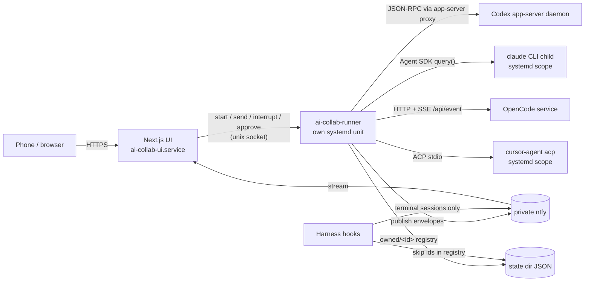

# Owned sessions: research

> Historical: written before the switch from ntfy to the local Postgres-backed bus; see [Owned sessions: shared contract](../owned-sessions-contract.md) and [ntfy removal](../ntfy-removal.md).

Researched 2026-11-21. Read-only: no agent turn was run and no code changed. Sources: T3 Code at commit [`5935157`](https://github.com/pingdotgg/t3code/tree/5935157711bc7f8640946a9008e91b5590553bff) (cloned to `/tmp/research-t3`), Codex at tag [`rust-v0.171.0`](https://github.com/openai/codex/tree/rust-v0.171.0) (sparse clone in `/tmp/research-codex`), the Codex protocol generated locally with `codex app-server generate-ts` (`/tmp/research-codex-schema`), `--help` output, and npm metadata. Below, `T3:` links are relative to the T3 commit and `codex:` links to the Codex tag.

Installed here: `codex-cli 0.171.0`, Claude Code `2.1.330`, `cursor-agent 2026.11.19-f005e9d`, `opencode v2.2.5` (the registered OpenCode service runs 2.2.6).

## Summary

Each of the four harnesses has a long-lived, bidirectional control interface on this machine: Codex `app-server` (JSON-RPC over stdio, or the managed daemon's socket), the Claude Agent SDK (already a dependency of AI Collab), the OpenCode 2 HTTP server with an SSE event stream, and `cursor-agent acp` (Agent Client Protocol over stdio; its `initialize` reply advertises `loadSession`). T3 Code drives the same four, through the app-server, the Agent SDK, the OpenCode 2 client, and `@cursor/sdk` instead of ACP. T3 is MIT-licensed, so copying is allowed with its notice, but its adapters are Effect 4 TypeScript bound to a 650 KB event-sourced orchestrator (Codex adapter 9,289 lines, Claude adapter 15,146). Port small pieces and the protocol knowledge, not modules. The biggest risk is process lifetime: the `ai-collab-ui` unit has `KillMode=control-group`, so restarting the UI kills every child it started, detached or not. Codex's daemon and OpenCode's service already run outside that cgroup. Claude and Cursor need a separate runner or a `systemd-run --user --scope` per session, plus native resume. One open fact: Codex 0.171 source sends nested code-mode tool calls through normal dispatch, which runs `PreToolUse` and emits `commandExecution` items. That contradicts the observation that motivated this work, so one live check is needed before committing to the design.

## Codex code mode: what the 0.171 source says

The observation was that Codex 0.171 fires no `PreToolUse`/`PostToolUse` for shell commands that run inside its `exec` code-mode tool. The source disagrees in part:

- `exec` itself defines no `pre_tool_use_payload` ([codex: core/src/tools/code_mode/execute_handler.rs](https://github.com/openai/codex/blob/rust-v0.171.0/codex-rs/core/src/tools/code_mode/execute_handler.rs)), so the outer `exec` call fires no hook.
- Each nested tool call goes through `submit_nested_tool` → `ToolCallRuntime::handle_tool_call_with_source(..., ToolCallSource::CodeMode {..})` ([codex: core/src/tools/code_mode/mod.rs#L352-L435](https://github.com/openai/codex/blob/rust-v0.171.0/codex-rs/core/src/tools/code_mode/mod.rs#L352-L435)). The `wait` handler's comment states that "Tool calls made from code mode still flow through normal dispatch" ([wait_handler.rs#L238-L244](https://github.com/openai/codex/blob/rust-v0.171.0/codex-rs/core/src/tools/code_mode/wait_handler.rs#L238-L244)).
- Normal dispatch runs `apply_pre_tool_use` ([registry.rs#L896](https://github.com/openai/codex/blob/rust-v0.171.0/codex-rs/core/src/tools/registry.rs#L896)), and `exec_command` reports itself to hooks as `Bash` ([handlers/unified_exec/exec_command.rs#L331-L342](https://github.com/openai/codex/blob/rust-v0.171.0/codex-rs/core/src/tools/handlers/unified_exec/exec_command.rs#L331-L342)).
- `emit_exec_command_begin` ([tools/events.rs#L116](https://github.com/openai/codex/blob/rust-v0.171.0/codex-rs/core/src/tools/events.rs#L116)) has no code-mode branch. The app-server turns `ExecCommandBegin` into `item/started` with a `commandExecution` item ([app-server/src/bespoke_event_handling.rs#L1043](https://github.com/openai/codex/blob/rust-v0.171.0/codex-rs/app-server/src/bespoke_event_handling.rs#L1043)). `CommandExecutionSource` is `"agent" | "userShell" | "unifiedExecStartup" | "unifiedExecInteraction"` and has no code-mode value.
- `codex features list` here shows `code_mode` as `under development false` and `code_mode_host` as `stable true`. Which surface the current model gets is decided by its model metadata, which this research did not read.

**Unverified.** These points come from reading source. One cheap Codex turn (`ls` in a scratch folder, with a hook logging stdin and an app-server client logging `item/started`) would settle the question. Other possible causes of the missing hooks: the model reaching shell through a tool that `ToolCallSource::CodeMode` handles differently, the plugin hooks not being trusted (`lib/start.mjs` already warns about that), or a matcher mismatch. Even if the hooks do fire, an owned session is still worth having for follow-ups, interrupts, and approvals.

## Per-harness interfaces

### Codex (0.171.0)

| | `codex app-server` (recommended) | `codex exec --json` + `codex exec resume` |
|---|---|---|
| Interface | JSON-RPC 2.0 over stdio. Spawn `codex app-server`, or connect to the managed daemon with `codex app-server proxy` (socket `~/.codex/app-server-control/app-server-control.sock`; `codex app-server daemon version` reports it running). Types come from `codex app-server generate-ts` / `generate-json-schema`. Docs: [developers.openai.com/codex/app-server](https://developers.openai.com/codex/app-server). | One process per turn, JSONL on stdout ([codex: exec/src/exec_events.rs](https://github.com/openai/codex/blob/rust-v0.171.0/codex-rs/exec/src/exec_events.rs)). `@openai/codex-sdk` (Apache-2.0) wraps `exec --experimental-json`. |
| Events | `turn/started`, `turn/completed`, `item/started`, `item/completed` (`commandExecution` with command, cwd, exit code, aggregated output; `fileChange`; `mcpToolCall`; `agentMessage`; `reasoning`; `collabAgentToolCall`; …), `item/agentMessage/delta`, `item/commandExecution/outputDelta`, `turn/plan/updated`, `turn/diff/updated`, `thread/tokenUsage/updated`, `thread/status/changed`, `account/rateLimits/updated` | `thread.started`, `turn.*`, `item.started/updated/completed` (`command_execution`, `file_change`, `mcp_tool_call`, `todo_list`, …) |
| Follow-ups | `turn/start` on the same thread. `turn/steer` adds input to a running turn. | `codex exec resume <id> "<prompt>"`, one new process each time |
| Interrupt | `turn/interrupt {threadId, turnId}` | Kill the process |
| Approvals | Server→client requests: `item/commandExecution/requestApproval`, `item/fileChange/requestApproval`, `item/permissions/requestApproval`, `item/tool/requestUserInput`, `mcpServer/elicitation/request`. Policy is set per turn with `approvalPolicy` and `sandboxPolicy`. | None: exec runs non-interactively |
| Resume | `thread/resume` rejoins a running thread ("If thread_id identifies a running thread, app-server rejoins that thread", already cited in `docs/phone-ui.md`). `thread/read`, `thread/turns/list`, and `thread/items/list` return history. | `exec resume` |
| Metadata | `model/list`, `skills/list`, `account/rateLimits/read`, `thread/tokenUsage/updated`, `thread/compact/start` | `turn.completed` usage |
| Effort | Medium: JSON-RPC client, ~10 notifications, 5 server requests | Low, with no approvals or interrupts |

T3 references: the client package [T3: packages/effect-codex-app-server](https://github.com/pingdotgg/t3code/tree/5935157711bc7f8640946a9008e91b5590553bff/packages/effect-codex-app-server) (client, protocol, and stdio: ~1,500 hand-written lines plus a 56,588-line generated schema), the launch args `app-server -c thread_unload_delay_secs=0` ([codexLaunchArgs.ts#L16-L21](https://github.com/pingdotgg/t3code/blob/5935157711bc7f8640946a9008e91b5590553bff/apps/server/src/provider/codexLaunchArgs.ts#L16-L21)), the mapping from permission mode to `approvalPolicy`/`sandboxPolicy` ([CodexAdapterV2.ts#L751-L800](https://github.com/pingdotgg/t3code/blob/5935157711bc7f8640946a9008e91b5590553bff/apps/server/src/orchestration-v2/Adapters/CodexAdapterV2.ts#L751-L800)), and the handlers for `item/started` (L5475), `item/completed` (L5630), command approval (L5981), file approval (L6052), user input (L6406), `turn/start` (L7711), `thread/start` (L8086), and `turn/steer` (L8317). T3 spawns its own app-server per provider instance and does not use the daemon.

### Claude Code (2.1.330)

| | Agent SDK `query()` (recommended) | `claude -p --input-format stream-json --output-format stream-json` |
|---|---|---|
| Interface | `@anthropic-ai/claude-agent-sdk` 0.3.330, already in `package.json` and used by `lib/sessions/control.ts` for `/compact`. It spawns the CLI and speaks its control protocol. | The same CLI and wire protocol, driven by hand |
| Events | `SDKMessage`: `system/init`, `assistant` (tool_use blocks), `user` (tool_result), `stream_event` with `includePartialMessages`, `result` (usage, cost), `system/compact_boundary`, task and subagent messages | Same JSON lines; `--include-partial-messages`, `--replay-user-messages` |
| Follow-ups | Pass an `AsyncIterable<SDKUserMessage>` as the prompt, or `streamInput()` (sdk.d.ts L3582) | Write user JSON lines to stdin |
| Interrupt | `query.interrupt()` (L3191); `stopTask()` for a background task | `control_request` `interrupt` on stdin (undocumented by hand) |
| Approvals | `canUseTool(toolName, input, {signal, suggestions})` → `{behavior:"allow", updatedInput}` or `{behavior:"deny", message}`. Also carries `AskUserQuestion`. `setPermissionMode()` (L3198). | `--permission-prompt-tool <mcp tool>`, or `--permission-prompts host` with SDK-style control messages |
| Resume | `options.resume: sessionId`, `resumeSessionAt`, `forkSession`; transcripts persist by default | `--resume <id>` |
| Metadata | `initializationResult()` (commands, models, agents), `supportedCommands()`, `getContextUsage()`, `setModel()` | `system/init` lists slash commands and tools |
| Effort | Low to medium | Medium: reimplements the SDK |
| Licence | "© Anthropic PBC. All rights reserved", subject to Anthropic's Commercial Terms (package `LICENSE.md`). Already accepted as a dependency. | n/a (the CLI) |

The SDK loads every filesystem settings source when `settingSources` is omitted (sdk.d.ts L2455-L2465), so plugins, and with them the AI Collab hooks, run inside an SDK session. `--bg` sessions (`claude attach/logs/stop`) belong to Claude's own supervisor and offer no programmatic message or approval channel. T3 references: [ClaudeAdapterV2.ts](https://github.com/pingdotgg/t3code/blob/5935157711bc7f8640946a9008e91b5590553bff/apps/server/src/orchestration-v2/Adapters/ClaudeAdapterV2.ts) builds query options (L1130-L1310, L2429), installs `canUseTool` in every mode (L1470, L12548-L12815), calls interrupt (L2007), and resumes with `resumeSessionAt` (L1544-L1580). Its slash-command probe sends a never-yielding prompt and reads `initializationResult()`, so it costs no tokens ([ClaudeProvider.ts#L520-L601](https://github.com/pingdotgg/t3code/blob/5935157711bc7f8640946a9008e91b5590553bff/apps/server/src/provider/ClaudeProvider.ts#L520-L601)).

### OpenCode (2.2.5 CLI, 2.2.6 service)

| | OpenCode 2 HTTP server (recommended) |
|---|---|
| Interface | `opencode serve [--port --hostname] [--service] [--stdio]`. A registered service already runs: `~/.local/state/opencode/service.json` holds `url`, `pid`, and `password`. Clients: `@opencode/client` / `@opencode/protocol` 2.3.2 (MIT). |
| Events | `GET /api/event` (SSE): `session.execution.started/succeeded/failed/interrupted`, `session.text.delta/ended`, `session.reasoning.*`, `session.tool.input.started/called/progress/success/failed`, `session.step.*`, `permission.asked/replied`, `session.inbox.enqueued/delivered`, `session.compaction.*`, `message.updated` |
| Follow-ups | `POST /api/session/:id/prompt`, or `/inbox` to queue during a run |
| Interrupt | `POST /api/session/:id/interrupt` |
| Approvals | `permission.asked` event → `POST /api/session/:id/permission/:requestID/reply` (`once`, `always`, `reject`). Questions use `/form/:formID/reply`. |
| Resume | Sessions live in the server. `GET /api/session/:id`, `message.list`, `/api/session/active` |
| Metadata | `command.list`, `model.list`, `agent.list`, session stats and token usage, `/api/session/:id/context` |
| Effort | Low to medium |

T3 references: [OpenCode2Server.ts](https://github.com/pingdotgg/t3code/blob/5935157711bc7f8640946a9008e91b5590553bff/packages/provider-opencode/src/server/v2/OpenCode2Server.ts) (password handling, readiness via `server.info`), [OpenCode2Service.ts#L55-L100](https://github.com/pingdotgg/t3code/blob/5935157711bc7f8640946a9008e91b5590553bff/packages/provider-opencode/src/server/v2/OpenCode2Service.ts#L55-L100) (finds the registered service and keeps it alive across T3 restarts), and the 5,574-line [v2 adapter](https://github.com/pingdotgg/t3code/blob/5935157711bc7f8640946a9008e91b5590553bff/packages/provider-opencode/src/server/v2/adapter.ts). [docs/internals/providers.md](https://github.com/pingdotgg/t3code/blob/5935157711bc7f8640946a9008e91b5590553bff/docs/internals/providers.md#process-and-account-isolation) warns that an "always" grant covers the whole project, so automatic replies should use `once`.

### Cursor (2026.11.19)

| | `cursor-agent acp` (recommended to try) | `cursor-agent -p --output-format stream-json` | `@cursor/sdk` 1.4.2 (T3's choice) |
|---|---|---|---|
| Interface | Hidden ACP stdio server. `initialize` (no tokens, run here) returned `loadSession: true`, `sessionCapabilities.list`, image prompts, and auth method `cursor_login` (the existing CLI login). Spec: [agentclientprotocol.com](https://agentclientprotocol.com/protocol/overview). | One process per turn | In-process SDK, local-agent runtime |
| Events | `session/update` notifications (message chunks, tool calls, plans) | JSON lines; `--stream-partial-output` for deltas | `onDelta` updates |
| Follow-ups | `session/prompt` on the same session | `--resume <chatId>` per turn; stdin takes no input format | `agent.send()`, steering |
| Interrupt | `session/cancel` | Kill the process | `run.cancel()` |
| Approvals | `session/request_permission` (agent→client) | None in print mode (`--force` or deny) | None: "The public SDK does not currently expose … interactive approval callbacks" ([T3: docs/user/cursor.md](https://github.com/pingdotgg/t3code/blob/5935157711bc7f8640946a9008e91b5590553bff/docs/user/cursor.md#v2-capability-mapping)) |
| Resume | `session/load`, `session/list` | `--resume`, `ls` | `Agent.resume()` |
| Auth / licence | CLI login | CLI login | Separate API key or browser sign-in on a paid plan; licence "SEE LICENSE IN LICENSE.md" (proprietary) |
| Effort | Medium (ACP client); live behaviour unverified | Low | Medium |

T3's generic ACP runtime is [packages/provider-acp/src/server/AcpSessionRuntime.ts](https://github.com/pingdotgg/t3code/blob/5935157711bc7f8640946a9008e91b5590553bff/packages/provider-acp/src/server/AcpSessionRuntime.ts) (3,211 lines). Its notes on agents whose `session/load` never replies (L81-L110, L1315-L1327) apply to Cursor.

## T3 Code: licence and architecture

**Licence: MIT**, in [`LICENSE`](https://github.com/pingdotgg/t3code/blob/5935157711bc7f8640946a9008e91b5590553bff/LICENSE), "Copyright (c) 2026 T3 Tools Inc.". Copying or adapting is allowed if the copyright and permission notice travel with the substantial portions. AI Collab is Apache-2.0, and MIT code may be included under it. Attribute ported files, for example a `THIRD_PARTY_NOTICES` entry plus a header line. The packages are `"private": true` and unpublished, so they cannot be consumed as dependencies. Third-party code that T3 bundles keeps its own licence (`third-party-licenses/`), for example `@pierre/diffs` (Apache-2.0), the diff viewer used by its web and mobile apps.

**Architecture** ([docs/internals/overview.md](https://github.com/pingdotgg/t3code/blob/5935157711bc7f8640946a9008e91b5590553bff/docs/internals/overview.md)):

- **Adapters** normalize each provider behind [ProviderAdapter.ts](https://github.com/pingdotgg/t3code/blob/5935157711bc7f8640946a9008e91b5590553bff/packages/provider-core/src/server/ProviderAdapter.ts) (874 lines). Codex: own `app-server` over stdio, one process serving every thread of an instance, frames routed by thread id. Claude: Agent SDK `query()` with `canUseTool`. OpenCode 2: one server per instance over HTTP and SSE. Cursor: `@cursor/sdk`. Others (Grok, Kiro, Pi, generic ACP) run over ACP or RPC.
- **Streaming to the UI**: the orchestrator decides events; `EventSink` commits events, projections, and outbox effects in one SQLite transaction; subscribers receive them over an Effect RPC WebSocket (`orchestration.subscribeThread`, `subscribeCommandOutput`; [packages/contracts/src/rpc.ts](https://github.com/pingdotgg/t3code/blob/5935157711bc7f8640946a9008e91b5590553bff/packages/contracts/src/rpc.ts)). Clients resume from a cursor. Token deltas are coalesced ([ProviderTextDeltaCoalescer.ts](https://github.com/pingdotgg/t3code/blob/5935157711bc7f8640946a9008e91b5590553bff/apps/server/src/orchestration-v2/Adapters/ProviderTextDeltaCoalescer.ts), 156 lines).
- **Follow-ups**: `orchestration.dispatchCommand`. The message starts a run, queues behind active work, or steers when the adapter supports it (Codex `turn/steer`, Cursor send).
- **Interrupts**: provider-native (`turn/interrupt`, `query.interrupt()`, OpenCode `interrupt`, Cursor `cancel`).
- **Approvals**: provider requests become persisted "runtime requests". `runtime-request.respond` validates the reply and commits it once. Codex async questions arrive as notifications and are answered with a new user message ([providers.md "Protocol traps"](https://github.com/pingdotgg/t3code/blob/5935157711bc7f8640946a9008e91b5590553bff/docs/internals/providers.md#protocol-traps)).
- **Restart**: "Restarting interrupts running agent turns" ([docs/user/background-service.md](https://github.com/pingdotgg/t3code/blob/5935157711bc7f8640946a9008e91b5590553bff/docs/user/background-service.md)). [ProviderRuntimeRecoveryService.ts](https://github.com/pingdotgg/t3code/blob/5935157711bc7f8640946a9008e91b5590553bff/apps/server/src/orchestration-v2/ProviderRuntimeRecoveryService.ts) marks the cut runs, resumes natively, and resends the cut prompt at most `MAX_RESENDS = 3` times (L62, L444-L490). Agents run in systemd scopes ([packages/shared/src/AgentScope.ts](https://github.com/pingdotgg/t3code/blob/5935157711bc7f8640946a9008e91b5590553bff/packages/shared/src/AgentScope.ts), 121 lines). Shared services such as the OpenCode service get `survivesRestart: true`.
- **State**: SQLite (`node:sqlite` via `@t3tools/shared/nodeSqliteClient`), event log plus projections, pruned to about one day of events.

**Worth porting (adapt to plain ESM JS; nothing drops in as-is)**

| Piece | Source | Size | Use |
|---|---|---|---|
| Codex permission-mode → policy table | CodexAdapterV2.ts L751-L800 | 50 lines | Owned-session permission modes |
| Codex launch args, per-thread config | codexLaunchArgs.ts; CodexAdapterV2.ts L1595-L1625 | ~60 lines | Spawn or thread config |
| Codex notification and request list | CodexAdapterV2.ts handler sites above | reference | Checklist for the client |
| Claude query option builder, `canUseTool` shape | ClaudeAdapterV2.ts L1130-L1310, L12548-L12815 | ~400 lines of logic | Claude runner |
| Zero-token slash-command and model probe | ClaudeProvider.ts L520-L601 | ~80 lines | Command picker |
| Codex slash commands, token usage | CodexProvider.ts L1162; CodexTurnTokenUsage.ts (170) | small | Picker, context meter |
| OpenCode service discovery and password | OpenCode2Server.ts (6.4 KB), OpenCode2Service.ts (4.8 KB) | ~200 lines | Reuse the running service |
| Text delta coalescer | ProviderTextDeltaCoalescer.ts | 156 lines | Fit ntfy's 4 KB cap |
| systemd scope wrapper | AgentScope.ts | 121 lines | Process lifetime |
| ACP session runtime | provider-acp AcpSessionRuntime.ts | 3,211 lines | Reference for Cursor ACP |
| Diff viewer | `@pierre/diffs` (Apache-2.0 npm package) | dependency | Code and diff view in the UI |

Not worth porting: the orchestrator, projections, checkpoints, and the full adapters. They depend on Effect 4.1.5 services, contracts, and the SQLite event store.

## How an owned session coexists with the hooks

- **Hooks still fire inside owned sessions.** The Claude SDK loads user settings and plugins by default. A Codex app-server, own or daemon, reads `~/.codex` config and the trusted plugin hooks. OpenCode's service loads its plugin. Cursor ACP probably loads `~/.cursor` plugins (unverified). Without a change, each tool call reaches the UI twice: once from the runner and once from the hook's `activity` envelope. Worse, `PermissionRequest` hooks in AFK `on` would post a second approval card and hold for up to `AI_COLLAB_APPROVAL_S` (540 s) beside the runner's own prompt.
- **Telling the hook it is inside an owned session.** An env var (`AI_COLLAB_OWNED=1`) works where the runner spawns the process: the Claude SDK `env` option, an own Codex app-server, Cursor ACP. It fails for shared servers (the Codex daemon, the OpenCode service), whose env is fixed. A registry file `$AI_COLLAB_STATE_DIR/<project>/owned/<native id>` works for all four, because every hook input carries the session or thread id. The hook then skips activity, approvals, inbox delivery, and the Stop wait for that id, and keeps only what the runner lacks.
- **Topics.** If the runner publishes the same envelopes (`activity`, `status`, `approval`, `approval-end`) to the existing `ai-collab-<project>--activity` and broadcast topics, the UI's hub, history, Home cards, and web push keep working unchanged. The costs: ntfy's 4,095-byte cap (send completed items, not deltas), the 12-hour cache, and phone-visible approval traffic. A direct runner→UI stream carries deltas but needs its own history store.
- **Read receipts.** Hooks now publish a receipt when they inject a message. For an owned session, the runner publishes the receipt when the harness accepts the input: the `turn/start` or `turn/steer` response, the SDK user message, OpenCode `session.inbox.delivered`, or ACP `session/prompt` starting. "queued" and **Send now** then mean "waiting for the current turn", or a steer.
- **AFK and approvals.** An owned session needs no Stop-hook wait: the runner holds the conversation and can start a turn whenever a message arrives. AFK keeps one job: whether an approval also sends a high-priority push. Approvals from the runner are always answerable (no view-only cards), and the operator can also decline to answer and interrupt instead.
- **Terminal sessions are unchanged.** They keep hooks, the Stop continuation, AFK waits, and view-only cards. A Codex thread on the daemon is visible to both the TUI and the runner. If the runner attaches to a TUI-started thread, both clients receive its approval requests (who answers first is unverified), so the runner should attach only to threads it started.

## Costs and risks

- **Process lifetime.** `systemctl --user show ai-collab-ui` reports `KillMode=control-group`, so a restart or crash kills every process in the unit's cgroup. Since 2026-11-22 `lib/start.mjs` and `runner/schedules.ts` put each child in a transient systemd user scope (`lib/scope.mjs`), a sibling cgroup, so a start from the phone and a scheduled agent survive that restart; the fallback where no scope can be made is still today's `detached: true` spawn. A separate runner unit and provider daemons remain the alternatives for owned sessions. The Codex daemon (`~/.codex/packages/app-server-daemon`, `backend: pid`) and the OpenCode service already run outside the UI's cgroup. Claude SDK and Cursor ACP children do not.
- **Resume after restart.** Codex: `thread/resume` against the daemon rejoins even a running turn. OpenCode: the server keeps running; reconnect SSE and re-list pending permissions. Claude: the running turn dies with its CLI child; `resume` with the session id continues from the transcript, and the cut turn must be marked, or resent as T3 does. Cursor ACP: `session/load` replays; a cut turn is lost.
- **Auth.** Every interface uses the existing CLI logins: Codex `~/.codex`, Claude's subscription or key, OpenCode's providers, Cursor's `agent login`. `@cursor/sdk` would need a separate key and a paid plan. The OpenCode service password sits in `service.json` (mode 0600 expected; not checked).
- **Concurrency.** One Codex app-server serves many threads; frames must be routed by `threadId`. Codex rejects a second `initialize` on a shared server (T3 CodexAdapterV2 L2080). OpenCode's "always" grants cover the whole project, so reply `once`. Two owned sessions in one folder edit the same files, as terminal sessions already do. The 10-second start rate limit still applies.
- **Approvals on the wire.** Anyone who can write the broadcast topic can approve, as today. A runner answering through `POST /api/approve` (authenticated UI) instead of ntfy replies would tighten this.
- **Permission defaults.** Today's starts pass no permission-skipping flags. An owned session must choose `approvalPolicy`, `permissionMode`, or a sandbox explicitly. A wrong default either floods the phone with prompts or runs unattended with full access.
- **Breakage for terminal sessions.** None, if owned-session suppression keys on the registry and the hooks' default stays as today. If the runner uses the Codex daemon, a daemon update (`codex app-server daemon update`, "may interrupt running work") interrupts both terminal and owned work.
- **Size.** A runner with four adapters in plain JS is roughly 1,500-3,000 lines plus tests (estimate). Codex and OpenCode are mostly event mapping; Claude can reuse the SDK; Cursor ACP is a small JSON-RPC client.

## Proposed architecture

- A separate `ai-collab-runner` user service owns sessions, so rebuilding or restarting the UI interrupts nothing. The UI keeps auth and rendering and calls the runner over a 0600 unix socket.
- One small adapter per harness, each with the same surface: `start`, `send`, `steer?`, `interrupt`, `respond(requestId, decision)`, `resume`, plus an event callback emitting AI Collab envelopes.
- Codex attaches to the managed daemon via `codex app-server proxy` (survives restarts; `thread/resume` rejoins), with `-c thread_unload_delay_secs` tuned as T3 does. Fallback: an own `codex app-server` child.
- Claude uses the Agent SDK with an `AsyncIterable` prompt, `canUseTool` mapped to approval envelopes, and `env: {AI_COLLAB_OWNED: "1"}`. On runner restart it resumes from the stored session id and marks the cut turn.
- OpenCode reuses the registered service from `service.json` and starts `opencode serve --service` when none runs. Permission replies use `once`.
- Cursor uses `cursor-agent acp`: `session/new`, `session/prompt`, `session/cancel`, `session/request_permission`, `session/load`. Fallback: `-p --resume` per turn without approvals.
- Envelopes reuse today's `activity`, `status`, `approval`, and `approval-end` kinds plus an `owned: true` field. Completed items only, at most 4,095 bytes, full output as an attachment as now. The runner also publishes read receipts.
- Per-session state: `$AI_COLLAB_STATE_DIR/<project>/owned/<native-id>.json` with harness, cwd, model, permission mode, status, and last turn. It doubles as the hook-suppression registry. SQLite is not needed at this scale.
- Hooks gain one check: if the hook input's session id is in the registry, publish nothing and inject nothing.
- Metadata the operator asked about: slash commands from Claude `initializationResult()` (no tokens), Codex `skills/list` plus T3's fixed list, OpenCode `command.list`; token counts from Codex `thread/tokenUsage/updated`, Claude `result.usage` and `getContextUsage()`, OpenCode session stats; rate limits from Codex `account/rateLimits/read`.

## Decisions for the operator

1. **Where owned sessions run.** (a) Inside the Next UI process: least code, but every UI restart or rebuild kills them (`KillMode=control-group`). (b) A separate `ai-collab-runner` unit: survives UI restarts; adds a service, a socket API, and install steps. (c) The UI process, with each child in `systemd-run --user --scope` plus provider daemons: children survive, but the UI loses their stdio pipes on restart, which works for Codex and OpenCode only.
2. **Codex transport.** (a) The managed daemon via `app-server proxy`: survives restarts and shares threads with the TUI; the daemon's env is shared and daemon updates interrupt work. (b) An own `codex app-server` child: isolated env (`AI_COLLAB_OWNED`), T3's choice; dies with its parent. (c) `exec --json` + `exec resume`: simplest; no approvals, no interrupt except kill.
3. **Run the cheap Codex code-mode check first?** (a) Yes, one small paid turn that logs hooks and app-server items: decides whether hooks are actually broken. (b) No, build owned mode regardless: it is needed for follow-ups and approvals anyway.
4. **Cursor.** (a) `cursor-agent acp`: CLI login, approvals, `loadSession`; live behaviour unverified. (b) `-p --resume` per turn: trivial; no approvals or interrupt. (c) `@cursor/sdk` as T3 does: separate key and paid plan, proprietary licence, no approval callbacks. (d) Leave Cursor observe-only for now.
5. **Event path to the UI.** (a) The runner publishes today's envelopes to ntfy: no UI change, push and history keep working; 4 KB cap, no streaming text. (b) A direct runner→UI stream (SSE or WebSocket): live deltas; needs its own history and push wiring. (c) Both: ntfy for completed items, approvals, and push; direct stream for deltas.
6. **Hooks inside owned sessions.** (a) Registry file, hooks stand down for owned ids: works for all four; one check per hook. (b) Disable hooks at launch (Claude `settingSources`, Codex `--disable hooks`): also drops CLAUDE.md, other plugins, or shared-daemon behaviour. (c) Keep both and de-duplicate in the UI by `callId`: double approval cards remain.
7. **Default permission mode for owned sessions.** (a) Supervised: every command and edit asks the phone; safe, noisy. (b) Auto-accept edits or the harness's auto review (Codex `on-request` + `auto_review`, Claude `acceptEdits` or `auto`): ask only for escalations. (c) Full access: no prompts; unattended risk.
8. **Restart semantics for a cut turn.** (a) Mark it interrupted and let the operator resend: simple, explicit. (b) Auto-resend at most N times, as T3 does: hands-off; can repeat side effects. (c) Avoid cuts where possible (daemons and scopes) and do (a) for the rest.
9. **Reuse strategy.** (a) Port selected T3 logic into plain ESM JS with an MIT notice: small, matches the codebase. (b) Adopt TypeScript and Effect to lift larger T3 pieces: more reuse, new toolchain, ~650 KB of coupling. (c) Write fresh from the generated schemas and specs, using T3 only as a reference: no notice needed, more rediscovery.
10. **Rollout order.** (a) Codex first (the motivating gap), then Claude, OpenCode, Cursor. (b) Claude first (SDK already a dependency) to prove the runner, then Codex. (c) All four behind a feature flag in one change.
