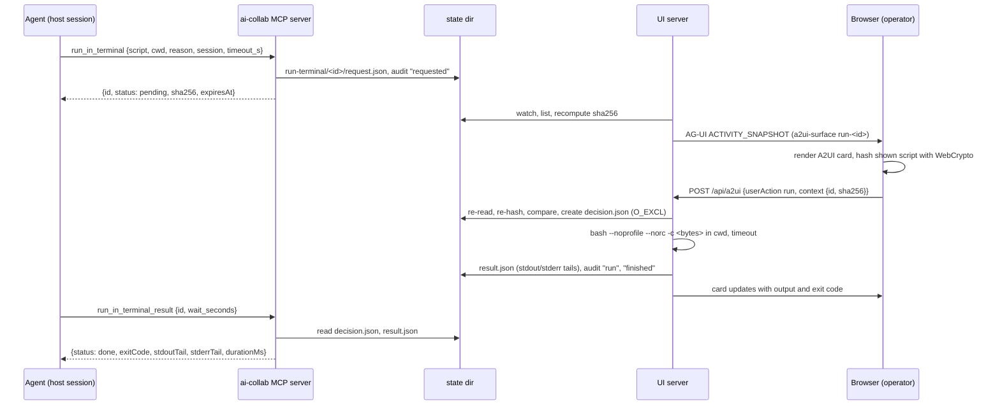

# Run in terminal

An agent proposes an exact bash script. The operator reads it in the phone UI and clicks **Run** or **Reject**. On Run, the UI server runs the script on the host, as its own user, and stores the result for the agent. Worktree-isolated agents use it for commands they cannot run themselves, such as landing a branch in the main checkout, without the operator copying commands by hand.

The feature is off by default. Turn it on in `~/.config/ai-collab/defaults.json`:

```json
{ "runInTerminal": true }
```

`AI_COLLAB_RUN_IN_TERMINAL=1` or `0` in a process's environment overrides the file for that process. The flag gates the MCP tools and the UI card together; restart the UI service (`systemctl --user restart ai-collab-ui`) and start new agent sessions after changing it. Only a UI server that saw the flag at start watches the request folder for push notices.

## Flow



### MCP tools

| Tool | Arguments | Returns |
|---|---|---|
| `run_in_terminal` | `script` (≤ 64 KB), `cwd` (absolute, existing directory), `reason` (≤ 300 chars), `session` (hook label), optional `timeout_s` (1 to 3600, default 300) | `{id, status: "pending", sha256, expiresAt}` at once |
| `run_in_terminal_result` | `id`, optional `wait_seconds` (0 to 45, default 25) | `status` (`pending`, `running`, `done`, `lost`, `rejected`, `expired`, `refused`); once done, `exitCode`, `signal`, `timedOut`, `stdoutTail`, `stderrTail` (last 16 KB each), `durationMs`, `startedAt`, `finishedAt`, `by` |

Both tools are listed only on the host with the flag on. In an OpenShell sandbox or a builder (`OPENSHELL_SANDBOX`, `AI_COLLAB_BUILDER`, `AI_COLLAB_SANDBOX_OUT`), they are neither listed nor callable, and `createRunRequest` refuses as well. They are not in the `run_code` client.

### The card

The card shows the reason, the requesting session, the cwd, the script with line numbers, and the server's sha256. Long lines wrap instead of scrolling, so no byte sits off screen. The browser hashes the text it displays with WebCrypto and shows whether that digest matches the server's. **Run** stays disabled until the browser has a digest, and the click sends the browser's digest, not the server's. WebCrypto requires a secure context: the Tailscale HTTPS origin or `127.0.0.1`.

A request expires 15 minutes after it is created (`AI_COLLAB_RUN_TTL_S` on the agent side, capped at 60 minutes by the server). After a decision, the card shows the outcome, exit code, duration, who clicked, and the stdout and stderr tails. Output streams to the card while the script runs: the server rewrites `result.json` at most every 250 ms and pushes the card again.

## Threat model

| Threat | Control |
|---|---|
| The script runs without the operator's click | Only `decideRun` runs a script, and the UI server calls it only from `POST /api/a2ui` (same-origin check, GitHub sign-in when configured, not in hosted mode). No auto-approve, no "always allow", no default decision on timeout. |
| Approval through the bus, an agent message, or `ask_question` | Nothing in `lib/run-terminal.mjs` reads the bus. A `reply <id> run`, an approval envelope with the id, or `POST /api/approve` leaves the request pending (`test/run-terminal.test.mjs`). |
| The script changes between display and run | The UI server pins each request's shown fields (script, hash, cwd, reason, session, timeout, creation and expiry times) the first time it lists it. The card keeps showing the pinned fields, and a stored request that no longer matches them is closed as `refused`. On Run, the server re-reads `request.json`, compares it with the pin, recomputes sha256 over the bytes it is about to run, and requires it to equal the browser's digest. |
| Bytes the operator cannot see | Requests with control, format, separator or default-ignorable characters other than tab, newline and space are refused: carriage returns, ANSI escapes, bidi marks, zero-width and tag characters, soft hyphens, variation selectors, line separators and look-alike spaces. So are invalid Unicode and runs of more than 64 blanks, which could push the rest of a wrapped line out of view. |
| Replay or double click | `decision.json` is created with `O_EXCL`; a second decision of any kind gets 409. |
| A stale request | Expiry is computed from the creation time, clamped to 60 minutes, and a creation time in the future invalidates the request. The first read after expiry closes it. |
| Sandboxed caller | The tools are host-only, like `builder_start`. |
| A run cut off by a UI restart | On start, the UI server marks each run still at `running` as `lost`, with an audit line; `run_in_terminal_result` returns it as final. |
| Runaway script | `timeout_s` sends SIGTERM to the script's process group, then SIGKILL 5 s later. |
| Lost accountability | Every request, run (with the script), rejection, refusal, expiry, loss, and finish is a line in `<stateDir>/run-terminal-audit.jsonl` (mode 0600) with id, project, session, script hash, decision, exit code, who clicked, and an ISO timestamp. |

### Limits

- The request files live in the state dir, which every process of the operator's user can write. Such a process can forge a request (it still needs a click), forge `result.json` (it misleads only the agent that reads it), or write `decision.json` (it blocks the request; nothing runs). A request changed after the UI showed it cannot run, but the pins live in the UI server's memory: a request changed before a UI restart is pinned as it reads after the restart.
- Run does not require GitHub sign-in. Without it, a local process running as the operator can POST to the loopback UI (`127.0.0.1:8795`) with a forged `Origin` header and press Run; so can any client that reaches the UI's Tailscale origin. Such a local process can already run commands as the user, so the feature adds no privilege to it, but the click guarantee then holds only against agents restricted to ai-collab's channels and against sandboxed sessions. Turn on [GitHub sign-in](github-sign-in.md) to require a browser session cookie.
- The script runs with the UI server's environment, including its `PATH`, minus the server's own variables (`AI_COLLAB_*`, `NEXT_*`, `__NEXT*`, `NODE_ENV`, `NODE_OPTIONS`); it gets no login shell.
- A `lost` run's process died with the UI service under systemd's default `KillMode`; processes the script detached from its group, such as `setsid` or `nohup` children, outlive it and its timeout.
- The shipped sandbox policies give no route to the UI: a builder reaches only `host.openshell.internal:8794` (`lib/builder/policy.mjs`), `run_read_code` has no egress (`lib/code-read-policy.yaml`), and `run_code` uses OpenShell's default policy unless `AI_COLLAB_CODE_POLICY` names one. A policy that opens `host.openshell.internal:8795` lets that sandbox press Run when sign-in is off. This was read from the policies, not tested against a live sandbox.

## A2UI and AG-UI

The card is an [A2UI](https://a2ui.org/specification/v0.9.1-a2ui/) v0.9.1 surface carried in [AG-UI](https://docs.ag-ui.com/concepts/events) events, on the same path as approval and question cards ([AG-UI event protocol](ag-ui.md#a2ui-surfaces)).

| Step | What the code does | Spec |
|---|---|---|
| Server to browser | One `ACTIVITY_SNAPSHOT` per card, `activityType: "a2ui-surface"`, `messageId: "run-<id>"`, `replace: true`, `content.a2ui_operations` | [ActivitySnapshot](https://docs.ag-ui.com/concepts/events#activitysnapshot) |
| Surface | `createSurface` (catalog `urn:ai-collab:a2ui:catalog:1`), `updateComponents`, `updateDataModel` with `script`, `shown`, `stdout`, `stderr` | [createSurface](https://a2ui.org/specification/v0.9.1-a2ui/#createsurface), [updateComponents](https://a2ui.org/specification/v0.9.1-a2ui/#updatecomponents), [updateDataModel](https://a2ui.org/specification/v0.9.1-a2ui/#updatedatamodel) |
| Components | Basic `Column`, `Row`, `Text`, `Button`, plus the app's `Chip` and a new `Script` component (`text`, `label`, `sha256`, `shown`) | [The component catalog](https://a2ui.org/specification/v0.9.1-a2ui/#the-component-catalog): a `catalogId` "is not required to be a resolvable network resource" |
| Run and Reject | `Button.action.event` `{name: "run", context: {id, sha256: {path: "/shown"}}}`; `Script` writes the browser's digest to `/shown` through two-way binding | [Defining actions](https://a2ui.org/specification/v0.9.1-a2ui/#defining-actions), [two-way binding](https://a2ui.org/specification/v0.9.1-a2ui/#two-way-binding--input-components) |
| Browser to server | `POST /api/a2ui` with `{project, forwardedProps: {a2uiAction: {userAction}}}`, where `userAction` holds `name`, `surfaceId`, `sourceComponentId`, `timestamp`, `context` | [RunAgentInput.forwardedProps](https://docs.ag-ui.com/sdk/js/core/types#runagentinput); A2UI [action](https://a2ui.org/specification/v0.9.1-a2ui/#action) |

### Gap to full AG-UI

- **Partial transport.** The UI keeps its own SSE stream and `POST /api/a2ui` rather than an AG-UI run whose `RunAgentInput` is the whole POST body. The POST carries only `project` and `forwardedProps`; it has no `threadId`, `runId`, or `messages`.
- **No AG-UI interrupt.** AG-UI models approvals as [interrupts](https://docs.ag-ui.com/concepts/interrupts): the run finishes with `outcome: {type: "interrupt"}` and resumes through `RunAgentInput.resume` ([resuming a run](https://docs.ag-ui.com/concepts/interrupts#resuming-a-run)). The agent here is an MCP client polling `run_in_terminal_result`, not an AG-UI run, so no run is suspended. An adapter could map a request to an interrupt with reason `tool_call` and a `responseSchema` carrying `approved` and `sha256`.
- **Snapshots, not deltas.** Output updates re-send the whole surface with `replace: true`. [ActivityDelta](https://docs.ag-ui.com/concepts/events#activitydelta) (JSON Patch) would send only the new output.
- **A2UI action envelope.** The spec names the client message `action`; the app forwards the `@a2ui/web_core` processor's `userAction` object inside `forwardedProps`, as the approval cards do.
- **Unverified.** The AG-UI [generative UI page](https://docs.ag-ui.com/concepts/generative-ui-specs) says AG-UI supports A2UI but names no `activityType` and no action return path. The A2UI spec's [transport bindings](https://a2ui.org/specification/v0.9.1-a2ui/#transport-bindings) section has an AG-UI subsection without a mapping. `a2ui-surface` and `a2ui_operations` are this app's names, not spec names. The A2UI spec also recommends v1.0 for new projects; `@a2ui/react` 0.15.0 renders v0.9 only.

## Files

| File | Role |
|---|---|
| `lib/run-terminal.mjs` | Flag, validation, request store, expiry, single claim, execution, audit log |
| `lib/surfaces/run-terminal-ops.ts` | The two MCP tools |
| `web/server/run-terminal.mjs` | UI server hooks: watch, snapshot, surfaces, Run and Reject |
| `web/lib/a2ui-run.js` | A2UI operations for the card and action parsing |
| `web/lib/a2ui-run-catalog.js` | `Script` component schema |
| `web/components/a2ui/script.tsx` | `Script` component |
| `web/app/run-requests.tsx` | The card list and its read-only fallback |
| `test/run-terminal.test.mjs` | Tests |
| `docs/run-in-terminal.md` | This page |

### Removing the feature

Delete the files above, then remove these registration lines:

| File | Lines |
|---|---|
| `lib/surfaces/ops.ts` | `import { RUN_TERMINAL_OPS } …` and `...RUN_TERMINAL_OPS,` at the end of `OPS`. Keep the `available` field on `Op` or drop it with its use in `lib/tool-api.mjs`. |
| `lib/tool-api.mjs` | `&& (!op.available \|\| op.available(env))` in `listed` (only if `available` goes) |
| `web/server/ui.mjs` | the `runTerminalUi` import; `const runTerminal = runTerminalUi(…)` (2 lines); `runTerminal.watch(item);`; `...runTerminal.snapshot(project.cfg, session),`; `...runTerminal.surfaces(current, now)` in `pushSurfaces`; the two `runTerminal.answer` lines in the `a2ui` action; `runTerminal.close();` |
| `web/components/a2ui/surface.jsx` | the `ScriptImpl` import and `ScriptImpl` in the catalog list |
| `web/app/chat-console.jsx` | the `RunRequests` import and `<RunRequests …/>` |
| `docs/` | the rows in `index.md`, `approvals.md`, `phone-ui.md`, `configuration.md` |

`grep -rn "run-terminal\|runTerminal\|RunRequests\|ScriptImpl\|RUN_TERMINAL\|run_in_terminal\|runInTerminal" lib web docs` finds them.
