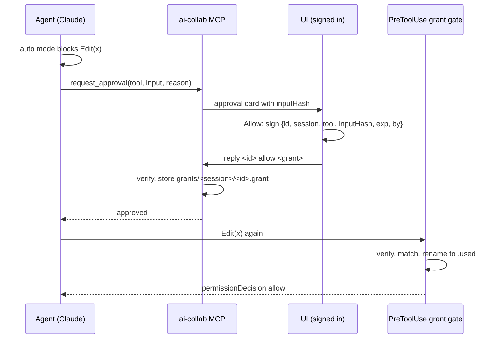

# Signed approvals

Claude Code's auto mode counts only real user messages as approval. Text that a hook adds, such as a phone answer the Stop hook delivers, is context, so auto mode keeps blocking test, golden and config edits that the operator approved from the phone ([permission modes, "What the classifier sees"](https://code.claude.com/docs/en/permission-modes)).

A PreToolUse hook that returns `"allow"` skips the auto mode check, except for actions no mode auto-approves ([hooks, PreToolUse decision control](https://code.claude.com/docs/en/hooks#pretooluse-decision-control)). A signed approval uses that path: the operator allows one exact call, and the hook allows that call once.

## Set up

1. Turn on [GitHub sign-in](github-sign-in.md). The UI signs an Allow only for a signed-in login on the `users` list. Without sign-in, Allow on a signed-approval card answers 403 and only Deny works.
2. Restart the UI. On the first signed Allow the UI creates its Ed25519 key at `$AI_COLLAB_STATE_DIR/auth/grant-ed25519.key` (mode 0600), with the public key beside it in `grant-ed25519.pub`.

## Use

When auto mode blocks a call the operator may approve, the agent calls `request_approval` with the tool name, the call's exact input and a one-line reason. The phone shows the usual Approve card. After **Allow**, the agent retries the identical call; the hook allows it once.

## The grant

| Field | Meaning |
|---|---|
| `id` | The card's 12-hex id. |
| `session` | The requesting session's label; another session's hook ignores the grant. |
| `tool` | The tool name, such as `Edit` or `Bash`. |
| `inputHash` | sha256 of the tool name and the input, with keys sorted and the top-level `description` dropped, so a reworded description still matches. |
| `exp` | 15 minutes after signing. |
| `by` | The signed-in GitHub login. |

The token is `base64url(JSON claims).base64url(Ed25519 signature)`, sent as `reply <id> allow <token>` (`lib/grants.mjs`).

- **Forgery:** the MCP server stores a grant only if the public key verifies it and its id and session match the open card. A plain `reply <id> allow` from the ntfy app or another bus writer is ignored, so the request keeps waiting.
- **Replay:** the hook renames the grant to `.used`, so of two racing hooks only one allows. A `.used` marker stays until the grant would have expired, and the MCP server refuses to store a token whose marker exists.
- **Scope:** one call, one session, 15 minutes.

## Limits

- **Same-user agents can sign.** The signing key sits on the host and every host session runs as the operator's user, so a host agent that reads `grant-ed25519.key` can sign its own grant. The operator chose this over a phone passkey on 2026-11-26. A sandboxed agent cannot read the key.
- **Summary only.** The card shows the reason and a 300-character summary of the input, not a full diff.
- **Claude only.** The grant gate is registered for Claude Code. Codex, Cursor and OpenCode use their own approval prompts.
- **Hosted mode:** the UI signs with the key under its root `$AI_COLLAB_STATE_DIR`, so hosted agents on other machines cannot verify the grant.
