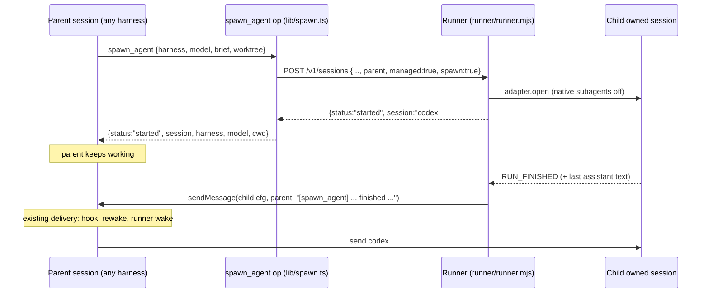

# spawn_agent and native-subagent blocking: implementation spec

Status: approved; the operator answered the open questions on 2026-11-27 (see [Operator answers](#operator-answers)). Written 2026-11-26 against `main` at `81129778`, rebased onto `b981d36e` (family and job moved to `.ts`).
Operator decisions of 2026-11-27, with decision 3 as revised:

1. A new tool, `spawn_agent(harness, model, brief, worktree?)`, on MCP (`lib/surfaces/ops.ts`) and the CLI (`lib/cli.mjs`), built on the runner. It does not extend `builder_start`.
2. Every session ai-collab starts (team members, pattern members, builders, spawned agents) runs with native subagents blocked. Sessions the operator starts keep them.
3. `spawn_agent` returns at once with the child's address. The parent keeps working. Each time the child finishes a run, its result reaches the parent as a direct message through the existing delivery and wake paths. Waiting is optional.

It also fixes board bug `bug-headless-opencode-run-qwen-jobs-star`: qwen jobs that agents start as `opencode run` never appear in the sessions list.

Line numbers below refer to `81129778`. Rebase first and re-check each anchor before editing.

## Constraints

- `lib/*.mjs` and `scripts/*.mjs` import only node builtins and relative paths. Put new core code in TypeScript (`lib/spawn.ts`, `lib/subagent-guard.ts`).
- `test/golden/dbos-step-sequences*` pins the workflow step sequence for `DBOS_APP_VERSION = "ai-collab-1"` (`lib/workflows.ts:19`). Add no `wf.step` to `sessionWorkflow`. The completion report runs inside the existing `run.wait` step.
- The operator applies every change to an existing test or golden as a patch. The list is in [Existing tests and goldens touched](#existing-tests-and-goldens-touched). New test files need no patch.
- Never write to the Postgres database `ai_collab` and never touch the `dbos` schema. Run tests with `TMPDIR=$(mktemp -d -p /home/b/.cache)` and delete that directory afterwards.

## Overview



| Session started by | `managed` | Native subagents |
|---|---|---|
| Operator: terminal, phone, UI start | no | allowed |
| `team_start` (roster member) | yes | blocked |
| `pattern_start` and pattern advances | yes | blocked |
| `builder_start` | yes | blocked |
| `spawn_agent` | yes | blocked |

## Part A: the managed flag

One flag marks a session ai-collab started. It travels two ways:

- **Env** `AI_COLLAB_MANAGED=1`, for detached starts (`lib/sessions/launch.ts` `startSession`) and for runner sessions whose adapter runs a per-session child (Claude). Hooks and agent shells read it.
- **Owned record** `managed: true`, for runner sessions. The runner reads it on open and on resume. The Cursor hook reads it, because Cursor's shared ACP process cannot carry per-session env.

### A1. New file `lib/subagent-guard.ts`

Constants first, then functions (user rule):

```ts
export const MANAGED_ENV = "AI_COLLAB_MANAGED";
// Claude Code built-in subagent tool; "Task" is its legacy alias (SDK 0.3.330 BUILTIN_TOOL_NAMES).
export const CLAUDE_SUBAGENT_TOOLS = ["Agent", "Task"] as const;
// Claude CLI settings that deny the subagent tool; `--settings` takes one value, `--disallowedTools` is variadic.
export const CLAUDE_NO_SUBAGENT_SETTINGS = JSON.stringify({ permissions: { deny: ["Agent", "Task"] } });
// Codex 0.171.0: [agents].enabled=false removes spawn_agent, wait_agent and the other collaboration tools.
export const CODEX_NO_SUBAGENTS = { "agents.enabled": false, "features.multi_agent_v2": false } as const;
// OpenCode 2.2.6 permission rule; the action name comes from GET /api/agent.
export const OPENCODE_NO_SUBAGENTS = [{ action: "subagent", resource: "*", effect: "deny" }] as const;
export const OPENCODE_NO_SUBAGENT_CONFIG = JSON.stringify({ permission: { subagent: "deny" } });
export const SUBAGENT_DENIED = "Native subagents are off in sessions ai-collab starts. Use the ai-collab spawn_agent tool "
  + "(or `ai-collab spawn`); the child reports back to you by message.";

/** Whether env marks this process as part of a session ai-collab started. */
export function managedEnv(env: NodeJS.ProcessEnv): boolean;
/** The CLI args that turn native subagents off for a detached start of this harness; [] for cursor. */
export function noSubagentArgs(harness: Harness): string[];
/** The extra env for a detached managed start: MANAGED_ENV=1, plus OPENCODE_CONFIG_CONTENT for opencode. */
export function noSubagentEnv(harness: Harness, env: NodeJS.ProcessEnv): NodeJS.ProcessEnv;
/** Whether a hook call starts a native subagent: Claude PreToolUse Agent/Task, Cursor subagentStart, OpenCode task. */
export function nativeSubagentCall(host: string, key: string, msg: Record<string, unknown>): boolean;
/** The deny output for that host, in the shape storeReadDenial uses (lib/store-read.ts). */
export function subagentDenial(host: string): Record<string, unknown>;
```

`noSubagentArgs`:

| Harness | Args |
|---|---|
| claude | `["--settings", CLAUDE_NO_SUBAGENT_SETTINGS]` |
| codex | `["-c", "agents.enabled=false", "-c", "features.multi_agent_v2=false"]` |
| opencode | `[]` (config travels in `OPENCODE_CONFIG_CONTENT`) |
| cursor | `[]` (hook only) |

`noSubagentEnv("opencode", env)` merges `OPENCODE_CONFIG_CONTENT`. If `env.OPENCODE_CONFIG_CONTENT` already holds JSON, deep-merge `permission.subagent = "deny"` into it. If it holds invalid JSON, throw.

`subagentDenial` shapes:

- claude: `{ hookSpecificOutput: { hookEventName: "PreToolUse", permissionDecision: "deny", permissionDecisionReason: SUBAGENT_DENIED } }`
- cursor: `{ permission: "deny", user_message: SUBAGENT_DENIED, agent_message: SUBAGENT_DENIED }`
- opencode: the Claude shape; `lib/opencode-plugin.mjs` `onToolBefore` throws on `permissionDecision: "deny"`.

`nativeSubagentCall`:

- claude: `key === "pretooluse"` and `msg.tool_name` is `Agent` or `Task`.
- cursor: `key === "subagentstart"`.
- opencode: `key === "pretooluse"` and `msg.tool_name` is `task`, compared case-insensitively.
- codex: always false. Its PreToolUse runs `--activity` only (`hooks/codex-hooks.json`), and Codex blocks through config instead.

### A2. Hook gate, `scripts/ai-collab-hook.mjs`

Add the gate inside the `--read-gate` path, before `if (argv.includes("--read-gate")) return emit({});` (line 207):

```js
if (argv.includes("--read-gate") && nativeSubagentCall(host, key, msg)) {
  if (managedEnv(env) || managedOwned(env, { cwd, host, session })) return emit(subagentDenial(host));
}
```

`managedOwned` calls `loadConfig(env, { cwd, host, session })` and returns `readOwned(cfg, session)?.managed === true && status !== "ended"`. It runs only for a subagent call, so ordinary read-gate calls stay config-free. Put it in `lib/subagent-guard.ts`, which imports `readOwned` from `lib/sessions/registry.ts`.

Import `lib/subagent-guard.ts` directly, as the hook already imports `lib/sessions/registry.ts` (line 35).

### A3. Hook manifests

- `hooks/cursor-hooks.json`: add `"subagentStart": [{ "command": "<same prefix as preToolUse> --read-gate --host cursor", "timeout": 10 }]`. Cursor reads `permission`, `user_message` and `additional_context` from that hook's output (bundle `~/.local/share/cursor-agent/versions/2026.11.22-e9042b2/4721.index.js`; read from source, not run).
- `hooks/hooks.json`: no change. The Claude `PreToolUse --read-gate` entry has no matcher, so it already sees `Agent` calls.
- `hooks/codex-hooks.json`: no change.
- OpenCode: no manifest. The plugin already sends every tool call through `onToolBefore` with `gate: true`.

### A4. Detached managed starts, `lib/sessions/launch.ts`

1. Add `managed?: boolean` to `startSession`'s options (line 214).
2. Where `childVars` is built (lines 226-228): if `managed`, merge `noSubagentEnv(harness, env)`.
3. Where the base argv is built (line 241): pass `managed` down. Then in `lib/harness.ts` `startArgv` (lines 138-153), add `ArgvOpts.start.managed` (line 49) and insert `noSubagentArgs(harness)`:
   - claude: after `--bg` and before the prompt.
   - codex: after `exec --json` and before the prompt.
4. `lib/catalog/roster.ts:64` `teamStart`: add `managed: true` to the `start(cfg, {...})` options.
5. Phone and UI starts (`web/server`) pass nothing, so they stay unmanaged.

If the UI routes team starts through the runner rather than `startSession`, the runner path (A5) covers them. Confirm by reading `web/server` callers of `teamStart`.

### A5. Runner sessions

`runner/runner.mjs`:

1. `start` (line 825) gains `managed`, `parent` and `spawn` (see B3). Compute `managed = Boolean(builder || patternRun || continuation || input.managed)`. `team_start` through the runner passes `managed: true`.
2. Pass `managed` into the `startWorkflow` input (line 872).
3. `sessionWorkflow` (line 380): destructure `managed`, `parent` and `spawn`. Add them to the owned record in `beforeStart` (line 403) and in the claim write (line ~427).
4. `ownedEnv` (line 170) becomes `ownedEnv(managed)`, returning `{ ...childEnv(env), ...(managed ? { [MANAGED_ENV]: "1" } : {}) }`. Pass `managed` in the `adapter.open` options (line 407) and in `adapter.resume` (line 296, from `s.record.managed`).
5. `runner/types.d.ts`: add `managed?: boolean` to `OpenOptions`. Add `managed?: boolean`, `parent?: string` and `spawn?: { depth: number }` to `OwnedRecord`.

Adapters:

| Adapter | Change | Anchor |
|---|---|---|
| `runner/adapters/claude.mjs` | When `options.managed` (and `record.managed` on resume), set `disallowedTools: [...CLAUDE_SUBAGENT_TOOLS]` in the `query()` options. SDK 0.3.330 `Options.disallowedTools?: string[]` (`node_modules/@anthropic-ai/claude-agent-sdk/sdk.d.ts:52`). | `startSession` query options, lines ~66-78 |
| `runner/adapters/codex.mjs` | `threadConfig(codeMode)` (line 44) becomes `threadConfig(codeMode, managed)`. When managed, merge `CODEX_NO_SUBAGENTS` into `config`. Apply it on `thread/start` (`openThread`, line ~436) and `thread/resume` (`attach`, line ~416). | lines 44, ~416, ~436 |
| `runner/adapters/opencode.mjs` | When managed, add `permissions: OPENCODE_NO_SUBAGENTS` to the `POST /api/session` body in `open` (line ~370). On resume, `PATCH /api/session/{id}` with the same `permissions`. Both fields are in the service's `/openapi.json` (OpenCode 2.2.6). | `open`, line ~370 |
| `runner/adapters/cursor.mjs` | None. The hook gate (A2) reads `managed` from the owned record. | |

Owned sessions' hooks stand down (`standsDown`, `lib/sessions/registry.ts:343`), and the gate runs before `standsDown`, so the Cursor deny still fires.

### A6. Per-harness blocking: sources and verification

| Harness (version) | Mechanism | Source | Verified |
|---|---|---|---|
| Claude Code 2.1.332, CLI | `--settings '{"permissions":{"deny":["Agent","Task"]}}'` | [Sub-agents: disable specific subagents](https://code.claude.com/docs/en/sub-agents) ("add them to the deny array … `Agent(...)`"); [Permissions: settings](https://code.claude.com/docs/en/permissions); `claude --help` lists `--settings <file-or-json>` and `--disallowedTools, --disallowed-tools <tools...>` | Flags read from `--help`. Not run with `--bg`; see test N4. |
| Claude Agent SDK 0.3.330 | `disallowedTools: ["Agent","Task"]` | `sdk.d.ts:52`; `BUILTIN_TOOL_NAMES` includes `Agent` | Type read; not run |
| Claude, backstop | PreToolUse deny through the `--read-gate` hook | [Hooks: PreToolUse decision control](https://code.claude.com/docs/en/hooks#pretooluse-decision-control) | Same output shape the store-read gate already uses |
| Codex 0.171.0 | `-c agents.enabled=false -c features.multi_agent_v2=false` (CLI); the same keys in `thread/start` and `thread/resume` `config` (app-server) | The binary's own message: "`[agents].enabled = false` disables subagent tools even when the model selects a subagent version, unless `[features].multi_agent_v2` is enabled" | CLI verified: `codex debug prompt-input -c agents.enabled=false "hi"` drops `spawn_agent`, `wait_agent`, `list_agents`, `send_message`, `followup_task` and `interrupt_agent`. The per-thread app-server `config` is unverified. |
| OpenCode 2.2.6, runner | `permissions: [{action:"subagent",resource:"*",effect:"deny"}]` on `POST /api/session` | Service `/openapi.json` (`Permission.Ruleset`); the built-in `general` and `explore` agents carry the same rule (`GET /api/agent`) | Schema read; not run |
| OpenCode 2.2.6, detached `opencode run` | `OPENCODE_CONFIG_CONTENT='{"permission":{"subagent":"deny"}}'` | `opencode run --help` has no permission flag | Verified with `opencode api --standalone GET /api/agent`: every agent (build, plan, general, explore, …) gains the deny rule. Whether `opencode run` applies client config when it attaches to the shared service is unverified; see test N5. |
| OpenCode, backstop | Plugin `onToolBefore` deny on tool `task` | `lib/opencode-plugin.mjs` | Works only where the server-side hook sees `AI_COLLAB_MANAGED` or an owned record; a service-hosted hook never sees client env (`docs/install.md:94`). |
| Cursor agent 2026.11.22 | `subagentStart` hook returning `{"permission":"deny"}` | `agent --help` has no flag; the hook runner is in the bundle named in A3 | Read from source, not run. No CLI or config switch exists. |

## Part B: spawn_agent

### B1. New file `lib/spawn.ts`

```ts
export const SPAWN_MAX_CHILDREN = 4;   // live spawned children per parent
export const SPAWN_MAX_DEPTH = 2;      // a spawned agent may spawn once more
export const REPORT_PREFIX = "[spawn_agent]";
export const REPORT_TEXT_MAX = 3500;   // stays under BODY's 4000 (lib/surfaces/schema.ts)

export type SpawnInput = { harness: string; model?: string; brief: string; worktree?: boolean };
export type SpawnResult = { status: "started"; session: string; harness: string; model: string; cwd: string; note: string };

/** Starts a managed child session through the runner and returns its address at once. */
export async function spawnAgent(cfg: Cfg, input: SpawnInput, { env = process.env, request = runnerRequest }: { env?: NodeJS.ProcessEnv; request?: typeof runnerRequest } = {}): Promise<SpawnResult>;
/** The direct message a child sends its parent when a run ends. */
export function spawnReport(child: string, outcome: string, text: string): string;
```

`spawnAgent`:

1. Require `cfg.session` and `cfg.peer`, or throw "spawn_agent needs this session's address; pass session". The parent is `` `${cfg.peer}#${cfg.session}` ``.
2. Validate `harness` with `parseHarnessModel` (`lib/harness.ts`). `harness` may be `opencode:qwen…` with `model` omitted; an explicit `model` wins.
3. Run `checkPrompt(brief)` (`lib/sessions/launch.ts:166`, 4000 chars max).
4. Call `request("POST", "/v1/sessions", { project: cfg.project, harness, prompt: brief, place: worktree ? "worktree" : "folder", managed: true, parent, spawn: true, system: false, ...(model ? { model } : {}) }, { socket: runnerSocket(env) })`. `lib/builder/supervisor.ts:105` has the same call.
5. If the runner is down (connection refused), throw "spawn_agent needs the ai-collab runner (systemctl --user start ai-collab-runner)". There is no fallback to detached starts: it would bring the bug back.
6. Return `{ status: "started", session, harness, model: model ?? "", cwd, note }` with `note = "It reports to you by message when each run ends; reply with send. wait until=message blocks for the report."`.

`system: false` makes the brief show as the parent's input in the UI, not as a system prompt. The runner prepends no prompt text; the child learns its parent from the hook context (`lib/family.ts` `parentLine`) or, for owned sessions, from B5.

### B2. Control route, `runner/control.mjs`

`route` (lines 41-95) already forwards `POST /v1/sessions` to `runner.start(input)`. Pass the three new fields through. If `route` whitelists fields, add `managed`, `parent` and `spawn` there.

### B3. Runner start, `runner/runner.mjs` `start` (line 825)

Add to the destructure: `managed`, `parent`, `spawn`.

When `spawn === true`:

1. `parent` must match `parentAddress({ AI_COLLAB_PARENT: parent })` (`lib/config.mjs:224`), else `fail(400, "Invalid parent address")`.
2. Depth: if the parent is an owned session (`sessions.get(parent)`), `depth = (parent.record.spawn?.depth ?? 0) + 1`. Otherwise `depth = 1`. If `depth > SPAWN_MAX_DEPTH`, `fail(409, "spawn depth limit reached")`.
3. Children: count `sessions` values with `record.parent === parent && record.spawn && record.status !== "ended"`. At `SPAWN_MAX_CHILDREN` or more, `fail(429, "this session already has 4 live spawned agents")`.
4. The start gap at line 864 skips spawns: change the guard to `!patternRun && !builder && !spawn`. The child cap bounds the rate.
5. Force `managed = true`.
6. Add `parent` and `spawn: { depth }` to the `startWorkflow` input (line 872).
7. Permission mode: a spawn that names none defaults to `auto` where the adapter supports it (Claude through the member `claudePermission: "auto"` path, Codex), else the harness default (answer 6). An operator start defaults to `supervised` (docs/owned-sessions-contract.md, Permission modes).

### B4. Workflow, `runner/runner.mjs` `sessionWorkflow`

1. Write `parent` and `spawn` into the owned record (line 403 and the claim write).
2. At line 453 pass `parent` to `recordSession`: `recordSession(cfg, { id, cwd, harness, event: "owned", proc, ...(parent ? { parent } : {}) })`. `list_sessions` then shows "parent" and the UI shows "started by …".
3. Last reply text. In `onEvent`, the `TEXT_MESSAGE_CHUNK` case (lines 199-203) records `s.patternReply` only for pattern runs. Rename it to `s.lastReply` and record it when `r.patternRun || r.spawn`. Update the reset at line 195 and the read at line 214. Behavior for pattern runs stays the same.
4. Report inside `run.wait` (lines 496-497). Replace the step function with:

```js
const finished = sent.runId && await wf.step("run.wait", async () => {
  const done = builder && !s.live ? await interrupted() : await waitRun(s, sent.runId);
  if (s.record.spawn && s.record.parent) await reportToParent(s, done);
  return done;
}, { onCut: async () => {
  const done = await interrupted();
  if (s.record.spawn && s.record.parent) await reportToParent(s, { outcome: "interrupted" });
  return done;
} });
```

`reportToParent(s, finished)` is a new function inside `createRunner`, placed after `endSession`:

```js
async function reportToParent(s, finished) {
  const text = finished?.outcome === "success" ? s.lastReply?.text ?? "" : finished?.message ?? "";
  await sendMessage(s.cfg, s.record.parent, spawnReport(s.record.address, finished?.outcome ?? "unknown", text)).catch((error) => log(`spawn report failed: ${error.message}`));
}
```

`sendMessage` is in `lib/messaging.ts:416`; add it to the runner's import from that file (line 16). `s.cfg` is `sessionCfg(project, harness, label)`, so the message comes from the child's address.

This adds no step, so the `dbos-step-sequences` golden stays unchanged. A finished step is checkpointed and never rerun, so replay sends no second report. A crash after `sendMessage` and before the checkpoint runs `onCut` on restart and sends a second "interrupted" report. Accept that.

### B5. Completion message

`spawnReport(child, outcome, text)`:

```
[spawn_agent] codex#3f2a9c0d1e4b5a69 finished (success):
<last assistant text, tail-kept, at most 3500 chars; prefixed with "…" when cut>
```

- `outcome` is one of `success`, `cancelled`, `error`, `interrupted` (the run outcome from `onEvent`, or `interrupted` from `onCut`).
- An empty text reads `(no reply text)`.
- Count `REPORT_TEXT_MAX` in UTF-16 code units, the same unit `checkPrompt` counts.

The envelope is the standard direct message from `sendMessage` (`lib/messaging.ts:416`): `{ from: "<child harness>", session: "<child label>", to: "<parent peer>", toSession: "<parent label>", ts, body }`, plus the id and fields `sendMessage` always adds. Priority is `normal`: not `fyi`, which never wakes an idle session, and not `urgent`, which steers a running turn. `expectReply` stays off.

The UI's message list and the parent's `inbox` show it as any agent message. Readers wrap agent messages with the `UNTRUSTED` note; the report is untrusted text from the child.

Each finished run sends one report, including runs a parent's follow-up `send` triggers. A child that gets three follow-ups sends four reports (answer 1).

### B6. How the parent wakes

No new wake code. The report is a direct message, so it travels the paths in `docs/messaging.md` "Waking idle sessions":

| Parent | Parent busy | Parent idle | Parent closed |
|---|---|---|---|
| Runner-owned (any harness) | The runner queues it as the next input (delivery workflow) | The runner delivery workflow starts a run with it | The runner wakes the session in place |
| Claude hook session | Next hook delivers it | Messaging socket, else the `asyncRewake` waiter exits 2 and wakes the session | The runner adopts and wakes it (seen in the last 7 days) |
| Codex hook session | Stop hook delivers it | Runner delivery (`codex queue … --resume`) | The runner adopts and wakes it |
| OpenCode hook session | Next hook | Runner delivery (`POST /api/session/<id>/prompt`, `queue`) | The runner adopts and wakes it |
| Cursor hook session | Next hook | No push path: it waits for the next hook | The runner adopts and wakes it |

### B7. Optional explicit wait

Add no new op. The parent already has two:

- `wait` (`lib/surfaces/ops.ts:220`, default `until=message`) returns the report when it arrives.
- `wait until=idle:<child>` returns `idle`, `ended` or `timeout` (`lib/agents.mjs:89` `waitForIdle`).

The `spawn_agent` description and its `note` name both. There is no `wait_for_agent` (answer 2).

### B8. MCP op, `lib/surfaces/ops.ts`

Insert after `team_start` (line ~275):

```ts
{
  name: "spawn_agent",
  description: "Start a child agent session (any harness) with a brief and return its address at once. "
    + "Keep working: each time the child finishes a run it messages you its result. Message it with send; "
    + "wait (until=message) blocks for the report. Native subagents are off in the child.",
  inputSchema: {
    type: "object", required: ["session", "harness", "brief"], additionalProperties: false,
    properties: {
      session: IDENTITY,
      harness: { type: "string", pattern: "^(claude|codex|cursor|opencode)(:[A-Za-z0-9._/:-]{1,120})?$", description: "claude, codex, cursor or opencode, optionally harness:model." },
      model: { type: "string", pattern: "^[A-Za-z0-9._/:-]{1,120}$", description: "Model id; overrides a harness:model suffix." },
      brief: { ...BODY, description: "The child's first prompt: the task, the files, the done condition." },
      worktree: { type: "boolean", default: false, description: "Start the child in a new git worktree instead of the project folder." },
    },
  },
  surfaces: ["mcp"],
  needsSession: true,
  handler: (args, { cfg, env }) => spawnAgent(cfg, passJs({ harness: args.harness, model: args.model, brief: args.brief, worktree: args.worktree === true }), passJs({ env })),
},
```

Take the model pattern from the runner's `MODEL` regex (`runner/runner.mjs`, constants 43-73) instead of the one above if they differ. `surfaces` is `["mcp"]` only: `run_code` programs cannot spawn (answer 3). Leave `listing` and `available` unset so every host sees the op; `lib/tool-api.mjs` `listed(env)` filters only `builder_start`.

### B9. CLI, `lib/cli.mjs`

Syntax:

```
ai-collab spawn <harness[:model]> [--model <id>] [--worktree] (--brief <text> | --brief-file <path|->)
```

1. USAGE (lines 34-~110): one line after the `team` lines: `  spawn <harness[:model]> --brief <text>|--brief-file <path|-> [--model <id>] [--worktree]   start a child agent that reports back`.
2. Dispatch (lines ~385-400): `case "spawn"` parses flags with `node:util` `parseArgs` (the pattern in `lib/builder/cli.ts` `parseStart`), reads stdin for `--brief-file -`, loads cfg the way `send` does, calls `spawnAgent`, and prints `started <address> (<harness>, <cwd>)`.
3. Exit 2 on a usage error; exit 1 when the runner refuses (print its `error`).
4. `spawn` stays out of the run_code-first mapping (lines ~237-256): it is not a read and not on the code surface.

### B10. Steer agents to spawn_agent, `lib/family.ts`

`childHint` (line 38) tells agents to start children from the shell. That is the bug path. Replace its text:

```
[ai-collab] To hand work to another agent, call the ai-collab spawn_agent tool (harness, model, brief); it returns the child's address at once and the child messages you its result when each run ends. Do not start harnesses from your shell. Message a child with send_to_peer; list sessions with list_sessions.
```

Keep `parentLine` and `greetParent`. A runner-owned child gets no hook context, so B4 adds the parent's address to the brief's end only when the brief does not already name it: `\n\n[ai-collab] You were started by <parent>; your result reaches it automatically when your run ends.` Append it in `start` (B3) before `checkPrompt`, and count it against the 4000-char limit.

### B11. Board bug `bug-headless-opencode-run-qwen-jobs-star`

The registry and board task were unreadable in this session (read-gate), so the root cause is not confirmed. Candidates:

| # | Hypothesis | Check |
|---|---|---|
| H1 | `listSessions` drops peers missing from `cfg.peers` (`lib/sessions/registry.ts:199`), and the project's peer list lacks `opencode` | Read `AI_COLLAB_PEERS` or the project's `peers` setting |
| H2 | The OpenCode plugin hook runs in the service process (`docs/install.md:94`), with the service's cwd and env, so it records under another project or none | Start `opencode run --format json -m <qwen> "say hi"` in the repo, then check `list_sessions` and the registry dir for an `opencode#…` entry |
| H3 | The job runs `--standalone` or archived, so no plugin loads | Inspect the command the agent ran (task store or the agent's transcript) |

Fix:

1. `spawn_agent` registers every child itself: the runner writes `registry/<harness>#<label>.json` with `event: "owned"` and `parent` (B4 step 2), whatever the plugin does. Nothing in this path relies on the OpenCode hook.
2. `childHint` stops recommending shell starts (B10).
3. Shell starts from a managed session are refused: in `lib/agent-guard.ts`, add `export function managedShellStartRefusal(argv, env)`. It returns `SUBAGENT_DENIED` when `agentHarness(argv)` is non-empty and `env.AI_COLLAB_MANAGED === "1"`, else `""`. Call it wherever `assertHostAgent` runs (`lib/job.ts`) and in the Claude and Cursor shell gates beside the existing harness-flag check. Operator sessions are untouched.
4. If H1 holds, also make `listSessions` keep a peer that is a harness name (`claude`, `codex`, `cursor`, `opencode`) even when `cfg.peers` omits it. This change touches `test/sessions*.test.mjs`; list it in the patch.

Run the H1-H3 checks first and record the result on the board task.

## Part C: new tests

Each new test file runs without network or real harnesses, with the fake ntfy (`test/helpers/fake-ntfy.mjs`) and the fake adapter (`runner/adapters/fake.mjs`).

`test/subagent-guard.test.mjs`:

- G1. `noSubagentArgs`: claude → `["--settings", '{"permissions":{"deny":["Agent","Task"]}}']`; codex → the four `-c` args; opencode and cursor → `[]`.
- G2. `noSubagentEnv("opencode", {})` sets `OPENCODE_CONFIG_CONTENT` to `{"permission":{"subagent":"deny"}}`. With an existing `{"model":"x"}` it keeps `model`. With `"{bad"` it throws.
- G3. `nativeSubagentCall`: claude `pretooluse` + `Agent` → true; + `Task` → true; + `Bash` → false; cursor `subagentstart` → true; opencode `pretooluse` + `task` → true; codex anything → false.
- G4. `subagentDenial("claude")` and `("cursor")` match the shapes in A1.

`test/subagent-hook.test.mjs` (run `scripts/ai-collab-hook.mjs` as a child process, as `test/hooks.test.mjs` does):

- H1. `--read-gate --host claude`, PreToolUse `Agent`, env `AI_COLLAB_MANAGED=1` → deny output.
- H2. The same without the env → `{}`.
- H3. `--read-gate --host cursor`, `subagentStart`, with an owned record `{managed:true, status:"idle"}` for the session label → `{permission:"deny",…}`. With `managed` absent → `{}`. With `status:"ended"` → `{}`.

`test/spawn.test.mjs`:

- S1. `spawnAgent` with a stub `request` sends `POST /v1/sessions` with `{project, harness:"opencode", model:"qwen3", prompt, place:"folder", managed:true, parent:"claude#<label>", spawn:true, system:false}` and returns `status:"started"` and the address.
- S2. `worktree: true` → `place:"worktree"`.
- S3. No `cfg.session` → throws. A 4001-char brief → throws. `harness:"vim"` → throws.
- S4. Connection refused → throws the runner-down message.
- S5. `spawnReport` formats outcome and text, keeps the tail at 3500 chars with a leading `…`, and writes `(no reply text)` for an empty text.

`test/runner-spawn.test.mjs` (setup copied from `test/runner.test.mjs` lines 33-62):

- R1. `runner.start({..., spawn:true, parent:"claude#aaaaaaaaaaaaaaaa"})` returns at once. The owned record has `managed:true`, `parent` and `spawn:{depth:1}`. The registry entry has `parent`.
- R2. After the fake run finishes, the fake ntfy holds one direct message from the child's address to the parent, with body `[spawn_agent] <child> finished (success):\necho: <brief>…`.
- R3. A second input (`runner.send(child, {text:"again"})`) produces a second report.
- R4. A fifth live child of the same parent → 429. A child whose parent is a depth-2 spawned session → 409.
- R5. Two spawns 0 ms apart both start (gap exempt) while `startGapMs` is 10000. A plain start right after a plain start still gets 429.
- R6. `parent:"bogus"` → 400.
- R7. The fake adapter's `open` call receives `managed:true`. A non-spawn, non-team start receives no `managed`.
- R8. Interrupt the run ("hang" brief) → report with `(cancelled)`.
- R9. Kill and recover the workflow mid-run (the pattern in `test/runner-durable.test.mjs`) → one `(interrupted)` report and no duplicate `success` report.

Adapter tests, in new files beside the existing ones:

- `test/runner-adapter-claude-managed.test.mjs`: `managed:true` → the captured `query()` options hold `disallowedTools: ["Agent","Task"]`; unmanaged → no `disallowedTools`.
- `test/runner-adapter-codex-managed.test.mjs`: `thread/start` and `thread/resume` params hold `config["agents.enabled"] === false` and `config["features.multi_agent_v2"] === false` when managed, and lack them otherwise.
- `test/runner-adapter-opencode-managed.test.mjs`: the `POST /api/session` body holds `permissions` when managed; resume sends `PATCH /api/session/<id>` with the same rule.

Manual checks the implementer runs once and records in the MR:

- N1. `codex debug prompt-input -c agents.enabled=false -c features.multi_agent_v2=false "hi"` → no `spawn_agent` tool.
- N2. Codex app-server: `thread/start` with `config: {"agents.enabled": false}`, then inspect the thread's tool list. If the tools remain, managed threads run on the second app-server (answer 5).
- N3. OpenCode: `POST /api/session` with `permissions`, then `GET /api/session/<id>` shows the rule.
- N4. Claude: `claude --bg --settings '<json>' "use the Agent tool to list files"` refuses the Agent tool.
- N5. `OPENCODE_CONFIG_CONTENT='{"permission":{"subagent":"deny"}}' opencode run --format json "use a subagent"` refuses the subagent, both with the service up and with it down.
- N6. Cursor: a managed owned Cursor session asked to start a subagent gets the deny.
- N7. From a Claude session: `spawn_agent opencode:<qwen> "say hi"` → the child shows in `list_sessions` with `parent`, and the report arrives while the parent is idle.

## Existing tests and goldens touched

The operator applies these as a patch. Regenerate goldens with `UPDATE_SURFACE_GOLDEN=1` and review the diff.

| File | Why |
|---|---|
| `test/golden/surfaces/mcp-ai-collab.json` | New `spawn_agent` tool |
| `test/golden/surfaces/mcp-ai-collab-run-code-first.json` | Same |
| `test/golden/surfaces/cli.json` | USAGE line for `spawn` (`help`, `--help`, `bogus-command` cases) |
| `test/mcp.test.mjs:39` | Tool-name list gains `spawn_agent` after `team_start` |
| `test/surfaces-ops.test.mjs` | If it counts ops or lists names |
| `test/tool-api.test.mjs` | If it lists names or the code-surface op set |
| `test/mcp-run-code-first.test.mjs` | If it lists names |
| `test/render-mcp-characterisation.test.mjs` | If it snapshots tool descriptions |
| `test/harness-argv.test.mjs` | Only if an existing case passes `managed`; new cases go in a new file |
| `test/start.test.mjs`, `test/new-session-start.test.mjs` | If they assert the exact child env or argv of a team start |
| `test/family.test.mjs`, `test/hooks.test.mjs` | Only if a case asserts the SessionStart context text; no test names `childHint` today |
| `test/hooks.test.mjs` | If it asserts the exact `--read-gate` output for Agent calls |
| `test/manifests.test.mjs`, `test/install.test.mjs`, `test/setup.test.mjs` | `hooks/cursor-hooks.json` gains `subagentStart` |
| `test/runner.test.mjs` | If a case asserts the start gap for a start that now passes `spawn` (no test references `patternReply`) |
| `test/runner-adapter-codex.test.mjs`, `test/runner-adapter-codex-limit.test.mjs` | If they assert the exact `thread/start` params |
| `test/runner-adapter-opencode.test.mjs` | If it asserts the exact `POST /api/session` body |
| `test/runner-adapter-claude.test.mjs` | If it asserts the exact `query()` options |
| `test/builder*.test.mjs` | If builder argv or options gain `managed` |
| `test/sessions*.test.mjs` | Only if B11 step 4 lands |
| `test/dbos-step-sequences.test.mjs` and its golden | Unchanged: B4 adds no step. If it fails, the implementation added a step; fix the code, not the golden. |

Before writing the patch, run `grep -ln "patternReply\|childHint\|thread/start\|api/session\|team_start\|subagentStart" test/` to confirm the list.

## Docs to update in the same change

- `docs/messaging.md` "Agents starting agents" (line 176): lead with `spawn_agent` and the report message; keep the shell path as the operator's option.
- `docs/owned-sessions-contract.md` "Session identity and the registry" (line 349): the `managed`, `parent` and `spawn` record fields.
- `docs/teams.md` "Enforcement" (line 66): native subagents are off for team and pattern members.
- `README.md` and `CLAUDE.md`: one line each for `spawn_agent`.

## Operator answers

The operator answered the open questions on 2026-11-27:

1. **Reports:** one report after every finished run of the child, not only the first.
2. **Explicit wait:** `wait` (and `wait until=idle:<child>`) is enough. Add no `wait_for_agent`.
3. **run_code:** `run_code` programs may not spawn. `spawn_agent` is a direct MCP tool only (`surfaces: ["mcp"]`).
4. **Limits:** 4 live children per parent, depth 2, and spawns are exempt from the 10 s start gap.
5. **Codex fallback:** if the per-thread `config` cannot turn Codex's own subagents off, managed sessions run on a second `codex app-server` started with `-c agents.enabled=false -c features.multi_agent_v2=false`.
6. **Permission mode:** spawned Claude and Codex children default to `auto`, as team members do. Spawned Cursor children run with full access inside OpenShell only (operator, 2026-11-26: "these are full access within the container"). `runner/runner.mjs` `start` gives a spawned Cursor child `place: "openshell"`, whatever place the spawn names; OpenShell's default mode, `full-access` (`acp --force`), follows from that. Its worktree is synced back to the host worktree when the session closes, and `cwd` in the spawn result is that host worktree. The host guards are unchanged: `full-access` outside OpenShell still needs `AI_COLLAB_ALLOW_HOST_AGENT=1`, and Cursor's never runs on the host. There is no host fallback. Without OpenShell on the runner host, the spawn is refused with 409 naming it. A spawn that would create a sandbox past the cap (`maxSandboxes`, default 6) is refused with 409 naming the running sandboxes. A spawn into the project's existing sandbox adds none. Both refusals come before the child slot is taken, so they never count against the parent's 4 children. Native subagents are blocked inside OpenShell too. Cursor has no switch for them, so `prepareSandbox` in `runner/adapters/cursor.mjs` gives a managed child `AI_COLLAB_MANAGED=1` in its exec env and uploads `/sandbox/home/.cursor/hooks.json`. Its `subagentStart` command is a shell line: with that env it prints `{"permission":"deny",…}`, without it `{}`. The sandbox is shared per project, so an unmanaged session there is let through. Unmanaged sandbox sessions get neither the env nor the file. Read from the Cursor bundle and tested against the fake openshell, not run in a live sandbox: Cursor reads `~/.cursor/hooks.json` and runs hook commands through a shell. OpenCode has no OpenShell place yet, so spawned OpenCode children still run `supervised` on the host, and their approvals reach the operator.
7. **Shell starts:** a harness started from the shell inside a managed session is refused (B11 step 3).
8. **Blocking:** the parent does not block. `spawn_agent` returns the child's address at once.

## Implementation notes

Where the built code differs from the text above (branch `feat/spawn-agent`):

- **Managed env scope.** `AI_COLLAB_MANAGED=1` goes only to processes that serve one managed session or only managed sessions: a managed Claude child, the managed Codex app-server and detached `ai-collab team start` children. The OpenCode service and Cursor ACP get no new env; their gates read the owned record (`managedOwned` in `lib/subagent-guard.ts`).
- **Codex.** Managed sessions always run on the second app-server (answer 5), because the shared app-server takes its env from the first session that starts it and must not carry the managed marker. The per-thread `config` keys are not sent. N2 confirmed the app-server applies the `-c` flags.
- **Shell-start gates.** No Claude or Cursor "harness-flag check" existed, so `managedShellStartRefusal` runs in the hook read-gate (Claude and OpenCode `Bash`, Cursor `beforeShellExecution`) and in `lib/job.ts`. Codex `PreToolUse` runs `--activity` only, so the hook runs the same gate on every Codex call. The command check is a heuristic: it splits on `;`, `&`, `|` and newlines outside quotes, strips env assignments and wrappers (`env`, `nohup`, `exec`, `command`, `time`, `setsid`, `nice`), and allows subcommands that start no session (`claude mcp`, `codex login`, `opencode models`). It misses `bash -c "…"`, `env -u` and `npx`.
- **Start tickets (backstop).** Every managed start (`noSubagentEnv`: `startSession` for team start, the session-control wake, and each runner open and resume) mints a single-use ticket under `<state dir>/managed-tickets/` and passes `AI_COLLAB_MANAGED_TICKET`. At `SessionStart`, a hook that sees `AI_COLLAB_MANAGED=1` binds the ticket to the harness process (pid and start tick) on first use and allows later starts only from that process; a ticket bound to another process is refused. A start with `AI_COLLAB_MANAGED=1` and no ticket file is refused too, even when the session has a live owned record, so a grandchild that unsets the ticket cannot resume its parent's session. A grandchild that keeps the env is refused because its process is not the one the ticket is bound to. A Codex `SessionStart` that runs before the runner writes the owned record passes, because it needs only the ticket. Codex sessions share one managed app-server: its first session's ticket binds to that process, and every later thread on it starts from the same process. The hook takes as the harness process the nearest ancestor whose argv[0] or `/proc/<pid>/exe` basename is the harness binary (`claude`, `claude.exe`, `codex`, `opencode`), or whose argv[1] is inside the Claude or Codex npm package (`@anthropic-ai/claude-code`, `@openai/codex`) or, for a node process, is a script named like the harness binary (a bin symlink such as `…/bin/claude`). So a grandchild started as `node …/cli.js` or under `exec -a` is a process of its own, and is refused. A renamed copy of a native binary is not recognised: the walk passes it and reaches the parent the ticket names, so it starts. Process identity needs `/proc`. On macOS and Windows the hook cannot find the harness, so the ticket stays unbound and any process with the env passes; only a managed start with no ticket is refused there. The runner saves the record's live status before it resumes a harness, so the record on disk never says `ended` during a wake. Any other start returns `{continue: false, stopReason}`, so a harness a managed session started through a wrapper the command check misses stops at once. Claude honours `continue: false` at `SessionStart`. Codex accepts the same output: the `session-start.command.output` schema embedded in codex-cli 0.171.0 lists `continue`, `stopReason`, `suppressOutput`, `systemMessage` and `hookSpecificOutput` with `additionalProperties: false`, so the hook adds no other field. Whether Codex then stops the session, and whether Cursor and OpenCode honour it, is unverified. The backstop is cooperative, not a security boundary. A ticket is a file name in the state dir plus an env var, so an agent that can write files can forge one, and `env -u AI_COLLAB_MANAGED` before the harness command skips the check altogether. It catches a managed agent that starts a harness through a wrapper by accident, not one that sets out to. Each mint prunes tickets bound to a harness process that has exited, and unused tickets older than 7 days.
- **Child cap race.** The runner counts spawns that are still opening against the cap, so parallel `spawn_agent` calls cannot exceed 4.
- **Wake path.** A detached managed session resumed by a wake gets no no-subagent argv; the hook backstop covers Claude.
- **Brief note.** The parent line is added in `runner/runner.mjs` `start` (`lib/spawn.ts` `spawnBriefNote`) and counts against the 4000-char limit. So does the self note (`spawnSelfNote`), whose length is fixed because every label is 16 hex digits; the first prompt is checked with it before the workflow starts.
- **`childHint`** takes no host argument; the hook passes `cfg` only.
