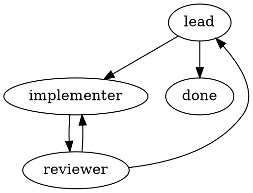

# Teams and patterns

A pattern is a graph of roles and handoffs in DOT, stored as `team.dot`. A team is a legacy pattern: one role per member, no handoffs, no runs.

## Model

The shipped template is `lib/team-templates/fix-and-review/team.dot`:



Graph attributes:

| Attribute | Values | Default |
|---|---|---|
| `description` | text | none |
| `max_visits` | 1-50 | unlimited |

Node attributes (a node is a role; its name is `[a-z][a-z0-9-]{0,23}`):

| Attribute | Values | Default |
|---|---|---|
| `agent` | `claude`, `codex`, `cursor` or `opencode`, optionally `:model` checked against the model lists | required |
| `count` | whole number 1-8: N instances of the role | 1 |
| `skill` | a skill name, `[a-z0-9][a-z0-9-]{0,63}` | none |
| `prompt` | the role's responsibility, 1-1000 characters | required for a role in a run |
| `fallback` | `harness` or `harness:model`, the model to propose when the role hits a usage limit | none |
| `code_mode` | `on` or `off`: native code mode for this role's session ([Code mode](code-mode.md)) | `defaults.json` `codeMode`, else on |

Edge attributes (a handoff; `done` is the only node that is not declared):

| Attribute | Values | Default |
|---|---|---|
| `on` | the event name, 1-60 characters | required |
| `kind` | `pair`, `broadcast` or `fan-in` | `pair` |
| `required` | `true` or `false` | `false` |
| `cap` | whole number 1-10, role-to-role handoffs only | none |

Checks: unknown attributes, kinds, harnesses and models, and edges to undeclared nodes fail with the line number. A node with no `prompt` fails with the node's line ("role `<id>` needs a prompt"). A pair edge needs both roles to have the same `count`. The digraph name is the team name and must match its folder. The first node is the entry role; every role must be reachable from it, and at least one edge must reach `done`.

### What loads from wteam files

Loads: `digraph` with `graph [...]`, node and edge statements, `//` and `/* */` comments, node ids of letters, digits, `_` and `-` (quoted when they contain `-`). Attributes as in the tables above.

Warnings, not errors (the parser reports each with its line; the editor lists them above the text, and the file keeps them as written): `shape`, `label`, `handoff_tokens`, `continue`.

Does not load (the file shows `invalid` with the line):
- `count="$pairs"` or any `$variable`; `count` takes a whole number 1-8.
- `node`, `edge` and `subgraph` defaults.
- Gate nodes: a node with no `agent`.
- An unquoted id containing `-` (`quote ids containing -`).
- Role-to-agent mapping. A role's `agent` is written in the file.

## Enforcement

- `required: true`: the run finishes only after this handoff has fired. `finished` before that is refused and names the missing handoff.
- `required: false` (guidance): the active role may skip it.
- `cap`: a handoff that would exceed `cap` suspends the run and notifies the operator. Each advance that fires the handoff counts once.
- `max_visits`: a handoff that would exceed `max_visits` for a role instance suspends the run and notifies the operator. The entry role counts as its first visit.
- In a suspended run, the operator can confirm the pending handoff in the run view. The confirmation applies to that handoff only and is recorded with the operator’s login.
- `fallback`: the `harness:model` the runner starts when that role hits a usage limit, ahead of the project default. The role does not ask the operator to switch.
- A role whose session cannot start fails the run with the reason and notifies the operator.
- Only a live instance's session can advance a run. The operator's UI can override and records the operator's login on the handoff.
- A run uses the pattern snapshot taken at start; later edits to the file do not change it.
- Handoff notes reach the next role labeled as untrusted data.
- A finished or failed run sends each role's session a closing message ("Stop work on this run"). The operator gets a project broadcast on failure.
- New DOT runs share the runner’s start rate limit. Roles within a run can start as soon as their handoff is ready. Legacy JSON patterns use the project’s 10-second start gate.

## Runs and kinds

A role with `count` N runs N live instances; each has its own session and its brief says "Instance i of N".

- `pair`: instance i of the source hands to instance i of the target. Both roles need the same count.
- `broadcast`: the handoff activates every instance of the target.
- `fan-in`: the handoff waits until every live instance of the source has advanced on this event, then activates the target.

`pattern start <name> "<task>"` creates a run with the entry role live and starts its sessions with the task and its allowed events. `pattern advance <run> "<event>" ["note"]` takes the handoff named by the event from the calling live instance. The next role receives an ai-collab message; a role with no session yet starts one.

DOT patterns start through the local runner. It checkpoints the compiled graph and queues advances in its durable log. A run waiting for an event resumes after a restart. If a restart interrupts a start or handoff, the run fails when repeating the operation could duplicate an agent launch or a message.

Each new DOT run shares one OpenShell sandbox and worktree across all its roles. Every role needs an OpenShell-capable adapter (currently Cursor). A role requests a handoff by ending its reply with `PATTERN_ADVANCE {"event":"<event>","note":"<optional note>"}`. The runner verifies that the session belongs to a live role. Operators can advance or confirm handoffs from the UI.

The runner stores run state in `<stateDir>/runner/pattern-runs/<project>/<run>.json` and still reads earlier project run records. `pattern status <run>` lists the role sessions, notes and handoff log.

## Storage

- Project team: `<project root>/.ai-collab/teams/<name>/team.dot`.
- Global team: `<config dir>/ai-collab/teams/<name>/team.dot`.
- A project file overrides a global file of the same name. A team file overrides a JSON pattern of the same name.
- Converted once: each `patterns.json` entry in the config directory became a global `team.dot`. The names it converted are recorded in `teams/.migrated.json`, so an edited file is never overwritten. `patterns.json` stays as a backup and is still read for names without a team file.
- Built-in: `lib/team-templates/fix-and-review/team.dot`. A saved file with the same name overrides it.
- Project patterns saved through the JSON API (`createPattern`) stay in the project's `patterns` map in `projects.json`. A team file of the same name shadows the JSON entry, which stays in place.
- Writes take a lock on `projects.json` or the team file and replace the file through a temp file and a rename. A write that finds the lock held fails with "busy; retry".
- Teams stay in the `teams` maps and appear in pattern listings with `source: team`.

## Surfaces

- CLI: `ai-collab pattern list|show|create|delete|start|runs|status|advance`. `pattern start` is for the operator's shell.
- MCP: `pattern_list` and `pattern_status` read; `pattern_advance` acts for the calling session; `pattern_start` returns an error to agents (operator-only).
- Chat: `@<pattern> <task>` starts a run; the text after the tag is the task.
- Web, Patterns page (the project's **Teams** view in the rail or the phone's bottom bar):
  - The list has a "New team" button. It opens the editor on the shipped template, renamed to the team name you type.
  - A pattern's page shows its roles, graph, handoffs and runs. "Raw" shows its DOT text. "Edit" opens the editor (project patterns only; built-in and global patterns are read-only, use "Copy to project").
  - The editor shows the DOT text and a graph that re-draws about 300 ms after each edit. A parse or check error shows its line and that source line; the graph keeps the last valid one. Save is enabled only when the text checks. Save writes `team.dot` in the project.
  - Layout: graph above the text on phones, side by side from 1024 px.
  - The check and save go through the `pattern` POST action (`checkDot`, `teamDot`, `team`), with the same same-origin, JSON and sign-in checks as other actions.

## Describe a team in words

A writing agent turns a plain-language request into one `team.dot`; the operator confirms before anything is written.

- "Describe a team" on the Patterns list opens the composer (`#level=patterns&author=1`). "Refine with agent" on a project or global team's page opens it on that team (`&pattern=<name>`), so the agent sees the team as it is now and changes only what you ask.
- The brief carries the `team.dot` rules, the name and scope, the current team, and the operator's messages. It is one start prompt, so it has the same 4000-character cap; the oldest history is dropped first, then the current team is cut, then the request.
- The writing agent answers with one fenced ```dot block. The reply is checked by `checkTeamText`, the same parse and validate a save uses; the draft shows its graph, roles and DOT, and nothing is written.
- The name is what you typed, else the team being refined, else the digraph the agent wrote. A name typed after the draft renames the digraph on save, as the editor does. A name already in use needs the confirm, which replaces it (`authorReplace`).
- Nothing is saved until "Save team". A project save goes through `saveTeamText`; a global save writes `<config dir>/ai-collab/teams/<name>/team.dot`. A built-in name, a legacy team name, and a save into the other scope are refused, so one file never silently shadows another.
- "Open in DOT editor" carries the name to the editor, where the text stays editable by hand.
- The composer picks the writing harness and model. The prefill is `AI_COLLAB_TEAM_AUTHOR_MODEL` (default `cursor:deepseek-v41-flash-1017-high`). It runs once with the brief as one argv element. When the project cannot run that harness and the operator has not picked one, another installed one writes instead (cursor, claude, codex, opencode), with no model. A failed answer includes the harness's stderr (a usage limit is printed there), and nothing is written.
- Requests go through the `pattern` POST action (`authorRequest` for a draft, `authorDot` to save), with the same same-origin, JSON and sign-in checks as other actions.

## Limits

- A team file cannot be renamed in the editor; save a copy under a new name instead. Deleting a team file is manual: remove its folder.
- The composer renames the digraph to the name you type, so it can save a draft under a name the agent did not use.
- Deleting or copying a JSON project pattern does not take the lock.
- Team names may not collide with a legacy team name.

## Legacy team roster in the UI

Open a legacy team in the project's **Teams** view to see its member roster. For a project team, **Edit roster** lets you save one harness or harness:model per line. Global rosters are read-only in the UI. Teams also work through `ai-collab team create|list|delete|start|status`, the MCP `team_*` tools, and `@team` chats. Create new coordination as a pattern.

## Strategist/Architect

Start the project pattern with `ai-collab pattern start architect "#<task-id> <objective>"` from the host shell. The entry role registers the session identity tag `role:architect`, which you can find with `ai-collab agents --tag role:architect`.

From the host session, check the [task board](tasks.md#decisions) and include the answer in the run brief. If the decision is pending, keep the run at the Architect role and relay the answer to that session when the operator responds. Builder task snapshots cannot observe host board updates.

The required `brief ready` handoff sends the PM the task ID, objective, scope, constraints, tradeoffs, risks, and acceptance criteria. The PM returns the agreed scope and delivery next steps to the host operator for recording on the task board.
