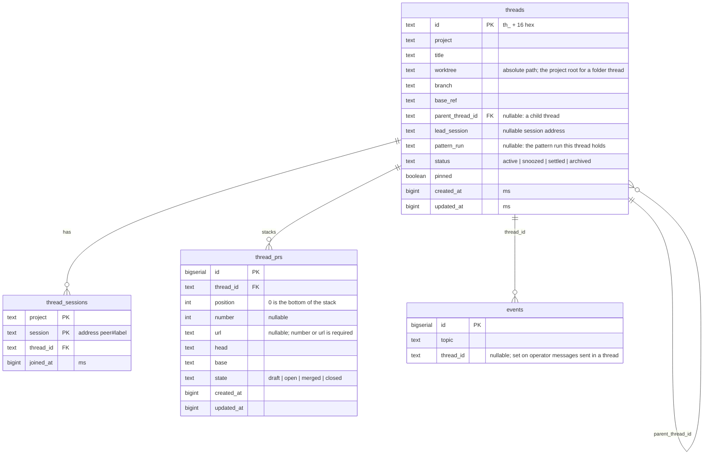

# Threads

A thread is the operator's main UI object: one conversation, one worktree and branch, and every session working in that worktree. A thread belongs to no single agent. The operator's sessions, spawned children, a later lead and pattern-run members share it.

## Data model

Threads live in the bus's Postgres schema (`bus` on the live machine), next to `events` and `files`. `openPostgresBusStore` (`lib/bus-postgres.ts`) creates them on open, under the same advisory lock as the other tables, with `IF NOT EXISTS` DDL. The SQLite and memory bus stores have no threads: their `/threads` routes answer 404, and the UI shows no thread list.

Session records stay where they are: JSON files in `<stateDir>/<project>/registry/` and the runner's owned records. `thread_sessions` joins a session address to its thread; a session has at most one thread per project.

`events.thread_id` has no foreign key. The bus prunes events after its retention window, and a message must not block deleting a thread. The message envelope carries the same id as `threadId`, so stream readers see it without the column.

## Status

The stored status holds only what the operator sets: `active`, `snoozed`, `settled`, `archived`, plus the separate `pinned` flag. The sidebar derives the shown status from the live session cards (`web/lib/threads.js` `threadStatus`):

| Session states in the thread | Shown status |
|---|---|
| any `waiting` or `afk` | `waiting` (waiting on the operator) |
| else any `working` | `working` |
| else | the stored status |

A snoozed or archived thread whose session asks a question shows `waiting` again, so a blocked agent never hides.

## Assignment

The thread store's `sync` (`lib/threads.mjs`) gives every unassigned session a thread. It runs in one transaction under an advisory lock and assigns only sessions without a `thread_sessions` row, so a second run assigns nothing; it also gives a thread without a worktree the folder of its first session. Parents go before children.

| Session | Thread |
|---|---|
| has a `parent` with a thread, and runs in that thread's worktree | the parent's thread (spawn_agent children, native child sessions) |
| has a `parent` with a thread, in another worktree | a child thread for its worktree, `parent_thread_id` set |
| belongs to a pattern run (owned record `patternRun`) | the run's thread, found by `pattern_run` |
| runs in a worktree under the project (`.claude/worktrees/<name>`) | the oldest thread with that worktree path, else a new one |
| runs in the project root | a new thread of its own |

Sessions in the project root do not share one thread: the main checkout holds unrelated work, and one thread for all of it would list every folder session together.

Callers:

- The bus runs `sync` for every registered project on open (`scripts/ai-collab-bus.mjs`): the backfill.
- The UI server posts unassigned sessions to `POST /threads/sync` when a project's registry changes, so hook-recorded sessions get a thread within one change.
- A UI start creates a thread titled from the first prompt and attaches the new session, or attaches it to the `thread` the request names. A start in a thread runs in the thread's worktree as a folder start.
- An operator message sent with `thread` carries `threadId` in its envelope and `thread_id` on its event row.

## Bus routes

All JSON, behind the bus token.

| Route | Effect |
|---|---|
| `GET /threads?project=P[&archived=1]` | threads of P with sessions and PRs, pinned first, newest update first |
| `GET /threads/<id>` | one thread |
| `POST /threads` | create `{project, title, worktree, branch, baseRef, parentThreadId, leadSession}` |
| `PATCH /threads/<id>` | `{title?, status?, pinned?, leadSession?}` |
| `POST /threads/<id>/prs` | attach `{number?, url?, head, base, state, position?}`; without position it goes on top |
| `DELETE /threads/<id>/prs/<prId>` | detach; positions above it close the gap |
| `POST /threads/<id>/sessions` | move `{session}` into the thread |
| `POST /threads/sync` | `{project, root, sessions}`: assign unassigned sessions |

The UI server's `POST /api/thread` takes `{project, op, ...}` with `op` one of `list`, `get`, `create`, `rename`, `status`, `pin`, `attach-pr`, `detach-pr`, `move-session`, and forwards to the bus. The UI snapshot carries `threads` for the current project.

## Migration

On the next bus restart:

1. `CREATE TABLE IF NOT EXISTS` for `threads`, `thread_sessions`, `thread_prs`, and `ALTER TABLE events ADD COLUMN IF NOT EXISTS thread_id`. Existing rows keep `thread_id` NULL.
2. The backfill reads every registered project's registry and owned records and inserts threads and memberships. It deletes nothing and edits no session file.

To reverse it, stop the bus and run `DROP TABLE bus.thread_prs, bus.thread_sessions, bus.threads; ALTER TABLE bus.events DROP COLUMN thread_id;`. Events and files are untouched by both directions.
