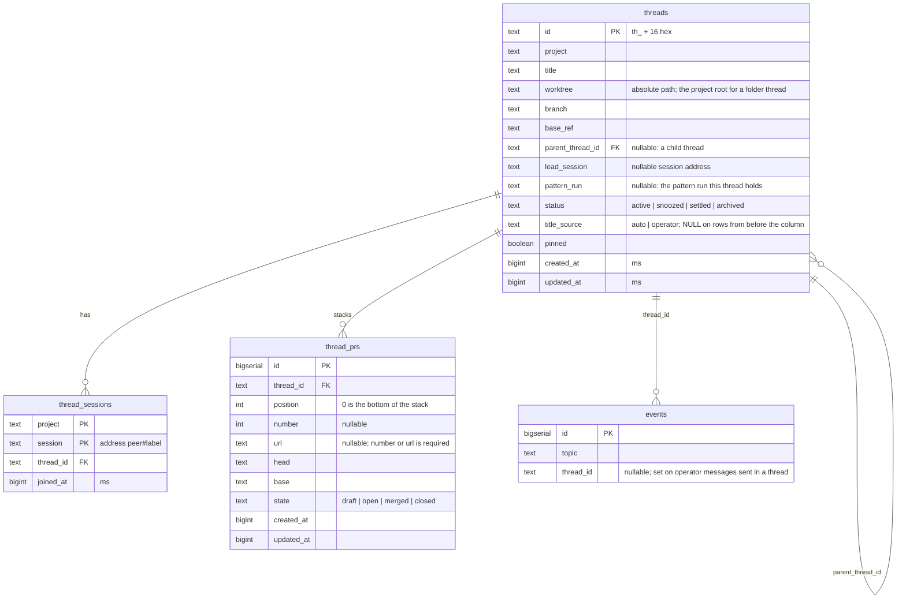
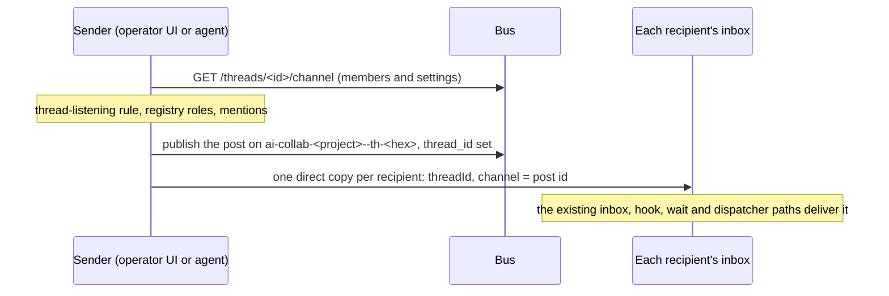

# Threads

A thread is the operator's main UI object: one conversation, one worktree and branch, and every session working in that worktree. A thread belongs to no single agent. The operator's sessions, spawned children, a later lead and pattern-run members share it.

## Data model

Threads live in the bus's Postgres schema (`bus` on the live machine), next to `events` and `files`. `openPostgresBusStore` (`lib/bus-postgres.ts`) creates them on open, under the same advisory lock as the other tables, with `IF NOT EXISTS` DDL. The SQLite and memory bus stores have no threads: their `/threads` routes answer 404, and the UI shows no thread list.



Session records stay where they are: JSON files in `<stateDir>/<project>/registry/` and the runner's owned records. `thread_sessions` joins a session address to its thread; a session has at most one thread per project.

`events.thread_id` has no foreign key. The bus prunes events after its retention window, and a message must not block deleting a thread. The message envelope carries the same id as `threadId`, so stream readers see it without the column.

## Status

The stored status holds only what the operator sets: `active`, `snoozed`, `settled`, `archived`, plus the separate `pinned` flag. The sidebar derives the shown status from the live session cards (`web/lib/threads.js` `threadStatus`):

| Session states in the thread | Shown status |
|---|---|
| any `waiting` or `afk` | `waiting` (waiting on the operator) |
| else any `working` | `working` |
| else | the stored status |

A snoozed or archived thread whose session asks a question shows `waiting` again, so a blocked agent never hides.

## Assignment

The thread store's `sync` (`lib/threads.ts`) gives every unassigned session a thread. It runs in one transaction under an advisory lock and assigns only sessions without a `thread_sessions` row, so a second run assigns nothing; it also gives a thread without a worktree the folder of its first session. Parents go before children.

| Session | Thread |
|---|---|
| has a `parent` with a thread, and runs in that thread's worktree | the parent's thread (spawn_agent children, native child sessions) |
| has a `parent` with a thread, in another worktree | a child thread for its worktree, `parent_thread_id` set |
| belongs to a pattern run (owned record `patternRun`) | the run's thread, found by `pattern_run` |
| runs in a worktree under the project (`.claude/worktrees/<name>`) | the oldest thread with that worktree path, else a new one |
| runs in the project root | a new thread of its own |

Sessions in the project root do not share one thread: the main checkout holds unrelated work, and one thread for all of it would list every folder session together.

Callers:

- The bus runs `sync` for every registered project on open (`scripts/ai-collab-bus.mjs`): the backfill.
- The UI server posts unassigned sessions to `POST /threads/sync` when a project's registry changes, so hook-recorded sessions get a thread within one change.
- A UI start creates a thread titled from the first prompt's first line (60 characters; `Untitled` without a prompt) and attaches the new session, or attaches it to the `thread` the request names. A start in a thread runs in the thread's worktree as a folder start.
- An operator message sent with `thread` carries `threadId` in its envelope and `thread_id` on its event row.

## One branch per thread

A thread lands as one branch. `spawn_agent` with `worktree: true` cuts the child's worktree from the branch checked out where the parent runs now (its owned record's cwd, else its registry entry, which hooks keep current) and records it as `spawn.mergeInto` on the child's owned record (`lib/spawn.ts`, `lib/thread-branch.ts`). The parent on `main`, a detached HEAD or outside git gives the child a branch from the default base, as before.

After each successful run with new commits, the runner rebases the child's branch onto `mergeInto` in the child's own worktree and fast-forwards `mergeInto`: by `git merge --ff-only` in the worktree that has it checked out, else by `git branch -f`. A rebase an earlier merge left behind (a restart cut it) is aborted first. The first line of the parent's report says what happened:

| Case | Report line |
|---|---|
| merged | `merged <n> commits from <child branch> into <branch>` |
| conflict | `not merged into <branch>: <child branch> conflicts with it in <files>; both branches are unchanged` |
| uncommitted edits in the child | `not merged into <branch>: <child branch> has uncommitted changes; commit them` |
| the parent's checkout refuses the fast-forward | `not merged into <branch>: its checkout at <path> refused the fast-forward …` |
| nothing new | no line |

`main` and `master` are never a merge target; the operator lands the thread's branch.

## Naming

The agent names its thread. `sync` titles a thread from its lead session (`leadSession`, else its first session; `sessionTitle` and `nextTitle` in `lib/threads.ts`):

| Source | Title |
|---|---|
| the lead's `set_identity` activity line | its first line, whitespace collapsed; updated when it changes |
| else the lead's first prompt (UI-server memory) | its first line, clipped to 60 characters, set as soon as the prompt arrives |
| else | the session's name unless it is an address or `agent-<hex>`, else the worktree folder, else `Untitled`; never the session address |

`title_source` records who set the title. `auto` follows the lead; `operator` (a rename, or a create with a title) freezes it. Rows from before the column hold NULL: `sync` retitles one only when its title contains `#` or equals its worktree folder name, then marks it `auto`. A retitle leaves `updated_at` alone, so naming never reorders the sidebar. `sync` returns `retitled` when it renamed any thread, and the bus backfill logs that count.

Every new thread gets a title at once: a UI start from its prompt, a synced or spawned session from `sessionTitle` or the fallback, a pattern run's thread from its session's title (`run <id>` until it has one). A prompt title replaces only a fallback, `run <id>`, or a title cut from that same prompt, so a later prompt never replaces the first.

The UI server's sync posts a known lead again when `nextTitle` says its thread's title would change. A prompt in the activity stream triggers that sync, as a registry change does.

## Sidebar

Each thread row and the thread header show where the thread runs (`threadPlace`): `main` for the project root, else the worktree folder name, then the branch.

The row's `…` menu holds Rename…, Pin or Unpin, Mark active (snoozed or settled threads), Settle, Snooze, and Archive or Unarchive. Archived threads stay in the collapsed Archived group; the UI snapshot lists them with the rest.

The sidebar's Menu holds Archive inactive…: it archives every thread not already archived whose `updated_at` is older than 24 h and whose sessions are all offline, ended or gone (`inactiveThreads` in `web/lib/thread-groups.ts`). A confirm shows the count first.

## Thread channels

A thread is also a channel, like a Discord channel: a post to `thread:<id>` reaches every session listening in the thread. The operator's composer posts there whenever a thread is open; an agent posts with `send` to `thread:<id>`. `lib/thread-channels.ts` resolves the recipients and `lib/thread-listening.ts` holds the rule.

### Who receives a post

A **subagent** is a session with a `parent` in its registry entry or owned record (spawn_agent children, native child sessions). A **cooperative** session has no parent. A **member** has the thread's `thread_sessions` row. The **setting** is the session's `thread_listeners` row for the thread: on, off, or none (the role default).

| Role | Member | Setting | @mentioned | Delivered |
|---|---|---|---|---|
| cooperative | yes | none | no | yes |
| cooperative | yes | none | yes | yes |
| cooperative | yes | off | no | no |
| cooperative | yes | off | yes | yes |
| cooperative | no | none | no | no |
| cooperative | no | none | yes | yes |
| subagent | yes | none | no | no |
| subagent | yes | none | yes | yes |
| subagent | no | none | no | no |
| subagent | no | none | yes | yes |
| any | any | on | any | yes |
| the sender | | | | never |

- A mention is `@peer#label`, or `@peer` for a member or a session with a setting row. A non-member is reached by its full address only.
- A recipient must be a session in the project registry. A thread lists ended sessions too; an address the registry no longer has gets nothing.
- Muted means not delivered: no inbox entry, so nothing wakes the session. It can still read the thread with `thread_messages`.

### Delivery



The post itself lives once on the thread topic with `events.thread_id` set; nothing reads that topic for delivery. Each copy is an ordinary direct message to `peer#label`, so delivery, wakes and receipts need no new path. A copy carries `threadId` and `channel` in its envelope and leaves `events.thread_id` NULL, so the thread's history holds each post once. An operator copy is an `operatorThread` message, so the agent can answer with `reply_to_operator`. An agent reading a copy sees `thread: <id>` on the message.

In the UI the composer of an open thread reads "Everyone listening in <thread title>". A post there goes to the channel, not to the selected session; `@name` still sends one direct copy to that agent, and a bare `@peer` reaches that peer's running sessions as a project-chat mention does. A post that tags a task (`#task`) keeps going to the task's owner. The UI wakes the selected session when it is a recipient, as a direct send does; other recipients get their copy through the dispatcher and their hooks.

### Thread view

A thread row in the sidebar opens the thread chat (`#project=<p>&level=thread&thread=<id>`). The header names the thread with its place beneath; the up/down switcher opens one of its sessions, and a session's header title leads back to the thread chat. The feed shows the thread topic's posts, oldest first, from `/api/events?thread=<id>`; the UI server keeps that topic subscribed while the view is open, so new posts arrive live. Its composer posts to the channel.

**Add agent** (the person-plus button in the thread chat's and a thread session's header) opens the new-session composer with that thread picked. The composer reads `Start in <project> → <thread>`; its picker lists **New thread** (the default) and the project's threads that aren't archived. A start in a thread sends `thread` and no place or code mode, and the server runs the agent in the thread's worktree and adds it to the thread.

The sidebar's **Project chat** row, under New thread, opens the project chat.

A post from an open session's chat reaches that session once even when it muted the thread, as long as the session is a member: the operator is looking at it.

### Listening toggle

- MCP `thread_listen {thread, on}` and CLI `ai-collab thread listen <id> on|off` set the caller's own setting.
- The sidebar's session rows under a thread carry a bell button (bell: listening, bell-off: muted) that sets that session's setting.
- MCP `thread_messages {thread, since?, limit?}` and CLI `ai-collab thread messages <id> [--since ISO|ID] [--limit N]` read the thread's posts, oldest first: with `since`, the first `limit` posts after that message id or from that time; without it, the newest `limit`. `limit` defaults to 30, maximum 100. `more` is true when posts remain past the page. It returns channel posts and the operator's direct messages sent in the thread (the rows with `events.thread_id`).

### Storage

One additive table, created by `migrateThreadChannels` (`lib/thread-channel-store.ts`) under the same schema advisory lock:

```sql
CREATE TABLE IF NOT EXISTS thread_listeners (
  thread_id TEXT NOT NULL REFERENCES threads(id) ON DELETE CASCADE,
  session TEXT NOT NULL,        -- address peer#label
  listening BOOLEAN NOT NULL,
  updated_at BIGINT NOT NULL,   -- ms
  PRIMARY KEY (thread_id, session)
)
```

No row means the role default. A table instead of a column on `thread_sessions`: that table's key `(project, session)` gives a session one thread, so a non-member who opts in to another thread has no row there. A non-member who turns listening on gets a `thread_listeners` row with `listening = true` and stays a non-member. A member who moves to another thread keeps its old row, which then counts as a non-member setting for the old thread. Deleting a thread deletes its rows. To reverse: `DROP TABLE bus.thread_listeners`.

| Route | Effect |
|---|---|
| `GET /threads/<id>/channel` | `{thread: {id, project, title, leadSession}, sessions: [{session, member, listening}]}`; `listening` is true, false or null |
| `PUT /threads/<id>/listening` | `{session, on}`: `on` true or false stores the setting; null deletes it |
| `GET /threads/<id>/messages?since=&limit=` | `{events, more}`: raw events with `thread_id` set |
| `GET /threads/listeners?project=P` | `{listeners: [{thread, session, listening}]}` for every thread of P |

The UI server's `POST /api/thread` takes `op: "listen"` with `{thread, session, on}`. The snapshot's threads carry `listeners`, the stored settings, and the sidebar applies the rule.

## Bus routes

All JSON, behind the bus token.

| Route | Effect |
|---|---|
| `GET /threads?project=P[&archived=1]` | threads of P with sessions and PRs, pinned first, newest update first |
| `GET /threads/<id>` | one thread |
| `POST /threads` | create `{project, title, worktree, branch, baseRef, parentThreadId, leadSession}` |
| `PATCH /threads/<id>` | `{title?, status?, pinned?, leadSession?}` |
| `POST /threads/<id>/prs` | attach `{number?, url?, head, base, state, position?}`; without position it goes on top |
| `DELETE /threads/<id>/prs/<prId>` | detach; positions above it close the gap |
| `POST /threads/<id>/sessions` | move `{session}` into the thread |
| `POST /threads/sync` | `{project, root, sessions}`: assign unassigned sessions and retitle auto-named threads; returns `{assigned, created, retitled?}` |

The UI server's `POST /api/thread` takes `{project, op, ...}` with `op` one of `list`, `get`, `create`, `rename`, `status`, `pin`, `archive`, `attach-pr`, `detach-pr`, `move-session`, and forwards to the bus. `archive` takes `{threads: [id, …]}` (1–500) and sets each to `archived`. The UI snapshot carries `threads` for the current project, archived ones included, each with its `place`.

## Migration

On the next bus restart:

1. `CREATE TABLE IF NOT EXISTS` for `threads`, `thread_sessions`, `thread_prs`, and `ALTER TABLE events ADD COLUMN IF NOT EXISTS thread_id`. Existing rows keep `thread_id` NULL.
2. The backfill reads every registered project's registry and owned records and inserts threads and memberships. It deletes nothing and edits no session file.

To reverse it, stop the bus and run `DROP TABLE bus.thread_prs, bus.thread_sessions, bus.threads; ALTER TABLE bus.events DROP COLUMN thread_id;`. Events and files are untouched by both directions.

`title_source` arrives with `ALTER TABLE threads ADD COLUMN IF NOT EXISTS title_source` under the same lock; existing rows keep NULL. To reverse it: `ALTER TABLE bus.threads DROP COLUMN title_source;`.
